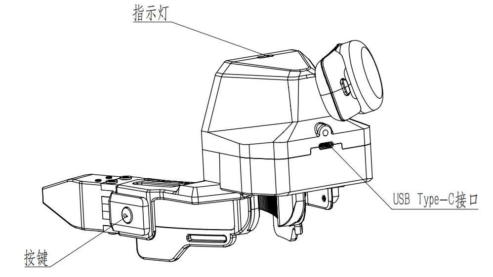

# Gripper buttons, LEDs and voice {#buttons-leds}

The gripper's two side buttons start, stop and delete recordings, and the LED and voice prompts report the state; all of it is handled by the backpack, so no browser needs to be online. Wiring and telling left from right are in [Gripper connection and serial numbers](../common/gripper.md).

{ width="480" }

## Buttons {#buttons}

While recording, a double-click or a long-press of the right gripper is silently ignored (against accidental presses); with nothing to delete, a double-click is refused (rapid yellow flashing).

| Gesture | Action |
|---|---|
| **Long-press the right gripper** | Start recording |
| **Long-press the left gripper** | Stop recording |
| **Double-click the left gripper** | Enter delete confirmation (purple blink; exits by itself after 5s without input) |
| **Double-click** again while confirming | Delete the previous episode (solid purple for 3s; those 3s are also the cool-down, during which double-clicks are ignored) |
| **Long-press the left gripper** while confirming | Cancel the delete |
| **Long-press the right gripper** while confirming | Abandon the delete and start a new recording right away (the previous episode is kept) |
| **Right gripper single press** while recording | Place a subtask marker (a sub-step boundary) in this recording, with a tone |

Which gripper does what (right starts / left stops), the timings and the LED patterns are fixed and cannot be changed; the values in effect are shown on the System → [Capture settings](system.md#capture-settings) page.

## LEDs {#leds}

| LED | Color and pattern | Meaning |
|---|---|---|
|  | Green · Steady | Standby: ready to record |
|  | Green · Breathing | Recording (one bright-dark cycle per second) |
|  | White · Flash | Saved (on for 0.4s) |
|  | Yellow · Steady | Recording failed to start (on for 2s), or a fatal problem while recording (stays on) |
|  | Yellow · Pulse | Suspect data: still recording, but that episode is questionable (on 0.2s, off 0.8s, 3 times) |
|  | Yellow · Rapid flashing | Action refused, e.g. a double-click with nothing to delete (0.1s on/off, 3 times) |
|  | Purple · Blinking | Delete confirmation, waiting for your second double-click; 0.3s on/off, cancels on timeout |
|  | Purple · Steady | The 3-second cool-down just after deleting; double-clicks are ignored |
|  | Red · Steady | System problem (e.g. a gripper dropped out, lit by the backpack) |
|  | Red · Burst flashing | Gripper-side problem (lit by the gripper itself, not via the backpack) |

Red only ever means a fault. Rapid flashing and pulse are both yellow: rapid flashing is dense, the pulse sparse; the System → [Capture settings](system.md#capture-settings) page has a legend that plays each pattern at its real rhythm.

## Voice prompts {#voice-cues}

The device announces key moments, complementing the LEDs. By default it **announces through the Pico headset**; when the headset is not connected, unsupported or playback fails (for example the "Pico connection failed" announcement), the backpack's speaker plays it instead. It can also be set to send everything to the backpack.

| When | What it says |
|---|---|
| Recording starts | "Recording started." |
| An episode finishes | "Recording complete. Please reset the scene." Reset the scene and get ready for the next one |
| A fatal problem while recording | "Recording failed." That episode is unusable |
| A gripper drops off while recording | "Left gripper disconnected" or "Right gripper disconnected"; "Gripper connection failed." when the side is unknown |
| Recording refused: left and right trackers are opposite to their gripper bindings | "Grippers swapped left and right" |
| Recording refused: hands outside the starting range | "Gripper start position outside the valid range" |
| The headset drops off while recording | "Pico connection failed." |
| A tracker drops off while recording | "Tracker connection failed." The headset may still be connected, so check the tracker on your hand first |
| Right gripper single press to mark a subtask | Subtask marker tone (no speech) |

- **Settings**: on/off, language (Chinese / English, following the interface language by default), volume, audio output and per-phrase preview are in System → [Capture settings](system.md#voice).
- If the headset app has no audio for one of the four prompts added in 0.4.7 (left / right gripper disconnected, grippers swapped, start position out of range), it plays from the backpack's speaker instead.
- The phrases and when they play are fixed and cannot be changed on site.
