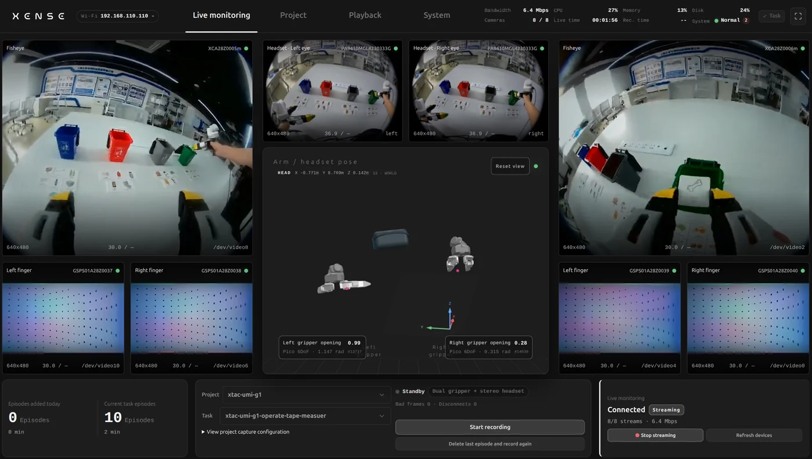

# Backpack Kit: the XTac UMI Backpack

The **XTac UMI Backpack** is the Backpack Kit's collection host: the grippers and headset plug straight in, the collection software, XTac UMI Collector, runs on the backpack, and a tablet, phone or computer just opens the console in a browser; no computer and no site network needed.

- **One-person operation**: the gripper buttons start and stop recording, and the LEDs and voice prompts report the state.
- **Raw recordings**: each demonstration is saved as one MCAP file, organized by project and task.
- **Delivery**: export per task as a LeRobot dataset or MCAP; download, or upload to ModelScope, S3, FTP, NFS and more.

[Quickstart](quickstart.md){ .md-button .md-button--primary }
[Compare the two editions](../product/editions.md){ .md-button }

## Where to start {#first-deploy}

Read [Safety and compliance](../product/safety.md) before operating. For a first deployment, work through the table below in order; after that, follow the [Quickstart](quickstart.md) every working day.

| Step | What to do | Details |
|---|---|---|
| 1. Headset setup | Update Pico OS, turn on developer mode, set screen-off and sleep to "Never", pair the two trackers (odd left, even right), install XTac UMI XR | [Pico4 headset and tracker setup](../common/pico4.md) |
| 2. Wiring and power | Grippers → headset → power the backpack on; adapter or power-bank power | [Unboxing, cabling and power](unbox-connect.md) |
| 3. Open the console | Plug the tablet into the backpack's `HOST1` / `HOST2` port and the console opens automatically; without a tablet, use the backpack hotspot | [Network and console access](network.md) |
| 4. Connect the headset to the backpack | In XTac UMI XR choose "XTac" as the connection and tap "Connect" | [Connecting the headset to the backpack](unbox-connect.md#pico-link) |
| 5. Gripper calibration | Calibrate each leader gripper's closed zero and maximum travel once | [Gripper configuration](system.md#gripper) |
| 6. Create a project and task | Choose the capture mode when you create the project; it cannot be changed afterwards | [Picking a project and task](monitor-record.md#project-task) |
| 7. Upload configuration (optional) | Save the remote account and bind it when you create a project | [Upload configurations](system.md#upload) |

## The console {#console}

Open the backpack's address in a browser to reach the console; the top bar has four pages:

| Page | What it does | Details |
|---|---|---|
| Live monitoring | Every view, pose and opening on one screen; pick a project and task, start / stop recording | [Live monitoring and recording](monitor-record.md) |
| Project | Manage recordings: playback, delete, export, upload, archive | [Projects, playback and export](projects-export.md) |
| Playback | Review recordings whose source files are still on the backpack | [Playback](projects-export.md#playback) |
| System | Device information, gripper calibration and firmware, capture settings, uploads, network, updates, interface language | [System settings](system.md) |

Recording is mainly driven by the gripper buttons: long-press right to start, long-press left to stop, with no browser needed; see [Gripper buttons, LEDs and voice](gripper.md).

## System composition {#system}

Every device plugs into the backpack, which stores the raw recordings; datasets are generated per task at export. Hover over (or tap) any block to see where its data comes from and where it goes; the buttons above switch between the three [capture modes](system.md#capture-mode).

## What each frame records {#frame}

In an exported LeRobot dataset, each row is the **observation** from frame t-1 plus the **action** from frame t. Hover over (or tap) any data item to see where it comes from and where it is stored.

- The action leads the observation by one step; the first frame of each episode has nothing to pair with, so each episode is one frame shorter.
- The poses `*_tcp.*` and `head.*` are 9-D each: position x, y, z plus a 6-D rotation; for the convention and the origin see [Export formats](projects-export.md#lerobot).
- Dimensions: Dual gripper, state and action 20-D each, 6 image streams; Dual gripper + stereo headset, 29-D each, 8 streams; Dual gripper + headset right eye, 29-D each, 7 streams (`head_right` only).

## Known limitations {#faq}

- Do not restart XTac UMI XR during collection: a restart resets the world origin, see [Startup and frame alignment](../common/pico4.md#pico-frame).
- In Collector 0.4.7, playback and live preview cannot run at the same time. See [Playback](projects-export.md#playback).
- The backpack only joins 5GHz Wi-Fi; with 2.4GHz only on site, use a cable or the backpack hotspot.
- Some phones and Windows cannot open the `.local` device name; use the IP address instead.
- While a recording is in progress, switching project / task, gripper calibration, firmware upgrades and system updates are all refused; stop recording first.

For problems see [Troubleshooting](troubleshooting.md); component versions are in [Versions and upgrades](versions.md).
