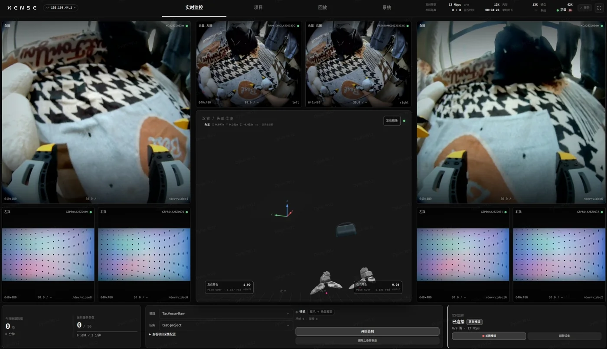

# 背包版：XTac UMI 数采背包

**XTac UMI 数采背包**是背包版的采集主机：夹爪与头显直接接上，采集软件 XTac UMI Collector 运行在背包里，平板、手机或电脑用浏览器打开控制台即可，不需要电脑，也不依赖现场网络。

- **单人作业**：夹爪按键开始、停止录制，指示灯与语音反馈状态。
- **原始记录**：每条人类示范存为一个 MCAP 文件，按项目与任务管理。
- **交付**：按任务导出 LeRobot 数据集或 MCAP，下载或上传到 ModelScope、S3、FTP、NFS 等。

[一页速通](quickstart.md){ .md-button .md-button--primary }
[对比两种配置](../product/editions.md){ .md-button }

## 从哪开始 {#first-deploy}

操作前先读[安全与合规](../product/safety.md)。首次部署按下表顺序做一遍；之后每天开工照[一页速通](quickstart.md)走。

| 步骤 | 做什么 | 详见 |
|---|---|---|
| 1. 头显配置 | 升级 Pico OS，开启开发者模式、灭屏与休眠设为「永不」，配对两只追踪器（左奇右偶），安装 XTac UMI XR | [Pico4 头显与追踪器](../common/pico4.md) |
| 2. 接线与供电 | 夹爪 → 头显 → 背包上电；适配器或充电宝供电 | [开箱、接线与供电](unbox-connect.md) |
| 3. 打开控制台 | 平板插背包 `HOST1` / `HOST2` 口自动打开；没有平板用背包热点 | [网络与控制台入口](network.md) |
| 4. 头显连背包 | XTac UMI XR 里连接方式选「XTac」，点「连接」 | [头显接背包](unbox-connect.md#pico-link) |
| 5. 夹爪标定 | 每只主夹爪标一次闭合零点与最大行程 | [夹爪配置](system.md#gripper) |
| 6. 建项目与任务 | 新建项目时选定采集模式，建完不能改 | [选项目与任务](monitor-record.md#project-task) |
| 7. 上传配置（可选） | 保存远端账号，新建项目时绑定 | [上传配置](system.md#upload) |

## 控制台 {#console}

浏览器打开背包地址即进入控制台，顶栏四个页面：

| 页面 | 做什么 | 详见 |
|---|---|---|
| 实时监控 | 各路画面、位姿与开合度同屏；选项目与任务，开始 / 结束录制 | [实时监控与录制](monitor-record.md) |
| 项目 | 管理录制：回放、删除、导出、上传、归档 | [项目、回放与导出](projects-export.md) |
| 回放 | 在线回放任意一条录制 | [回放](projects-export.md#playback) |
| 系统 | 设备信息、夹爪标定与固件、采集设置、上传配置、网络、系统更新、界面语言 | [系统设置](system.md) |

录制主要用夹爪按键：右爪长按开始、左爪长按停止，浏览器不在线也能录，见[夹爪按键、指示灯与语音](gripper.md)。

## 数采系统组成 {#system}

各路设备接到背包，背包保存原始记录，导出时再按任务生成数据集。把鼠标移到（手机上点按）任一模块，可以看到它的数据从哪来、到哪去；上方按钮切换三种[采集模式](system.md#capture-mode)。

## 每帧记录什么 {#frame}

导出的 LeRobot 数据集里，每一行由第 t-1 帧的**观测**和第 t 帧的**动作**组成。把鼠标移到（手机上点按）任一数据项，可以看到它从哪来、存到哪。

- 动作领先观测一步；每集第一帧没有上一帧可配对，因此少 1 帧。
- 位姿 `*_tcp.*` 与 `head.*` 都是 9 维：位置 x、y、z 加 6-D 旋转，约定与原点见[导出格式](projects-export.md#lerobot)。
- 维数：「双爪」观测状态与动作各 20 维、6 路画面；「双爪 + 头显双目」各 29 维、8 路画面；「双爪 + 头显右单目」各 29 维、7 路画面（只有 `head_right`）。

## 已知限制 {#faq}

- 采集全程不要重启 XTac UMI XR：重启会重设世界坐标系原点，见[启动与坐标系对齐](../common/pico4.md#pico-frame)。
- 回放与实时预览不能同时进行，见[回放](projects-export.md#playback)。
- 背包只连 5GHz WiFi；现场只有 2.4GHz 时用网线或背包热点。
- 部分手机与 Windows 打不开设备名（`.local`），改用 IP 地址访问。
- 录制进行中，切换项目 / 任务、夹爪标定、固件升级、系统更新都会被拒绝，先停止录制。

遇到问题见[故障排查](troubleshooting.md)；各组件版本见[版本与升级](versions.md)。
