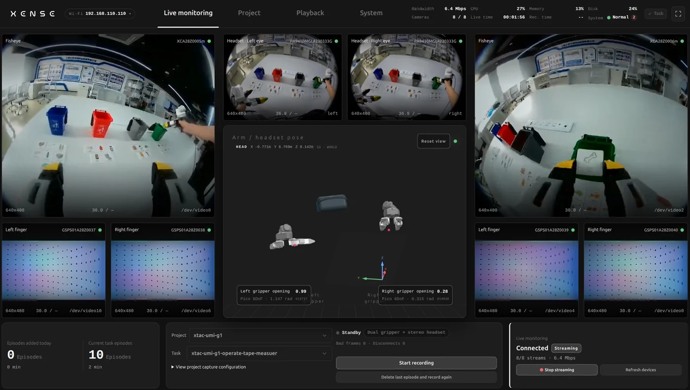
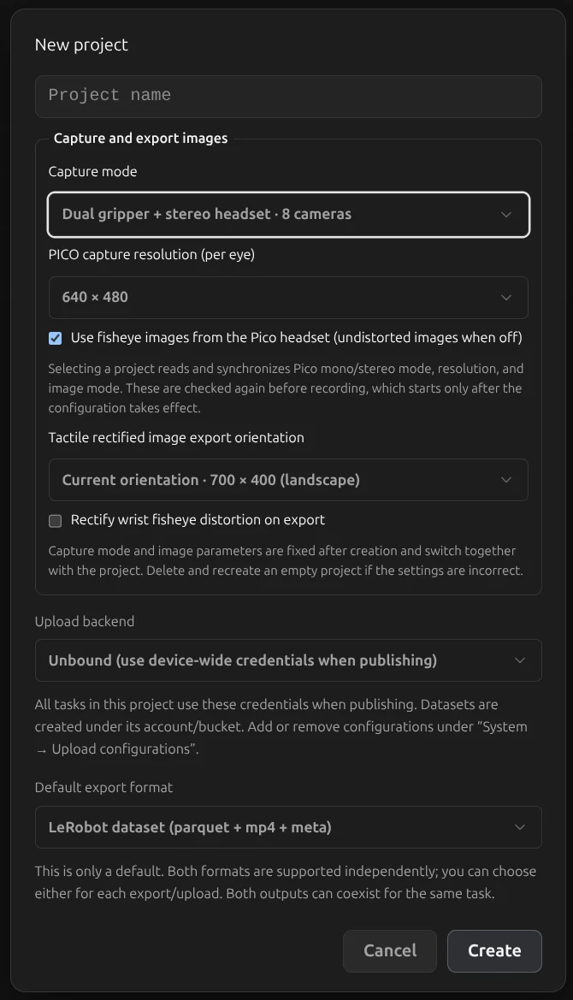
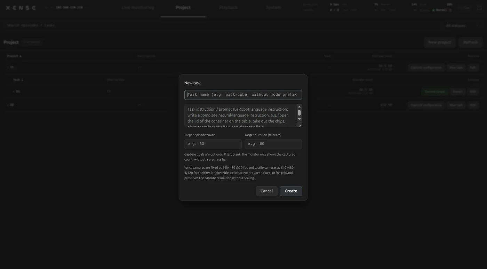
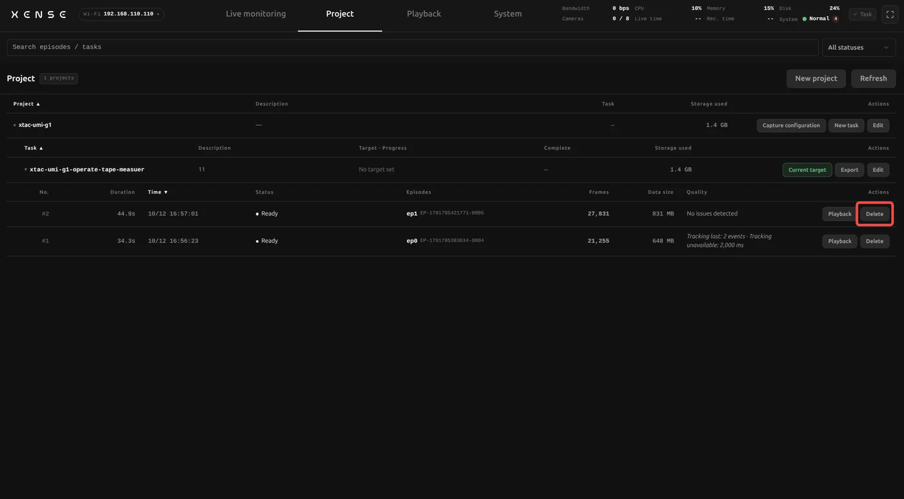
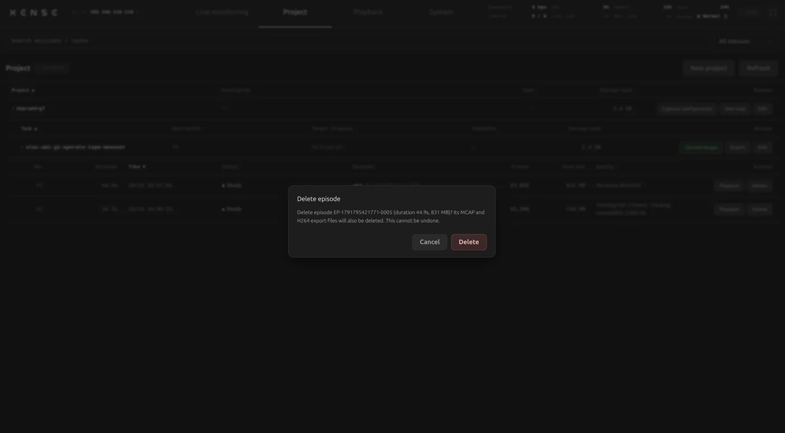

# Live monitoring and recording

This page covers the console's "Live monitoring" page. Button gestures, LED patterns and voice prompts are in [Gripper buttons, LEDs and voice](gripper.md).

- **Top bar**: device status (bandwidth, CPU, memory, disk, cameras, live time, recording time, system).
- **Middle**: the side columns each hold one gripper's fisheye view plus its left-finger / right-finger visuotactile feeds; the center column holds the headset's stereo pair, the "Arm / headset pose" 3D view (with a trail of about 1.5 seconds behind each end effector) and, below it, the left and right gripper opening-angle cards.
- **Bottom**: from the left, the "Current task episodes" card, the project / task selectors with the record button, and the "Live monitoring" connection card ("Stop streaming", "Refresh devices").

## Confirm in the console before recording {#checks}

Check each item before recording, and do not start if any is wrong:

| What to look at | What you want | When it is wrong |
|---|---|---|
| Every view | The top bar's "Cameras" count matches the capture mode (6 / 6 for "Dual gripper", 8 / 8 for "Dual gripper + stereo headset", 7 / 7 for "Dual gripper + headset right eye") and every tile has an image; fisheye views are sharp; the visuotactile feed is the geometrically rectified image with no difference overlay, and the contact area changes as you press | A blurred fisheye usually means the focus ring was knocked; turn it back to sharp before recording. If the count is wrong, check [System → Capture settings](system.md#capture-mode); only if one feed stays black for long, click "Refresh devices" |
| Headset pose and tracker state | Move a gripper and the headset and the 3D model follows; the indicator at the top right of the pose card is green; the pose view shows enough battery on both trackers | "Pose online" but the model does not move: the tracker app in the Pico usually never really started; hold the tracker's power button to reactivate it and restart the app on the Pico. Light turns yellow with a prompt: a tracker has left the headset's view (orientation only, no position); bring it back into view. Check left / right by serial number, odd left and even right, see [Reading a tracker SN](../common/pico4.md#pico-tracker-sn) |
| Both grippers' opening | The two cards below the pose view show radians, degrees and a normalized percentage: about 100% fully open, about 0% closed (about 0.02rad; a little more force reaches 0) | If fully open will not reach 100% or closing will not return to 0, recalibrate at [System → Gripper configuration](system.md#gripper) |
| Free disk space | The top bar's "Disk" usage is below 70% (recording disk, measured on the device); hovering shows the mount point, used, total and available space | At 70% recording is refused; [export and archive](projects-export.md#archive) the data you have, or delete recordings you do not need |
| Recording state | The status line at the top right of the project / task card reads "Standby", followed by the capture-mode badge (for example "Dual gripper + stereo headset"); "Start recording" is clickable | When the badge says "Pico not ready" and the button is gray, the reason is below the status line: "Pico not ready" and "Tracker not ready" are separate and can appear together, each followed by the specific cause (for example disconnected or timed out, pose data missing or timed out, left-eye / right-eye video missing or timed out, clock synchronization missing or timed out, or the tracker out of view or stationary for over 5 seconds); a missing project / task is stated too. Deal with the reason first |

- Preview and recording use separate paths. XHE always uses H.264 during recording. V1 projects can enable streaming encoding in advanced settings.
- On a weak tablet network, only the dropped feed shows "Network unstable; waiting to recover" and reconnects automatically; the others are unaffected and there is no need to refresh.

## Picking a project and task {#project-task}

Recordings sit under a "project → task" hierarchy. The two drop-downs at the bottom of the Live monitoring page pick the project and task; their last entries, "New project…" and "New task…", create one on the spot. You can also create them on the [Project page](projects-export.md) and set a task as the current target there.

A new project fixes its **capture config** at creation. **Once created it is frozen**; for different settings, create a new project (an empty project can be deleted and recreated). The System page shows it [read-only](system.md#capture-mode). A project name cannot duplicate that of an unarchived project, and task names within a project must be unique too.

- **Recording format and streaming encoding**: New projects default to XHE. XHE encodes video as H.264 during recording, writes it to `.xhe.mcap`, and exports only the original XHE MCAP. Only V1 projects can export LeRobot or Training MCAP. The streaming encoding setting applies only to V1. It is off by default and can be enabled in advanced settings. Existing projects retain their settings.
- **Capture mode**: Choose Dual gripper, Dual gripper + stereo headset, or Dual gripper + headset right eye. New projects default to dual grippers with stereo headset fisheye.
- **PICO resolution**: When you create a project in the console, the capture mode sets the resolution automatically. Stereo uses 1280×960 per eye, and right-eye-only capture uses 1920×1440, both at 30 fps. Existing projects keep their resolution. These features require a [compatible newer headset app](../common/pico4.md#pico-app).
- **PICO image source**: fisheye or undistorted images.
- **Headset mount**: In both Dual gripper + stereo headset and Dual gripper + headset right eye modes, choose On head or Around neck. The default is On head. Around neck records the pose at chest level, and the [starting-pose check](#initial-pose) uses the neck range. Use one mount per dataset.
- **Export quality and video encoding**: New projects default to High. Standard and Compact are also available. H.265 and MJPEG apply only to V1 exports. XHE exports the original MCAP with H.264 video and ignores the video codec setting.
- **Tactile rectified image export orientation**: 700 × 400 landscape by default, or a further 90° counterclockwise for 400 × 700.
- **Wrist fisheye**: V1 projects can choose whether to rectify distortion on export. See [Wrist fisheye rectification](system.md#undistort).
- **Upload backend and default export format**: you can bind one configured at [System → Upload configurations](system.md#upload) as the project's default; without a binding you pick one at upload time.

{ width="360" }

The fields for a new task:

| Field | What to enter |
|---|---|
| Task name | A short label using lowercase letters, digits and hyphens only, for example `pick-chips` |
| Task instruction / prompt (required) | The LeRobot language instruction, written as complete natural language, for example *open the lid of the container on the table, take out the chips, place them into the box, and close the lid* |
| Target episode count | How many episodes this task should collect; may be left blank |
| Target duration (minutes) | How long this task should collect for; may be left blank |

- With targets blank, only the count collected so far is shown, with no progress bar.
- **The target count is a hard gate**: once met, recording is refused, from both the console button and the gripper buttons.
- **Counted cumulatively**: "Ready" and "Uploaded" episodes both count; archiving only deletes local files without changing the state, so **neither uploading nor archiving frees up room**, and progress never goes backwards. Deleted episodes do not count; "Delete last episode and record again" leaves the net count unchanged.
- **To keep collecting once met**: raise the target count, or delete recordings that should not count.
- **The "Current task episodes" card**: bottom left, showing the count, duration and progress against the target on the same basis; starting or stopping from the gripper buttons or another tablet updates it and the Project page list immediately.

Camera parameters and rectification:

- **Wrist cameras and tactile sensors**: Choose 640×480 or 1920×1080 wrist capture when creating a project. 1080p requires gripper firmware 1.3.1 and matching fisheye calibration. XHE records tactile video at 60 fps.
- **V1 export rectification**: Tactile images are geometrically rectified in the chosen orientation. If wrist fisheye rectification is enabled, export uses the calibration parameters saved at the start of recording.
- **V1 LeRobot export**: Fixed at 30 fps. When streaming encoding is enabled for V1, video is encoded at its native frame rate and written to disk during recording, at the same quality as High exports. Export can reuse the encoded video to reduce transcoding.

## Recording {#record}

- **Gripper buttons (day to day)**: long-press the right gripper to start and the left to stop, with no browser needed, see [Buttons](gripper.md#buttons).
- **Console buttons**: "Start recording / Stop recording" do the same, for someone not holding a gripper; you can also bind a [recording shortcut](system.md#keybinding).
- **On-site feedback**: away from the tablet, watch the [LEDs](gripper.md#leds) and listen for the [voice prompts](gripper.md#voice-cues).

### Recording gates {#record-gates}

Whether started from a gripper button or the console, the device checks these in order and stops at the first failure:

1. Disk usage below 70%;
2. A project and task are selected, and the task's cumulative count has not reached its target;
3. Gripper MCU online. Collector 0.5.0 requires leader firmware 1.2.7 or later and follower firmware 1.2.17 or later. A 1080p wrist project requires 1.3.1 and matching fisheye calibration;
4. Pico ready: the headset is connected with pose and clock sync working. In modes that record headset video, the selected eye's video must be working. The device blocks recording if the headset capture rate is below **28 fps**;
5. Tracker ready: the trackers are connected and "tracking normally within the field of view"; recording is refused if a tracker has been still for more than 5 seconds or has left the field of view (brief stillness mid-recording does not interrupt and is not counted against quality; the position stays accurate while still);
6. The headset's video parameters match the project: after you select a project or the headset reconnects, the device re-reads mono / stereo, resolution and image source automatically, then checks again just before recording. **If no confirmation arrives, the check times out, or the headset disconnected or its parameters changed meanwhile, recording is refused**, and the message says which;
7. The headset's video clock is sane: if one eye's video time runs more than 1 second ahead of the time it was received, you get "headset … eye video time sync abnormal" and recording is refused. The problem is the headset app's camera clock versus its sync clock, not the backpack.
8. Coordinate reset: the device has the headset reset its world frame and waits for it to finish; on failure you get "Failed to reset Pico coordinates before recording";
9. Trackers not swapped: if the trackers' actual positions are opposite to their left / right gripper bindings, or left and right cannot be told apart yet, recording is refused;
10. Hands in the starting range (modes that record headset video), see [Starting-pose check](#initial-pose) below.

- **When refused**: an "Unable to start recording" dialog states the reason (the same for a gripper-button start); away from the tablet, listen for the announcement and watch the LEDs.
- **Message when the target is met**: "Task '…' has reached its cumulative collection target (N/M); recording refused. To keep collecting, raise the task's target count or delete recordings that should not count towards the target."

### Starting-pose check {#initial-pose}

In modes that record headset video ("Dual gripper + stereo headset", "Dual gripper + headset right eye"), the device checks before recording that both hands are **in the starting range in front of and below the body**, and refuses to record otherwise, so every episode in a dataset starts from the same posture. The console button, gripper buttons and "Delete last and re-record" all go through this check.

- **Reference frame**: the headset at the moment recording starts is the origin, X points forward (the headset's heading, horizontal only), Y left, Z up, in metres; the same as the [origin of exported data](../common/coordinates.md#episode-origin).
- **What is checked**: the TCP position of each gripper against its own box; the right hand's box is the left hand's mirrored left-to-right.
- **How it decides**: it waits up to 1.5 seconds and needs several consecutive samples inside the box (about 3 frames, 100 ms).
- **Range by mount**: around the neck the origin is at the chest, so the hands sit about 5–20 cm higher relative to it; the neck range is therefore wider up and down.

The current reference ranges are below (in metres); later versions may fine-tune them, so go by what the device reports.

| Mount | Forward (X) | Left hand leftward (Y), negated for the right hand | Up (Z) |
|---|---|---|---|
| On head | 0.10 to 0.50 | 0.05 to 0.40 | −0.70 to −0.30 |
| Around neck | 0.10 to 0.50 | 0.05 to 0.50 | −0.70 to −0.10 |

With the head range, the hands sit roughly 10–50 cm in front of the headset, 5–40 cm either side of the body's midline and 30–70 cm below the headset: arms hanging naturally, forearms forward, hands apart.

The pose view's "Start box" toggle can show this range: green is inside, orange is out of range, gray means that hand has no pose.

The two refusal messages:

- **Out of range**: "Your hands are outside the starting pose range, so recording was blocked: left hand 5 cm too high, right hand 2 cm too far left. Adjust as indicated, hold still, and retry." Move the stated distance the opposite way. The device also announces "Gripper start position outside the valid range".
- **No pose**: "Could not get valid headset and tracker poses at the same time, so the starting hand pose cannot be confirmed. Recording was blocked." Check that the headset and trackers are tracking first.

!!! note "Only the moment recording starts is checked"
    How you move after recording starts is not limited. Exports re-run the check on each episode's first 3 frames; out-of-range episodes are only listed by number in the export result, and the export still completes.

### While recording {#record-live}

- **Status line**: changes to "Recording" with a running timer, and the capture-mode badge stays; the top bar's "Rec. time" runs in step.
- **Red counters**: the recording card accumulates "Bad frames N" (delivered but incomplete), "Disconnects N" (a device-level disconnection; frames never arrived) and "Tracker out of view X s" (with ×N when more than once). With every camera green, out-of-view is the only clue; when you see it, consider stopping and re-recording.
- **Low FPS**: when a camera's good-frame rate stays below 90% of nominal over 3 seconds, the recording card shows "Low FPS" with the camera's name; if it persists, stop, check that camera's cable and record again.
- With the live preview off, each camera card shows its frame rate as a large number in the middle.
- You cannot delete episodes or change the task while recording; the capture mode can never be switched.

### USB device disconnects while recording {#usb-disconnect}

- **Trigger**: a gripper, or a wrist fisheye or tactile camera used by this episode, drops off USB while recording.
- **What the device does**: stops the whole recording at once, finalizes safely, marks it failed and shows "… disconnected, recording terminated".
- **Voice and LED**: a gripper dropping out plays "Left gripper disconnected" or "Right gripper disconnected"; a camera dropping out plays "Recording failed."; the gripper LED turns yellow as for a failed recording.
- **The failed recording**: not counted towards the cumulative count, and left out of normal export and upload.
- **No resume after recovery**: even a quick reconnect does not continue the recording; the device reconnects in the background, then start a new recording yourself.

### Headset disconnects while recording {#pico-disconnect}

- **Trigger**: the cable in the PICO port is pulled or loose, the headset disconnects, or the pose or required headset video has not updated for about 3 seconds.
- **What the device does**: stops recording at once, finalizes safely and marks it failed.
- **Console notice**: "Pico issue: recording interrupted", stating the kind of disconnect (for example "Pico disconnected", "Pico tracker disconnected", "Pico pose data has not updated for 3 seconds"). One incident shows it once, and refreshing or reopening the page does not repeat it; the mobile view shows the failure reason too.
- **Voice and LED**: "Pico connection failed." or "Tracker connection failed.", and the gripper LED turns yellow as for a failed recording.
- **The failed recording**: kept for diagnosis, not counted towards the cumulative count, and left out of normal export and upload.
- **No automatic resume after recovery**: when the data is back and finalizing is done, the yellow LED clears with "Pico has recovered. You can start a new recording when the device is ready."; start a new recording yourself.

### After stopping {#record-stop}

Long-press the left gripper or click "Stop recording": the episode is saved into the current task, and the LED flashes white once and returns to standby. Numbering is in the [Project page](projects-export.md#projects).

**XHE finalization check (Collector 0.5.0)**: When you stop recording, the system checks each camera separately. The recording passes this check if no camera skipped more than **2%** of the frames it captured. If any camera exceeds the limit, the system identifies that camera and reports the counts of captured, written, and skipped frames.

After an XHE recording is finalized, you can [play it back](projects-export.md#playback) from the Project page.

Earlier console versions marked an episode as "data suspect" when any of these conditions applied:

- The recording is shorter than 1s (almost always a misfire);
- Any camera channel recorded not one frame, or the whole episode received no video frames at all;
- Tracking was lost for more than 20% of the episode's duration (suspected to have left the field of view);
- A missing tactile rectification recipe prevents LeRobot export (V1 projects only);
- Any camera ran at low FPS for more than 5% of the episode's duration in total.

For a questionable episode, [delete it](#record-delete) on the spot and record it again.

### Episode states {#episode-state}

Project page rows and mobile cards show four states:

| State | What it means | What you can still do |
|---|---|---|
| Ready | Just recorded; the raw file is on the device and has never been uploaded | Play back, export or upload in a format the project supports, archive, delete |
| Uploaded | Uploaded in at least one format, with the raw file still on the device | The same actions. V1 projects can also export in the other format |
| Archived | Only the catalog record is left; the raw file was cleared at archive time | Only the record and deletion; the replay entry point is grayed out and no format can be exported |
| Discarded | The recording failed part-way (for example a [headset disconnect](#pico-disconnect), a gripper dropout, or a power loss / system restart during recording); the episode row states the failure reason; the data size reflects the files actually left, kept for diagnosis | Delete |

- "Uploaded" says whether a remote copy exists and "archived" whether the local file is still there, in two separate columns.
- **Local files**: an upload **keeps them by default**; to delete, tick auto-archive before uploading, or [archive](projects-export.md#archive) by hand later.

### Deleting the previous episode {#record-delete}

- **Buttons**: double-click the left gripper to enter delete confirmation, then double-click again to delete, see [Buttons](gripper.md#buttons).
- **Console**: "Delete last episode and record again" deletes the current task's most recent episode and immediately starts recording, with no second confirmation; unavailable while recording.
- **Earlier episodes**: click "Delete" on its row in the [Project page](projects-export.md). The confirmation lists the number, duration and size, and deletes its MCAP and H264 export files with it. This cannot be undone.

