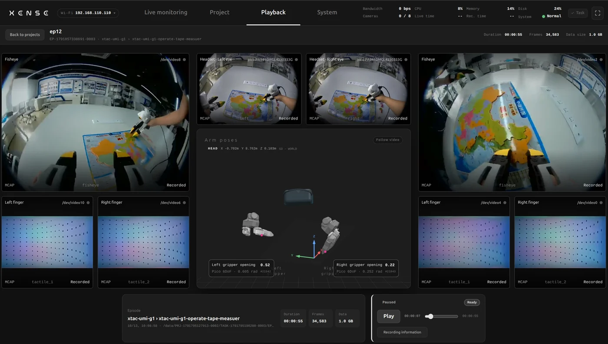

# Playback

You do not need to download a recording to review it: replay it in the console and decide whether to keep it.

Find the recording on the [Project page](projects-export.md#projects) and click Playback at the end of its row. The phone layout has no playback page; use a tablet or computer.

## Playing {#controls}

- Click "Stream playback": views, poses and opening play in sync; drag the progress bar to seek.
- "Recording information" shows the recording's duration, channels and other details.
- "Back to projects" returns to the Project page.

!!! warning "Playback and live preview cannot run at the same time"
    While any device is watching the live preview or an export is transcoding, playback is refused with the reason. Click "Stop streaming" on the Live monitoring page first, then come back.

Archived recordings have had their raw files cleared and cannot be replayed; fetch that data from where it was uploaded.

## Quality flags {#quality}

Each recording on the Project page has a Quality column:

| Shows | Meaning |
|---|---|
| No issues detected | The episode is clean |
| Lag N / Drop N / Bad N | Dropped frames, device dropouts or bad frames |
| Collecting statistics | Still recording |
| Incomplete statistics / No statistics | A failed or older recording without complete statistics |

Replay flagged episodes first and delete the ones you cannot use on the Project page; recordings with missing streams or zero frames are also blocked at export.
