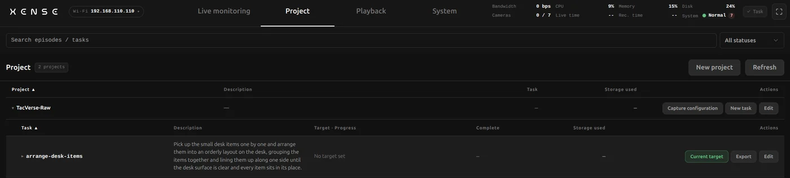
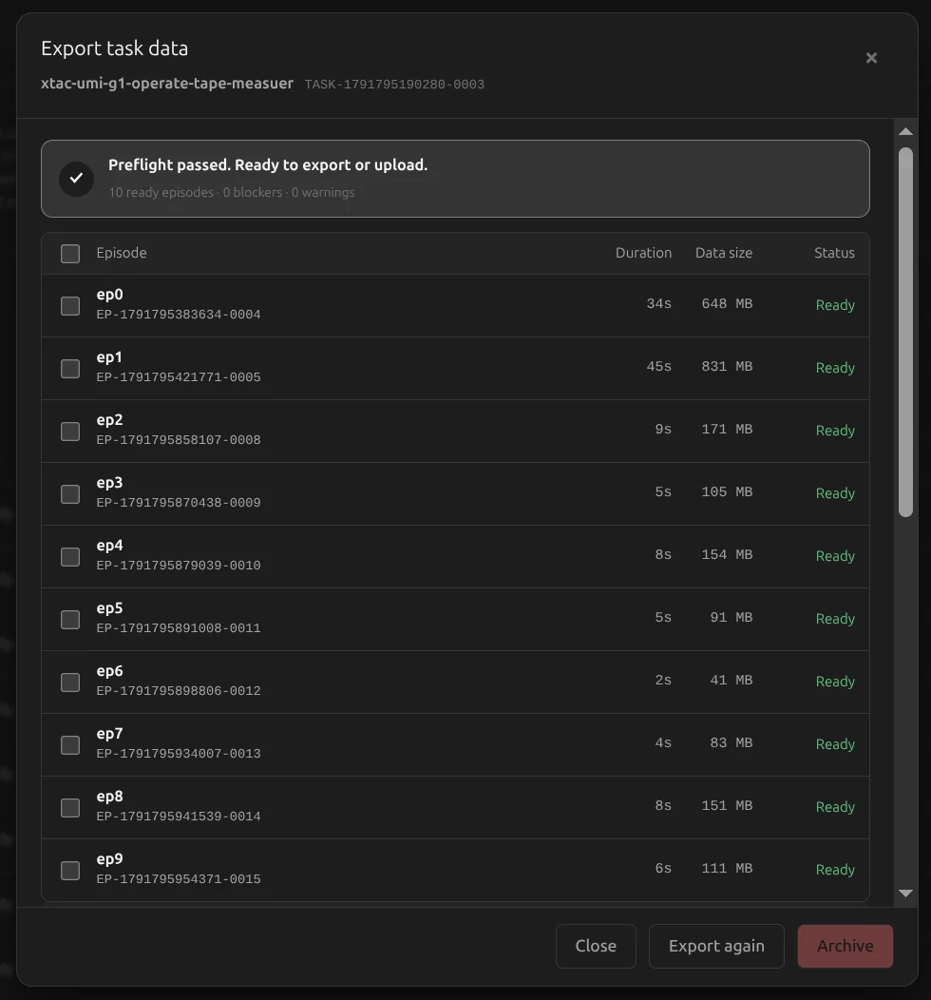
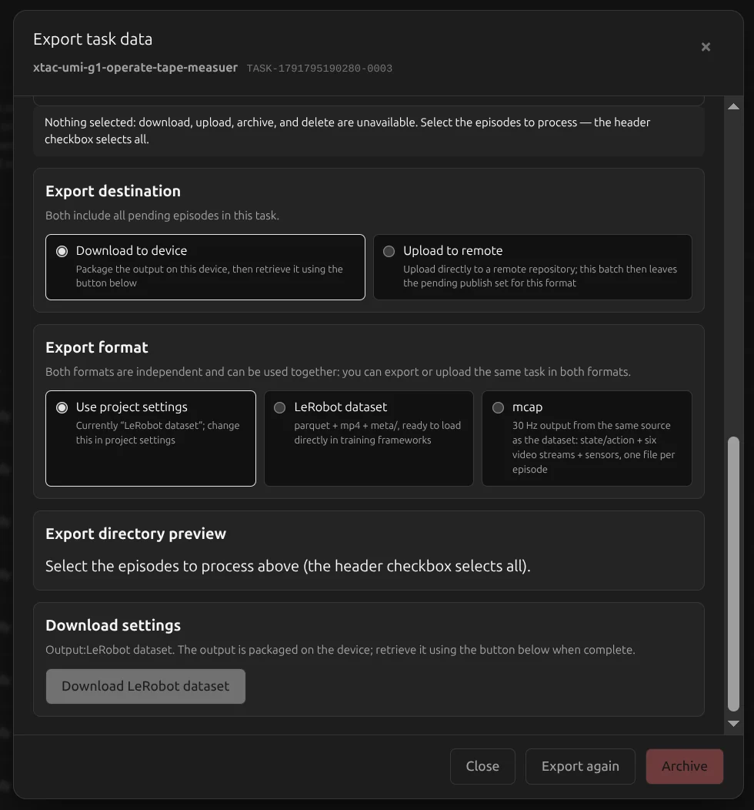

# Projects, export and upload

Manage recorded data on the console's Project page: export a task as a LeRobot dataset or MCAP, download it or upload it to a remote backend (for example ModelScope), then free up space with Archive.

## The Project page {#projects}

The hierarchy is **project → task → recording**. Each recording shows frames, data size and [quality](playback.md#quality), with Playback and Delete at the end of the row.

| Where | Actions |
|---|---|
| Page header | New project, search, filter by status |
| Project row | Capture configuration, New task, Edit (rename / upload backend / delete permanently) |
| Task row | Set as target (recordings go into this task), Export, Edit (edit task / delete task permanently) |
| Recording | Playback, Delete |

### New projects and tasks {#new}

- **New project**: enter a name and pick a capture mode (one of three); modes with the headset also pick headset resolution, image type and [headset mount](monitor-record.md#project-task) (On head / Around neck); optionally set export quality (High quality / Standard / Compact), tactile export orientation, wrist fisheye correction, upload backend and default export format. **It cannot be changed afterwards**; if it is wrong, delete the empty project and create it again.
- **New task**: task name (lowercase letters, digits and hyphens, e.g. `pick-cube`) and task instruction (required; it is the LeRobot language instruction); target count and target duration are optional.

## Export {#export}

Click Export on a task row to open "Export task data":

1. **Precheck**: the task's recordings are checked automatically; on success it says the export can go ahead, otherwise it lists the blockers to fix before clicking "Export again".
2. **Pick recordings**: tick the recordings to process; the header checkbox selects all. With nothing ticked, download, upload, archive and delete are unavailable.
3. **Pick where it goes**: "Download to device" or "Upload to remote".
4. **Pick the format**: follow the project setting, LeRobot dataset or MCAP.
5. **Start**: click "Download …" or "Upload …". Progress runs precheck → transcode → build → pack / upload → done; closing the dialog leaves it running in the background.
6. **Export notice**: if some episodes started with a hand outside the [starting range](monitor-record.md#initial-pose), the result says "N recordings start with a hand outside the configured range" and lists them; the export still completes, and whether to drop those episodes is up to you.

### Download to device {#download}

When it is done, click "Download dataset" or "Download mcap" and the browser saves an archive.

### Upload to remote {#upload}

Pick an [upload backend](system.md#upload) (or create one on the spot); optionally tick "Automatically archive after upload (delete local source files; keep metadata only)".

- **Confirm the file list**: once packing finishes, "Confirm files to upload" lists the number of files, total size and each file; transfer starts only after you click "Confirm upload". If you close the dialog while it waits, reopening it lets you confirm.
- **Progress**: shows the current group, file number, bytes sent, upload speed and the estimated time left in the current group; that estimate covers this group only, not later groups or remote confirmation. During a network retry it shows "Retrying".

| Backend | Formats |
|---|---|
| ModelScope | LeRobot dataset, MCAP; creates the repo automatically, private or public |
| S3 object storage | LeRobot dataset, MCAP |
| Tencent Cloud COS | LeRobot dataset, MCAP |
| FTP / FTPS, NFS network storage | LeRobot dataset, MCAP |
| STS | MCAP only |

**Publishing to ModelScope** is simply uploading with the ModelScope backend; there is no separate Publish button. A public release cannot be withdrawn.

## Export formats {#formats}

You can export both formats; they do not affect each other.

### LeRobot dataset {#lerobot}

A standard LeRobotDataset v3 at 30fps, with `meta/`, `data/` and `videos/`. The directory layout and how to load it are in the [LeRobotDataset v3.0 documentation](https://huggingface.co/docs/lerobot/lerobot-dataset-v3).

| Capture mode | `robot_type` | Video streams | State / action dims |
|---|---|---|---|
| Dual gripper | `bi_taccap_gripper` | 6 | 20 |
| Dual gripper + stereo headset | `xtac_umi_g1` | 8 | 29 |
| Dual gripper + headset right eye | `xtac_umi_g1` | 7 | 29 |

It also includes `meta/taccap_extrinsics.json` (tracker extrinsics) and `meta/xumi_collection_devices.json` (which devices recorded each episode and which version exported it).

- **Pose origin**: the headset and left / right TCP poses in state and action are relative to the headset at the start of each episode, see [Coordinate frames · Origin of exported data](../common/coordinates.md#episode-origin).
- **Dataset-level declarations**: `meta/info.json` states `tcp_frame_convention` (currently `mirrored-v1`: the left-hand TCP is the right-hand convention rotated 180° about its own X axis) and `headset_mount` (`head` / `neck`). A dataset can only have one mount; exporting a mix is an error.
- **Do not mix with exports from 0.4.3 or earlier**: the pose origin and the left-hand TCP convention both changed, so tell old and new data apart by the two fields above before merging.

### MCAP {#mcap}

The export is a training MCAP: one `.train.mcap` file per recording, built from the same data as the LeRobot dataset in a different container. It holds the state and action aligned to 30Hz, every video stream and the sensor data, and opens directly in Foxglove and similar tools.

It is not the same file as the raw recording on the backpack:

| | Raw recording | Exported `.train.mcap` |
|---|---|---|
| Where | On the backpack's data drive, for replay and export | Downloaded or uploaded to a remote backend |
| Rate | Each stream at its device's native rate: visuotactile 120fps, wrist fisheye 30fps, gripper opening and IMU 100Hz | All aligned to 30Hz |
| Images | Raw frames, not rectified | Rectified according to the project settings |

## Archive {#archive}

Archiving **deletes the raw files on the device and keeps only the record**, to free space; archived recordings can no longer be replayed or exported.

Tick recordings in the export dialog and click Archive, or tick "Automatically archive after upload (delete local source files; keep metadata only)" when uploading. The confirmation separates recordings by whether they were uploaded or downloaded, and recordings never uploaded or downloaded need a final extra confirmation.

## Delete {#delete}

- **One recording**: click Delete on its row; the files go with it and cannot be recovered.
- **Several**: tick them in the export dialog and click "Delete permanently". Unlike archiving, the record goes too; copies already uploaded to a remote backend are unaffected.
- **A whole project or task**: "Delete permanently" in its Edit menu; you must type the name to confirm.
