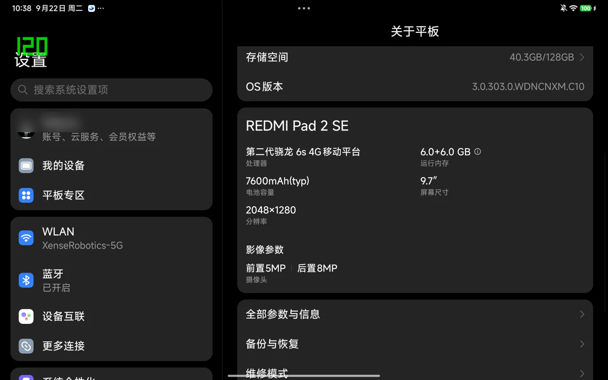
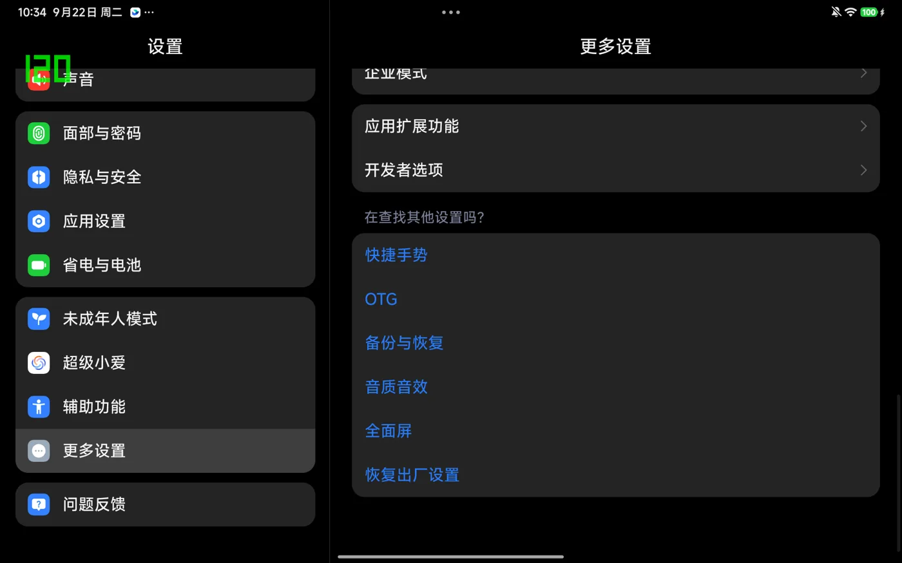
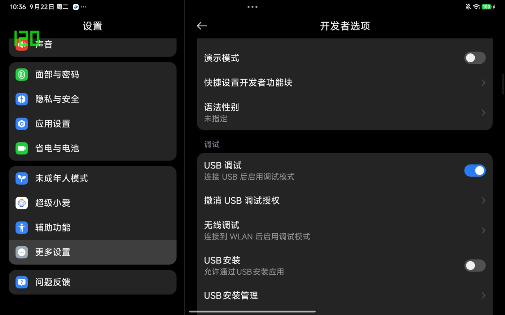

# Troubleshooting

Find the cause and fix by symptom. Before troubleshooting, listen for the voice announcement and check the [gripper LEDs](gripper.md#leds) and the Live monitoring page's status dots.

!!! danger "Odor, smoke, obvious overheating, structural damage or damaged cable insulation"
    Cut the power and stop using the device immediately. Note the serial number on the body and contact technical support.

## Power and connectors {#power}

??? failure "The headset loses power and shuts down during use"
    **Cause:** the headset is underpowered, or the power bank stopped output on the original port when a second device was connected.

    **Fix:** select components and wire them as described in [Power-bank power](unbox-connect.md#powerbank). Do not connect additional devices to the power bank during collection.

??? failure "Poor contact in the DC, PICO or USB port"
    **Cause:** the board has shifted under mechanical load (a hardware fault).

    **Fix:** do not force the connector. Note the serial number on the body and contact technical support for repair.

??? failure "A gripper's LED is dark, or the system log repeatedly shows `mcu ... disconnected / reconnected`"
    **Cause:** the gripper cable has poor contact or is not connected to UMI-L / UMI-R. When one gripper drops out, the other shows solid red (a system problem).

    **Fix:** seat both ends of the Type-C cable firmly and tighten the locking screws. If disconnections continue, report the SN and the time period to technical support.

## Headset and trackers {#tracker}

??? failure "The status dot on the Live monitoring page's pose card is yellow, with “Tracker out of view” or “Pose stale” beside it"
    **Cause:**

    - **Yellow dot**: the headset is connected, but the tracker pose is invalid (out of view, tracking fault, or not powered on / not paired); poses during that time are unreliable.
    - **"Pico offline"**: the headset is not connected to the backpack.

    **Fix:**

    - Move the grippers back into the headset's field of view.
    - Confirm that both trackers show blue, are [paired to the headset](../common/pico4.md#pico-tracker-bind) and are in independent tracking mode.
    - For "Pico offline", check that XTac UMI XR is connected; see [The app's screen](../common/pico4.md#pico-toolkit-ui).

??? failure "The pose is shown as online, but the 3D model does not move"
    **Cause:** the tracker app in the headset has not fully started (for example, on first use of the day without pressing the tracker button).

    **Fix:** hold the tracker's power button to reactivate it and restart the app in the headset; before recording, move a gripper and confirm that the 3D model follows.

??? failure "The left and right gripper poses are swapped"
    **Cause:** the trackers were fitted or paired on the wrong sides. The SN rule is odd for left, even for right.

    **Fix:** check against [Reading a tracker SN](../common/pico4.md#pico-tracker-sn) and swap them back. Before recording, move one gripper alone to confirm.

## Connecting and reaching the console {#connect}

??? failure "The tablet does not open the console when connected to the backpack"
    **Cause**: the tablet was factory reset, USB debugging was turned off, or debugging authorizations were revoked (the bundled tablet is authorized before shipping).

    **Fix**: confirm that the cable is connected to `HOST1` / `HOST2` and the tablet is unlocked. If the console still does not open, re-enable USB debugging and trust the backpack as follows (the bundled REDMI Pad 2 SE is shown):

    === "1. Developer mode"

        Go to Settings → My device and tap "OS version" about 7 times until developer mode is enabled.

        

    === "2. Developer options"

        Go to Settings → Additional settings → Developer options.

        

    === "3. USB debugging"

        In the Debugging group, turn on "USB debugging" and confirm.

        

    === "4. Trust the backpack"

        Connect the tablet to the backpack. When prompted "Allow USB debugging?", select "Always allow from this computer" and tap Allow.

    After authorization, the backpack disables the tablet's debugging-authorization timeout. Subsequent connections open the console without confirmation.

??? failure "Connected to the backpack hotspot, but the console cannot be opened"
    **Cause:**

    - **Wrong backpack**: every backpack hotspot name starts with `xense-`.
    - **Missing `http://`**: iOS / Safari treats the device name as a search term, so the page appears not to open, but no request is sent.
    - **`.local` cannot be resolved**: some Android devices do not support it.

    **Fix:**

    - Check that the hotspot name matches the Wi-Fi line on the body label (the password is also on the label).
    - Enter the full address `http://192.168.44.1` (the hotspot gateway is fixed), or the `http://xense-xxxxxx.local` address on the last line of the label.
    - If the signal is weak, move closer. If the backpack is occasionally unresponsive, power-cycle it.
    - Access methods are described in [The backpack hotspot](network.md#softap).

??? failure "The tablet or phone cannot find the backpack hotspot"
    **Cause:** the hotspot operates on 5GHz only; devices that support only 2.4GHz cannot detect it.

    **Fix:** use a 5GHz-capable device, or connect the backpack to the site network and access it over the LAN; see [Joining a site network](network.md#lan).

??? failure "A PC cannot open `xense-xxxxxx.local`, but a phone can"
    **Cause:** mDNS resolution on Windows is unreliable.

    **Fix:** use the IP address, shown in the top-bar [network dropdown](network.md#status) (viewable by connecting the tablet over USB). On the hotspot, use `http://192.168.44.1`.

??? failure "The console disconnects during collection, and the Wi-Fi has switched to another network"
    **Cause:** Windows / the tablet switched automatically to a saved network with a "better signal".

    **Fix:** turn off "auto-connect" for other saved networks, or forget them, so that only the backpack hotspot remains.

??? failure "The backpack's network page cannot find the site Wi-Fi"
    **Cause:** the backpack joins and lists 5GHz Wi-Fi only; a router that supports only 2.4GHz is not shown.

    **Fix:** use a wired connection or the backpack hotspot.

??? failure "After extended use, the Wi-Fi disconnects and the body is hot"
    **Cause:** the backpack is overheating.

    **Fix:** restart the backpack to recover. Check that the fan outlet is not blocked and the fan is running. If the problem recurs, report it for repair.

## Collection and recording {#record}

??? failure "The record button is grayed out, or the gripper button fails to start recording (solid yellow LED)"
    **Cause:** a [recording gate](monitor-record.md#record-gates) did not pass; a dialog states which one.

    **Fix:**

    - **No project / task**: select a [project and task](monitor-record.md#project-task) at the bottom of the Live monitoring page.
    - **"Pico not ready"**: wait for the headset to connect and the pose dot to turn green.
    - **"Tracker not ready"**: move the grippers back into the headset's field of view and move them slightly.
    - **No gripper MCU online**: check the gripper cables, see [Power and connectors](#power).
    - **Other messages** (firmware too old, target reached, disk full, coordinate reset failed, trackers swapped, starting pose out of range): see the entries below.

??? failure "Recording refused: “… gripper firmware version … is too old; this Collector version requires 1.2.7 or later”"
    **Cause:** Collector 0.5.0 requires leader gripper firmware 1.2.7 or later and follower firmware 1.2.17 or later. 1080p wrist projects require firmware 1.3.1 and matching fisheye calibration.

    **Fix:** Follow the [gripper firmware instructions](versions.md#gripper-firmware). Reconnect USB for a leader. Reconnect 24V power for a follower, leaving USB connected. Verify the version in Device information before recording.

??? failure "Recording refused: “Task '…' has reached its cumulative collection target (N/M)”"
    **Cause:** the target counts **cumulatively**, and **neither uploading nor archiving frees capacity**; the counting rules are in [Picking a project and task](monitor-record.md#project-task).

    **Fix:**

    - raise the task's target count;
    - or delete episodes that should not count on the Project page (such as accidental short episodes or episodes judged suspect);
    - or create a new task to count from zero.

??? failure "Recording refused: “Your hands are outside the starting pose range, so recording was blocked”"
    **Cause:** modes that record headset video require both hands to be in the [starting range](monitor-record.md#initial-pose) in front of and below the body when recording starts; the message names each hand, the direction it is off and by how many centimetres.

    **Fix:**

    - Look forward, bring both hands back in front of and below your body, naturally apart, hold still and start again.
    - The Z axis is always out of range (too high or too low): check that the project's "Headset mount" matches how the headset is actually worn; worn around the neck but set to On head, the hands look too high. The mount is fixed once the project is created, so a wrong one means creating a new project.
    - A crooked headset, or looking down or turning sideways at the start, also shifts the whole range.

??? failure "Recording refused: “Could not get valid headset and tracker poses at the same time”"
    **Cause:** within 1.5 seconds the device did not get valid poses from the headset and both trackers at the same time, so it cannot tell where the hands are.

    **Fix:** work through [Headset and trackers](#tracker): the trackers are in the headset's view with a blue LED, and the pose card on the monitor page shows a green dot; move the grippers slightly to wake the trackers, then retry.

??? failure "Recording refused: “The tracker positions are opposite to their left/right gripper bindings” or “Unable to confirm the left/right gripper positions”"
    **Cause:** swapped grippers, wrongly fitted trackers or swapped bindings; a start is also refused when left and right cannot be told apart because the hands are crossed, too close together or tracking is unstable.

    **Fix:** look forward, hold your hands apart without crossing them, move slightly to wake the trackers and retry. If it still says they are opposite, check the grippers are in the correct hands, and check tracker fitting and binding as in [The left and right gripper poses are swapped](#tracker).

??? failure "Recording refused: “Failed to reset Pico coordinates before recording”"
    **Cause:** the headset is disconnected, XTac UMI XR is not running in the foreground, or the XR version does not support the reset; the reason follows the colon.

    **Fix:** make sure the headset is connected, XTac UMI XR is running in the foreground and shows "Connected", and its version matches the [version baseline](versions.md#baseline), then retry.

??? failure "Recording refused: “Recording disk is N% used, at the 70% limit”"
    **Cause:** Collector 0.5.0 blocks new recordings at 70% recording-disk usage to leave space for exports.

    **Fix:**

    - **Archive**: after exporting the data (download or upload), [archive](projects-export.md#archive) it.
    - **Delete**: delete unneeded episodes on the Project page. Their MCAP and H264 files are deleted as well; this cannot be undone.
    - **Uploading does not free space**: local files are kept by default; click "Archive" as well.

??? failure "The gripper LED turns solid yellow during recording"
    **Cause:** a fatal problem occurred in this episode (for example, a camera or required channel dropped), so the episode is invalid. The LED stays yellow until recording ends.

    **Fix:** stop recording, delete the episode and record again; on the Live monitoring page, check the cable of the feed that dropped.

??? failure "The headset disconnected during recording, and the episode was interrupted and marked failed"
    **Cause:** the headset's USB link drops, its connection breaks, or its pose / images stop updating for about 3 seconds; the device stops recording at once and marks the episode failed, see [Headset disconnects while recording](monitor-record.md#pico-disconnect).

    **Fix:** check the cable from the headset to the backpack's `PICO` port, the headset battery, and that XTac UMI XR is running; when the announcement is "Tracker connection failed", check the tracker. Recording **does not resume automatically**; start a new recording once ready.

??? failure "While recording: “… disconnected, recording terminated”, and the episode is marked failed"
    **Cause:** a gripper, or a wrist fisheye or tactile camera used by this episode, dropped off USB; the device stopped the whole recording and marked it failed. See [USB device disconnects while recording](monitor-record.md#usb-disconnect).

    **Fix:** check the Type-C cable and port of the device named in the message, wait for it to come back (its view returns on the monitor page or the gripper LED returns to standby), then start a new recording. If it keeps happening, work through [loose contacts](#power).

??? failure "The recording card shows “Low FPS”, or the episode is marked suspect after stopping"
    **Cause:** a camera's good-frame rate stayed below 90% of nominal, usually a USB cable, port or bandwidth issue; the camera itself reports no error.

    **Fix:** after stopping, check that camera's cable and port, replug it and confirm on the monitor page that the frame rate is back, then delete the suspect episode and record again.

??? failure "About 5 seconds of lost data right after a leader gripper is powered up again"
    **Cause:** known issue. About 0.5 seconds after a leader gripper is powered up again and first starts streaming, it occasionally stops answering; the Collector reconnects automatically and it recovers in about 5 seconds.

    **Fix:** nothing to do; wait for the gripper to recover before recording, and do not start recording the instant a gripper powers up.

??? failure "A recording shows as failed, with power loss or a system restart as the reason"
    **Cause:** the backpack lost power, or the system or capture service restarted, during recording, so the episode was not finalized.

    **Fix:** the files may be incomplete; verify, then delete and record again. If power losses recur, check the power supply and cabling; see [Power and ports](#power).

??? failure "The gripper LED is solid red"
    **Cause:** the backpack reports a system problem (a gripper or camera dropped out, or a required channel is missing). The LED stays red until the problem clears.

    **Fix:**

    - Reconnect the cable of the feed shown as offline on the Live monitoring page.
    - In [Device information](system.md#device-info), check which camera is marked "(Offline)" and whether both gripper MCUs are present.
    - If the problem persists, power-cycle the backpack.

??? failure "The gripper LED flashes red rapidly"
    **Cause:** the gripper's MCU self-check reports an internal fault (for example, a sensor fault). During this time it ignores the backpack's LED commands.

    **Fix:** reconnect that gripper's Type-C cable or power-cycle the backpack. If the problem recurs, note the gripper's SN and contact technical support.

??? failure "The buttons do not respond: a double-click is refused (fast yellow flash), or a long press during recording has no effect"
    **Cause:** this is the designed state-machine behavior:

    - during recording, a double-click and a long press on the right gripper are silently ignored to prevent accidental input;
    - a double-click is refused when there is nothing to delete;
    - a double-click has no effect during the 3-second cooldown after a deletion.

    **Fix:** refer to the gesture table in [Buttons](gripper.md#buttons). Current bindings are at System → [Capture settings](system.md#capture-settings).

??? failure "The device is silent: no voice announcement when recording starts or stops"
    **Cause:** usually the announcements are muted or the volume is 0.

    **Fix:** at System → [Capture settings › Voice prompts](system.md#voice), check the switch and the volume, and click "Preview" next to each line to test it; the page shows which device played the sound and why. If the headset app lacks the audio for a line, that line plays through the backpack's speaker.

??? failure "The fisheye view is blurred"
    **Cause:** the focus ring is easily knocked out of focus.

    **Fix:** check both fisheye views before collecting. If a view is blurred, turn the focus ring back until the image is sharp. Clean a dirty lens with a lint-free cloth; see [Maintenance](../common/maintenance.md).

??? failure "Switching project, gripper calibration, a firmware upgrade or a system update is refused with “Recording in progress”"
    **Cause:** these operations are refused while recording.

    **Fix:** stop recording first (with the Live monitoring page button or a long press on the left gripper), then retry.

## Replay, export and data {#export}

??? failure "Collector 0.4.7 blocks playback because live preview is active"
    **Cause:** replay and live preview share the backpack's hardware encoder. Replay is refused while Live monitoring is open in another tab or on another device; a camera is still treated as using the encoder for up to 15 seconds after it disconnects.

    **Fix:** close the monitor page in other tabs and on other devices, wait a few seconds and click Playback again.

??? failure "Archived recordings cannot be played back or exported again"
    **Cause:** expected behavior. [Archiving](projects-export.md#archive) deletes the raw files that replay and export both read, keeping only the record; "Playback" for those episodes is grayed out with "Archived; local source files deleted".

    **Fix:** export every required format before archiving. Recordings that were never uploaded have no copy once archived; the confirmation warns you.

??? failure "The upload finished, but no space was freed on the recording disk"
    **Cause:** expected behavior; uploads **keep local files by default**.

    **Fix:** before uploading, select "Automatically archive after upload (delete local source files; keep metadata only)", or click "Archive" in the task's export dialog afterwards. If both formats are needed, export both before archiving.

??? failure "An NFS / FTP upload fails, or “Test read/write” does not pass"
    **Cause:** the target does not meet the requirements, or the path / port is incorrect; go by the check's messages.

    **Fix:** at System → [Upload configurations](system.md#upload), check each item according to the messages:

    - **Target directory**: must already exist (likewise the NFS target subdirectory); the device does not create it.
    - **Permissions**: the NAS or FTP / FTPS service must allow the account to write, read back, rename and delete.
    - **NFS**: check the protocol version and UID / GID.
    - **FTPS**: check that the server address matches the certificate and whether a private CA is required.
    - Save the changes and click "Test read/write" again. If it still fails, contact technical support with the exact check message, device SN, console version and backend type.

??? failure "The LeRobot dataset is larger than expected"
    **Cause:** about 0.5GB per hour of exported LeRobot dataset is normal; the size is mostly set by the project's "Export quality".

    **Fix:** plan capacity at this scale. For a new project where size matters, choose "Compact" export quality when creating it; an existing project cannot be changed.

??? failure "After upgrading, exported or uploaded datasets show as needing re-export"
    **Cause:** this is expected. When the export rules change, old exports are marked stale: from 0.4.6, exported poses are relative to the headset at the start of each episode and the left-hand TCP uses the mirrored convention; from 0.4.7, each camera takes its own nearest frame and pose and gripper opening are interpolated at the frame time, so both frame selection and values change. Raw recordings are unaffected.

    **Fix:** re-export recordings whose raw files are still on the device. Archived recordings cannot be re-exported; keep their old exports. Do not merge old and new exports into one dataset; tell them apart by `tcp_frame_convention` in `meta/info.json`, see [Export formats](projects-export.md#lerobot).

## Upgrades {#update}

??? failure "Power was lost during an upgrade / the console cannot connect after applying an update"
    **Cause:** the collection software restarts when an update is applied, and the page waits up to 90 seconds; if the new version fails to start, the device falls back to the previous version automatically, see [Rollback](versions.md#rollback).

    **Fix:**

    1. Refresh the page.
    2. If the console still cannot connect, power-cycle the backpack.
    3. On the System update page, check the current version and "Last operation / Last error"; if the device fell back, import the bundle again.

??? failure "The upgrade bundle fails verification on upload"
    **Cause:** the file is corrupt or incompletely uploaded, the version gap is too large, or the version is older than the current one.

    **Fix:** read "Last error", then download and upload the bundle again. For a version-skipping upgrade, request intermediate bundles from technical support. A rejected bundle does not affect the currently running version.

??? failure "After flashing the gripper firmware, the gripper works intermittently and frames are silently dropped"
    **Cause:** flashing ends with a soft reset only, so the gripper's USB-to-serial chip is not power-cycled and remains in a degraded state.

    **Fix:** Wait for the gripper to finish restarting. Reconnect USB for a leader. Reconnect 24V power for a follower, leaving USB connected. Then check the firmware version. See [Gripper firmware](versions.md#gripper-firmware).

---

If the problem persists, open System → [Device information](system.md#device-info), click "Export diagnostics" and send the encrypted ZIP to technical support; if the console is unreachable or the download fails, send error screenshots first. The block of readings at the top right opens "System logs" for viewing errors. For contact channels and the information to include, see [Support and feedback](../common/reference.md#support).
