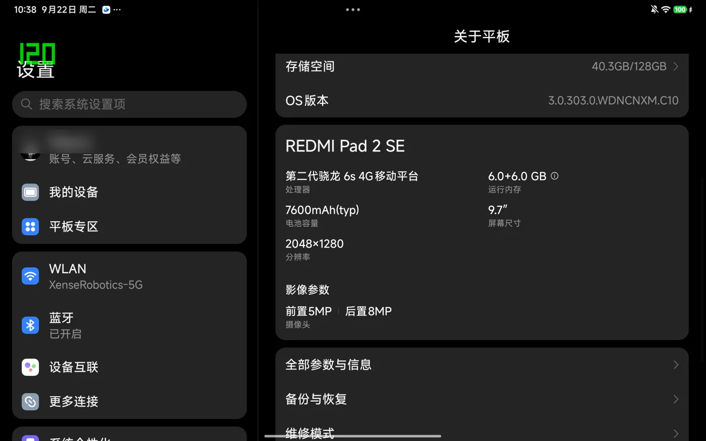
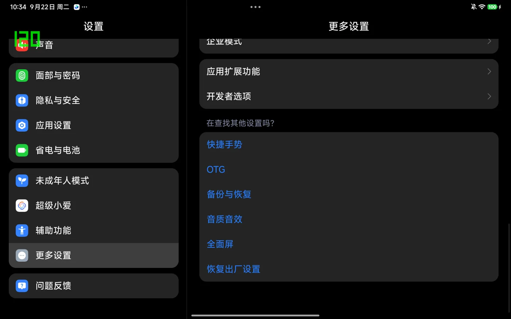
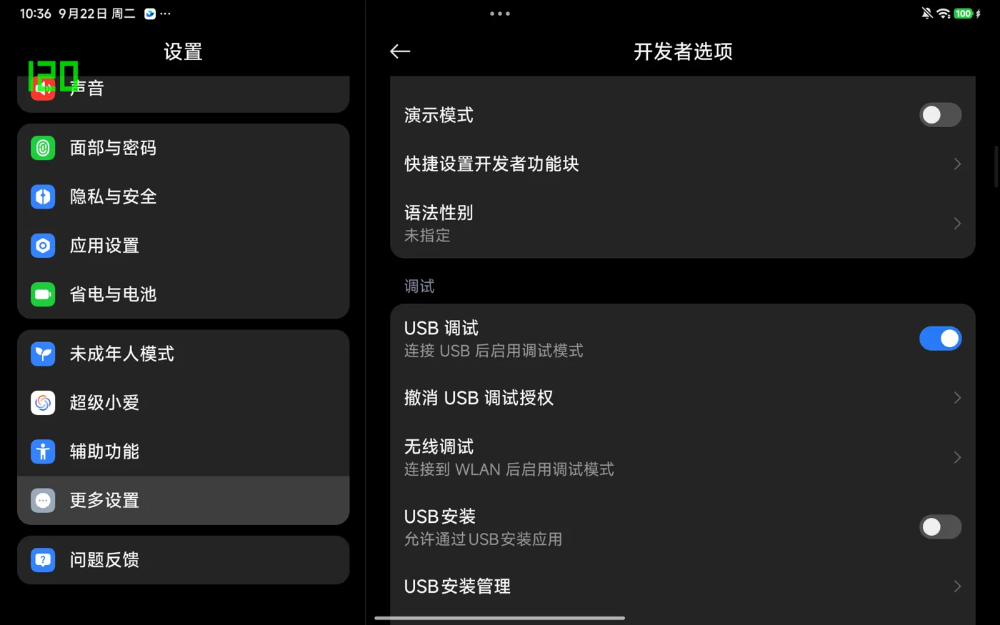

# 故障排查

按症状查原因与解决方法。排查前先留意语音播报、[夹爪灯语](gripper.md#leds)与监控页状态点。

!!! danger "异味、冒烟、明显发热、结构破损或线缆破皮"
    立即断电并停止使用，记录机身 SN 后联系技术支持。

## 供电与接口 {#power}

??? failure "头显在使用过程中掉电关机"
    **原因**：头显供电不足，或充电宝接入第二台设备后停止了原接口的输出。

    **解决**：按[充电宝供电](unbox-connect.md#powerbank)选型并接线。采集过程中不要向充电宝接入其他设备。

??? failure "DC 供电口、PICO 口或 USB 口接触不良"
    **原因**：板卡受力移位，属于硬件问题。

    **解决**：不要用力扳动接口。记录机身 SN 后联系技术支持报修。

??? failure "夹爪指示灯不亮，或系统日志反复出现 `mcu ... disconnected / reconnected`"
    **原因**：夹爪线束接触不良，或未接入 UMI-L / UMI-R 口。一只夹爪掉线时，另一只亮红灯常亮（系统问题）。

    **解决**：将 Type-C 线两端插紧，并旋紧锁紧螺钉。如仍频繁断连，记录 SN 与发生时段后反馈技术支持。

## 头显与追踪器 {#tracker}

??? failure "监控页位姿卡的状态点为黄色，旁边显示「tracker 出视野」或「位姿不新鲜」"
    **原因**：

    - **黄点**：头显已连接，但追踪器位姿无效（超出视野、追踪异常，或未开机 / 未配对），期间的位姿不可信。
    - **显示「Pico 未上线」**：头显未连接到背包。

    **解决**：

    - 将夹爪移回头显视野内。
    - 确认两只追踪器亮蓝灯、已[配对到头显](../common/pico4.md#pico-tracker-bind)，并处于独立追踪模式。
    - 显示「Pico 未上线」时，检查 XTac UMI XR 是否已连接，见[打开 App 后的界面](../common/pico4.md#pico-toolkit-ui)。

??? failure "位姿显示在线，但 3D 模型不动"
    **原因**：头显中的追踪器 App 未真正启动（如当日首次使用且未按追踪器按钮）。

    **解决**：长按追踪器电源键重新激活，并重启头显中的 App；开录前移动夹爪确认模型跟随。

??? failure "左右夹爪的位姿互换"
    **原因**：两只追踪器安装位置互换，或配对时左右对调。SN 规则为左单右双。

    **解决**：按[追踪器序列号](../common/pico4.md#pico-tracker-sn)核对并换回。录制前单独移动一只夹爪进行确认。

## 连接与控制台入口 {#connect}

??? failure "平板连接背包后未自动打开控制台"
    **原因**：平板已恢复出厂设置、关闭了 USB 调试，或撤销了调试授权（随箱平板出厂时已授权）。

    **解决**：确认线缆接在 `HOST1` / `HOST2` 口，且平板已解锁。如仍未打开，按以下步骤重新开启 USB 调试并信任背包（以随箱 REDMI Pad 2 SE 为例）：

    === "1. 打开开发者模式"

        进入 设置 → 我的设备，连续点击「OS 版本」约 7 次，直至提示已进入开发者模式。

        

    === "2. 找到开发者选项"

        进入 设置 → 更多设置 → 开发者选项。

        

    === "3. 打开 USB 调试"

        在「调试」分组中开启「USB 调试」，并按提示确认。

        

    === "4. 信任背包"

        将平板连接背包。弹出「允许 USB 调试？」时，勾选「始终允许使用这台计算机进行调试」，点击「允许」。

    授权后，背包会自动关闭平板的调试授权超时。此后连接背包无需确认，控制台将自动打开。

??? failure "已连接背包热点，但无法打开控制台"
    **原因**：

    - **连接了错误的背包**：多台背包的热点名前缀均为 `xense-`。
    - **地址未带 `http://`**：iOS / Safari 会将设备名当作搜索词，看似「无法打开」，实际未发起访问。
    - **无法解析 `.local`**：部分安卓设备不支持。

    **解决**：

    - 核对热点名与机身标签上 WiFi 一行是否一致（密码也在标签上）。
    - 输入完整地址 `http://192.168.44.1`（热点网关固定），或标签最后一行的 `http://xense-xxxxxx.local`。
    - 信号较弱时靠近背包；偶发无响应时，将背包重新上电。
    - 访问入口见[网络与控制台入口](network.md#softap)。

??? failure "平板或手机无法搜索到背包热点"
    **原因**：热点仅工作在 5GHz，仅支持 2.4GHz 的设备无法搜索到。

    **解决**：改用支持 5GHz 的设备，或将背包接入现场网络后通过局域网访问，见[接入现场 WiFi 与有线](network.md#lan)。

??? failure "电脑无法打开 `xense-xxxxxx.local`，手机可以打开"
    **原因**：Windows 的 mDNS 解析不稳定。

    **解决**：改用 IP 地址访问。IP 见顶栏[网络下拉](network.md#status)，可用平板通过 USB 进入控制台查看。连接热点时使用 `http://192.168.44.1`。

??? failure "采集中控制台断开连接，WiFi 切换到了其他网络"
    **原因**：Windows / 平板自动切换到「信号更好」的已保存网络。

    **解决**：关闭其他已保存网络的「自动连接」，或忘记这些网络，仅保留背包热点。

??? failure "背包网络页无法扫描到现场 WiFi"
    **原因**：背包仅连接并列出 5GHz WiFi，仅支持 2.4GHz 的路由器不会显示。

    **解决**：改用有线连接，或使用背包热点。

??? failure "背包长时间使用后 WiFi 断开、机身发烫"
    **原因**：背包过热。

    **解决**：重启背包即可恢复。检查出风口是否被遮挡、风扇是否运转。反复出现时请报修。

## 采集与录制 {#record}

??? failure "录制按钮为灰色，或按夹爪按键开始录制被拒绝（夹爪黄灯常亮）"
    **原因**：未通过[开录门槛](monitor-record.md#record-gates)，弹窗写明是哪一项。

    **解决**：

    - **未选项目 / 任务**：在监控页底部选择[项目与任务](monitor-record.md#project-task)。
    - **「Pico 未就绪」**：等待头显连接、位姿状态点变绿。
    - **「Tracker 未就绪」**：将夹爪移回头显视野内，并稍加移动。
    - **无在线的夹爪 MCU**：检查夹爪线，见[供电与接口](#power)。
    - **其他提示**（固件过旧、录满、盘满、坐标系重置失败、左右拿反、初始位姿越界）：见以下各条。

??? failure "开录被拒：「…夹爪固件版本 … 过旧，本版本采集端要求 1.2.7 及以上」"
    **原因**：Collector 0.5.0 要求主夹爪固件至少 1.2.7、从夹爪至少 1.2.17。1080p 腕部项目要求 1.3.1 和对应鱼眼标定。

    **解决**：按[夹爪固件](versions.md#gripper-firmware)升级。主夹爪重新拔插 USB，从夹爪重新拔插 24V 电源（无需拔插 USB）。在设备信息中复查版本后再开录。

??? failure "开录被拒：「任务「…」已达到累计采集目标（N/M）」"
    **原因**：目标按**累计采集**计数，**上传与归档均不会释放名额**，口径见[选项目与任务](monitor-record.md#project-task)。

    **解决**：

    - 提高该任务的目标条数；
    - 或在项目页删除不应计入的条目（如误触产生的短条目、已判定可疑的条目）；
    - 或新建任务，从零开始计数。

??? failure "开录被拒：「双手不在开录初始位姿范围内，已阻止录制」"
    **原因**：录头显画面的模式要求开录时双手在身体前下方的[初始范围](monitor-record.md#initial-pose)内，提示写明哪只手往哪个方向超出多少厘米。

    **解决**：

    - 目视前方，双手回到身体前下方、自然分开，稳定后再开录。
    - 总是 Z 轴越界（太高或太低）：核对项目的「头显佩戴方式」是否与实际一致，挂脖用戴头的范围会显得双手偏高；佩戴方式建完不能改，选错了只能新建项目。
    - 头显戴歪、开录时低头或侧身，也会让范围整体偏移。

??? failure "开录被拒：「开录前未能拿到同时有效的头显与 tracker 位姿」"
    **原因**：1.5 秒内没有拿到头显与两只 tracker 同时有效的位姿，无法判断双手位置。

    **解决**：按[头显与追踪器](#tracker)排查：tracker 在头显视野内、亮蓝灯，监控页位姿卡为绿点；轻微移动夹爪唤醒 tracker 后重试。

??? failure "开录被拒：「检测到左右 tracker 位置与夹爪绑定相反」或「暂时无法确认左右夹爪位置」"
    **原因**：左右拿反、tracker 装错或绑定反了；双手交叉、靠得太近或追踪不稳时分辨不出左右，也会被拒绝。

    **解决**：目视前方，双手自然分开、不要交叉，轻微移动唤醒 tracker 后重试。仍提示相反时，核对左右夹爪没有拿反，并按[左右夹爪的位姿互换](#tracker)检查 tracker 安装与绑定。

??? failure "开录被拒：「开录前重置 Pico 坐标系失败」"
    **原因**：头显断开、XTac UMI XR 未在前台运行，或 XR 版本不支持重置，冒号后写明原因。

    **解决**：确认头显已连接、XTac UMI XR 在前台运行并显示「连接成功」，版本符合[版本基线](versions.md#baseline)，再重试。

??? failure "开录被拒：「录制盘已用 N%，达到 70% 上限」"
    **原因**：Collector 0.5.0 在录制盘占用达到 70% 时禁止开始新录制，为后续导出预留空间。

    **解决**：

    - **归档**：已采集数据导出（下载或上传）后，执行[归档](projects-export.md#archive)。
    - **删除**：在项目页删除不需要的条目，其 MCAP 与 H264 文件将一并删除，且不可恢复。
    - **上传不释放空间**：本地文件默认保留，需另外点击「归档」。

??? failure "录制中夹爪灯变为黄色常亮"
    **原因**：本条录制发生致命问题（如某路相机或必需通道中断），已作废。黄灯将保持至录制结束。

    **解决**：停止录制后删除本条并重录，在监控页检查中断那一路的线缆。

??? failure "录制中头显断联，本条录制被中断并标记为失败"
    **原因**：头显 USB 断开、连接中断，或位姿 / 图像约 3 秒未更新，设备立即停录并判失败，见[录制中头显断联](monitor-record.md#pico-disconnect)。

    **解决**：检查头显到背包 `PICO` 口的连线、头显电量，以及 XTac UMI XR 是否在运行；播报「Tracker 连接失败」时检查 Tracker。设备**不会自动续录**，就绪后重新开录。

??? failure "录制中提示「…断开连接，录制已终止」，本条标记为失败"
    **原因**：录制中夹爪或本条用到的腕部鱼眼、视触觉相机 USB 掉线，设备停止整条录制并判为失败，见[录制中 USB 设备断连](monitor-record.md#usb-disconnect)。

    **解决**：检查提示里那一路的 Type-C 线和接口，等设备重新上线（监控页该路恢复画面或夹爪灯回到待机）后重新开录。反复出现时按[接触不良](#power)排查。

??? failure "录制卡显示「帧率偏低」，或停录后标为可疑"
    **原因**：某路相机有效帧率持续低于标称的 90%，多为 USB 线缆、接口或带宽问题；相机本身不报错。

    **解决**：停录后检查该路线缆与接口，重插后在监控页确认帧率恢复，再删掉可疑条目重录。

??? failure "主夹爪重新上电后约 5 秒内数据中断"
    **原因**：已知问题。主夹爪重新上电、首次开始传数据约 0.5 秒后，偶尔会停止应答，采集端会自动重连，约 5 秒恢复。

    **解决**：无需处理，等夹爪恢复后再开录。不要在夹爪刚上电时立即开录。

??? failure "录制显示失败，原因为断电或系统重启"
    **原因**：录制中背包断电、系统或采集服务重启，录制未正常收尾。

    **解决**：文件可能不完整，确认后删除并重新录制。频繁断电时检查供电与接线，见[供电与接口](#power)。

??? failure "夹爪灯红色常亮"
    **原因**：背包检测到系统问题（夹爪掉线、相机掉线或必需通道缺失），红灯持续至问题解除。

    **解决**：

    - 重新插接监控页上离线那一路的线缆。
    - 在[设备信息](system.md#device-info)的相机清单中查看哪台相机标为「离线」，并确认夹爪 MCU 是否均在线。
    - 如未恢复，将背包重新上电。

??? failure "夹爪灯红色爆闪"
    **原因**：夹爪 MCU 自检发现自身故障（如传感器故障），此期间不响应背包的灯控指令。

    **解决**：重新插拔该夹爪的 Type-C 线，或将背包重新上电。反复出现时，记录夹爪 SN 并联系技术支持。

??? failure "按键无响应：双击被拒绝（黄灯快闪）、录制中长按无效"
    **原因**：这是状态机的设计行为：

    - 录制中，双击与右爪长按会被静默忽略，以防误触；
    - 没有可删除的条目时，双击被拒绝；
    - 删除后 3 秒冷却期内，双击无效。

    **解决**：对照[按键](gripper.md#buttons)的手势表操作。当前按键绑定见 系统 → [采集设置](system.md#capture-settings)。

??? failure "设备无声，录制开始 / 结束均无语音播报"
    **原因**：通常是已静音或音量为 0。

    **解决**：在 系统 → [采集设置 › 语音播报](system.md#voice) 检查开关与音量，点每句旁的「试听」逐句验证，页面会显示声音来源及原因。头显应用缺少某句素材时，该句改由背包喇叭播放。

??? failure "鱼眼画面模糊"
    **原因**：对焦旋钮容易被误碰，导致失焦。

    **解决**：开始采集前检查两路鱼眼画面。画面模糊时，将对焦旋钮旋回清晰位置。镜头脏污时用无尘布清洁，见[维护保养](../common/maintenance.md)。

??? failure "切换项目、夹爪标定、固件升级或系统更新被拒绝，提示「录制进行中」"
    **原因**：录制过程中，系统拒绝执行这些操作。

    **解决**：先停止录制（点击监控页按钮或长按左爪），再执行操作。

## 回放、导出与数据 {#export}

??? failure "Collector 0.4.7 点击「回放」被拒绝，提示被相机预览占用"
    **原因**：回放与实时预览共用背包的硬件编码器。其他标签页或设备开着实时监控时回放被拒绝，相机断开后最多 15 秒内仍视为占用。

    **解决**：关闭其他标签页与设备上的监控页，等待几秒后再点击回放。

??? failure "归档后的录制无法回放或再次导出"
    **原因**：预期行为。[归档](projects-export.md#archive)会删除回放与导出所需的原始文件，只保留记录；条目的「回放」按钮置灰，并显示「已归档，本地源已删除」。

    **解决**：归档前先导出所需的全部格式。未上传过的条目归档后没有副本，确认框会提示。

??? failure "上传完成后，录制盘空间未释放"
    **原因**：预期行为，上传后**默认不删除本地文件**。

    **解决**：上传前勾选「上传完成后自动归档（删除本地源，只留元数据）」，或上传后在任务导出窗口点「归档」。需要两种格式时，先都导出再归档。

??? failure "NFS / FTP 上传失败，或「检测读写」未通过"
    **原因**：目标位置不符合要求，或路径 / 端口填写错误，以页面检测提示为准。

    **解决**：在 系统 → [上传配置](system.md#upload) 按检测提示逐项检查：

    - **目标目录**：必须已存在（NFS 目标子目录同理），设备不会自动创建。
    - **权限**：NAS 或 FTP / FTPS 服务须允许该账户写入、读回、重命名与删除。
    - **NFS**：检查协议版本与 UID / GID。
    - **FTPS**：检查服务器地址与证书是否匹配，以及是否需要填写私有 CA。
    - 修改后保存，再点击「检测读写」。仍未通过时，附上检测提示原文、设备 SN、控制台版本与后端类型，联系技术支持。

??? failure "LeRobot 数据集体积超出预期"
    **原因**：导出的 LeRobot 数据集约 0.5GB/小时属于正常，体积主要由项目的「导出质量」决定。

    **解决**：按此量级预留空间。对体积敏感的新项目，建项目时把导出质量选为「紧凑」；已有项目不能改。

??? failure "升级后，已导出或已上传的数据集显示需要重新导出"
    **原因**：这是预期行为。导出规则变化后，旧导出会标为过期：0.4.6 起导出的位姿以每条开录时的头显为原点、左手 TCP 改用镜像约定；0.4.7 起各路相机分别取最近帧、位姿与开合度按帧时刻插值，选帧与数值都有变化。原始录制不受影响。

    **解决**：对仍保留原始文件的录制重新导出。已归档的录制无法重新导出，保留旧导出即可；新旧导出不要合进同一个数据集，用 `meta/info.json` 的 `tcp_frame_convention` 区分，见[导出格式](projects-export.md#lerobot)。

## 升级 {#update}

??? failure "升级过程中断电 / 应用更新后控制台持续无法连接"
    **原因**：应用更新时采集软件会重启，页面最多等待 90 秒；新版本启动失败时会自动回退到上一版本，见[回滚](versions.md#rollback)。

    **解决**：

    1. 刷新页面。
    2. 仍无法连接时，将背包重新上电。
    3. 在系统更新页查看当前版本与「上次操作 / 上次错误」；如已回退，重新导入升级包。

??? failure "上传升级包校验失败"
    **原因**：文件损坏或未完整上传、版本跨度过大，或版本低于当前版本。

    **解决**：查看「上次错误」，重新下载后再上传。跨版本升级时，向技术支持索取中间版本升级包。校验未通过不影响当前版本运行。

??? failure "刷写夹爪固件后夹爪工作不稳定，数据中出现静默丢帧"
    **原因**：刷写完成后仅进行软复位，夹爪的 USB 转串口芯片未断电，停留在降级状态。

    **解决**：待夹爪重启后，主夹爪重新拔插 USB，从夹爪重新拔插 24V 电源（无需拔插 USB），然后核对固件版本，见[夹爪固件](versions.md#gripper-firmware)。

---

仍未解决时，到 系统 → [设备信息](system.md#device-info) 点「导出诊断」，把加密 ZIP 交给技术支持；控制台打不开或下载失败时先提供报错截图。顶栏右上角的田字读数可打开「系统日志」查看错误。反馈渠道与材料清单见[支持与反馈](../common/reference.md#support)。
