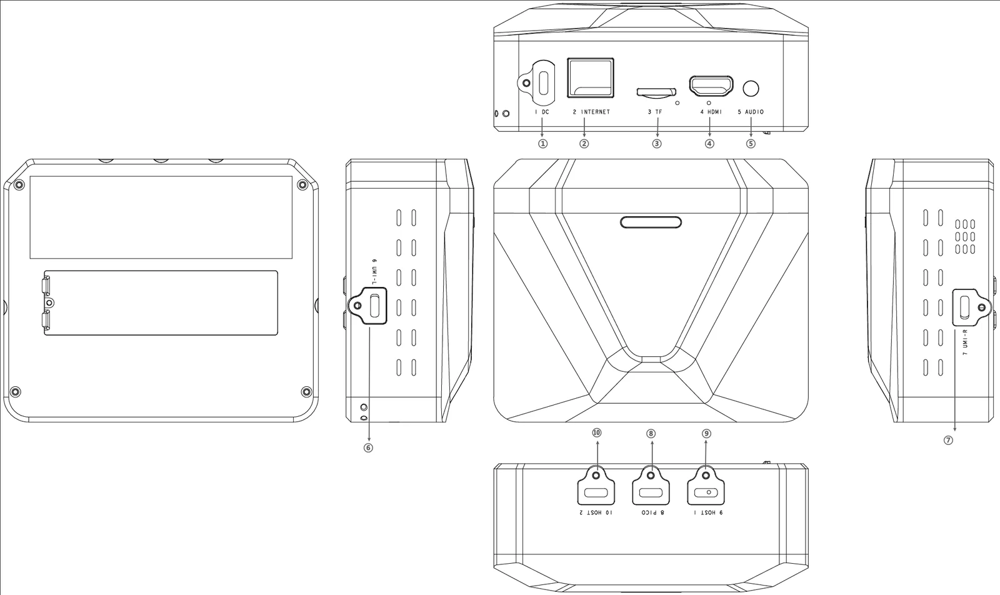
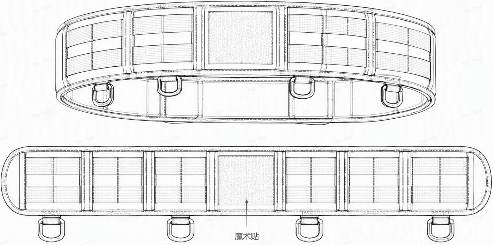
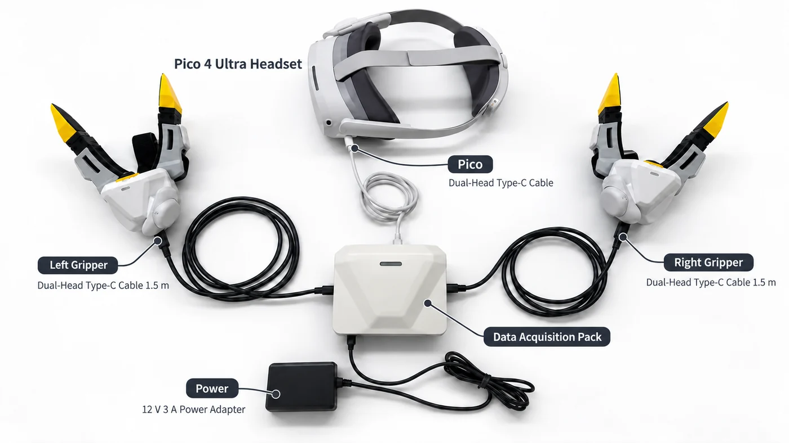
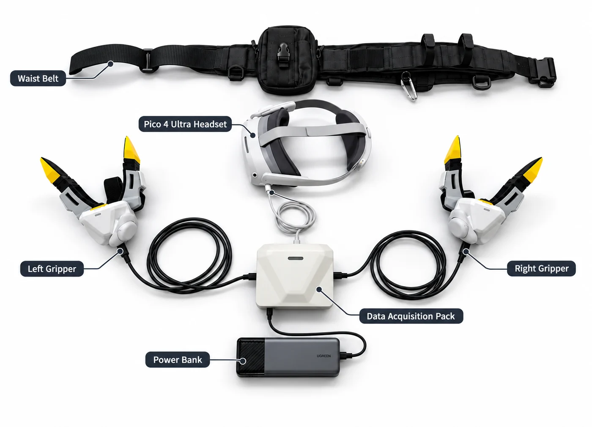

# Unboxing, cabling and power

Connect the grippers, the headset and the backpack in turn, then connect power. Once connected, the backpack is powered up and the leader grippers' LEDs are solid green; then go to [Network and console access](network.md) to open the console.

## Unboxing checks {#unbox}

The box contents and quantities are in [Product line and configuration comparison](../product/editions.md). Before cabling, check these three:

1. **Leader grippers (XTac UMI G1)**
    - One left and one right: an odd last digit of the serial number means left, an even one means right; see [Serial numbers and side identification](../common/gripper.md#sn).
    - The Type-C cables' locking connectors are undamaged, and nothing is lodged in the gripper connectors.
2. **Backpack body label**
    - It carries this device's SN, hotspot name and password, and device name, which you need to identify it and get it online, so do not peel it off; see [Identifying the unit: by its label, not by IP](network.md#label).
3. **Headset setup**
    - Done as described in [Pico4 headset and tracker setup](../common/pico4.md): developer mode on, screen timeout and sleep set to "Never", both trackers paired, XTac UMI XR installed.

## The backpack's ports {#ports}

{ width="900" }

| No. | Connector | Location | What it is for |
|---|---|---|---|
| ① | `DC IN` | Rear panel | 12V power input: the supplied 12V 3A adapter, or the power bank through its power cable |
| ② | Ethernet | Rear panel | Wired networking, DHCP from the factory, static IP settable on the System page |
| ③ | TF | Rear panel | TF card slot, not used for day-to-day collection |
| ④ | `HDMI` | Rear panel | Video out, not used for day-to-day collection |
| ⑤ | Headphone | Rear panel | 3.5mm headphone jack |
| ⑥ | `UMI-L` | Left side | Left leader gripper, Type-C locking cable, which also powers the gripper |
| ⑦ | `UMI-R` | Right side | Right leader gripper, Type-C locking cable, which also powers the gripper |
| ⑧ | `PICO` | Front panel | Pico4 Ultra Enterprise headset, Type-C. In XR choose "XTac" as the connection, then tap "Connect" |
| ⑨ ⑩ | `HOST1` / `HOST2` | Front panel | USB host ports, for a tablet or other devices |

### Waist belt {#belt}

The waist belt holds the backpack and the power bank and keeps the cables out of the operator's way.

{ width="720" }

- Before putting it on, check that the backpack, the power bank and the belt are secure.
- Leave slack in the cables so turning, bending or raising an arm does not pull on a connector.
- Do not cover the vents of the backpack or the power bank.

## Connection and disconnection order {#order}

The order is fixed: grippers → headset → power up the backpack.

1. Connect the grippers: the end of the Type-C locking cable with the screws goes into the gripper body, and you tighten the locking screws; the other end goes into the side of the backpack, the left gripper to UMI-L and the right to UMI-R. The gripper is bus-powered over this cable and needs no separate supply.
2. Connect the headset: the headset cable (Pico → Pack) goes from the headset to the backpack's PICO port.
3. Power up the backpack: the DC port takes the adapter or a power bank. After boot, a solid green gripper LED means standby; then plug the tablet into the backpack's `HOST` port to open the console, see [Recommended: the tablet over USB](network.md#tablet) (the LED patterns are in [Gripper buttons, LEDs and voice](gripper.md#buttons-leds)).

Disconnection is the reverse: stop recording first, then unplug the backpack end, and finally loosen the locking screws and unplug the gripper end. Take anti-static precautions when powering up or down and when plugging or unplugging cables.

!!! warning "Tighten the gripper end before connecting the backpack end"
    If the locking screws are not tight, the cable works loose during collection and the gripper drops out; the system log fills with `mcu ... disconnected / reconnected` and that recording is wasted.

## Choosing the power source {#power}

The grippers and headset are wired the same way; only the backpack's power source differs:

| | Adapter power | Power-bank power |
|---|---|---|
| Where | A fixed station with a socket | Mobile collection away from a socket |
| Source | 12V 3A power adapter on mains | The power bank in the box (20000mAh, 45W) |
| Cable into the backpack's DC port | The adapter's own lead | 0.3m 12V PD power cable, using the power bank's 12V output |

!!! note "The headset battery drains slowly"
    The headset needs only one cable and the backpack powers it through that cable, but not enough to cover its draw, so the battery still drains at a net of about 1–2W; when it runs out the headset shuts down and collection stops. Charge the headset fully before you start and, on long sessions, keep an eye on its battery icon (set it to always show under [power policy](../common/pico4.md#pico-system)).

### Adapter power {#adapter}

Plug the 12V 3A adapter into the backpack's `DC` port, then into the mains.

### Power-bank power {#powerbank}

Connect the power bank in the box to the backpack's `DC` port with the 0.3m 12V PD power cable.

The backpack draws about 20W and runs about 3.5–4 hours on the power bank; see [Technical specifications](../product/specs.md#backpack).

!!! warning "Do not add devices to a power bank during collection"
    Some power banks shut down an existing output port when a second device is plugged in, and the backpack loses power on the spot. Connect every cable before you start recording.

## Connecting the headset to the backpack {#pico-link}

1. **Start and connect**: the headset and the backpack connect by cable only. Put on the headset, open XTac UMI XR, choose "XTac" as the connection (selected by default on first launch; it connects to `192.168.100.1`), then tap "Connect".
2. **Status icons**: the fold button is at the top right of XR. When tracking accuracy degrades or the link to the backpack drops, both XR and the console's Live monitoring page show an icon; the interface is described in [The app's screen](../common/pico4.md#pico-toolkit-ui).
3. **Get in position**: stand at the work position facing the working direction before you open XR; where XR first starts becomes the [world-frame origin](../common/pico4.md#pico-frame). **Do not restart XR during collection.**

!!! danger "Leave the headset cable alone while recording"
    Pulling it or letting it work loose makes the device stop and fail the current recording at once; see [Headset disconnects while recording](monitor-record.md#pico-disconnect).

## Checks after powering up {#verify}

Once the console is open, check these three; if any is wrong, go back and check the cabling:

1. **Camera count**: the "Cameras" counter at the top right shows online / total, which should be 6 / 6 in "Dual gripper" mode. One missing usually means a gripper cable is not tightened or not fully seated.
2. **Gripper LEDs**: normally solid green. A rapid red flash means the gripper's own self-check found a problem; solid red means the backpack detected that the gripper dropped out.
3. **Capture mode**: the current project's [capture mode](system.md#capture-mode) matches how the system is wired ("Dual gripper", "Dual gripper + stereo headset" or "Dual gripper + headset right eye"; the System page shows it). Once the headset is connected, the pose view on the Live monitoring page should follow your hand; see [Camera and pose checks](monitor-record.md#checks).

If nothing happens at power-up or the headset keeps dropping in and out, try a different cable and port first; if that does not help, see [Troubleshooting](troubleshooting.md#power).
