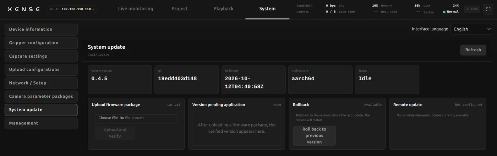

# Upgrades and OTA

This page covers upgrading the console program and the gripper firmware:

- **Console program**: import an upgrade bundle on System → System update.
- **Gripper firmware**: flash it on System → Gripper configuration; see [Gripper firmware](#gripper-firmware).

## Upgrade order {#order}

A new Collector version may require newer gripper firmware. **Flash the gripper firmware first, then import the upgrade bundle**:

1. Look up the leader gripper firmware requirement in the [version baseline](versions.md#baseline) and check both grippers' firmware in [Device information](system.md#device-info).
2. If either is below it, flash it from the current console as in [Gripper firmware](#gripper-firmware); after both are done and the backpack has been power-cycled, check again.
3. Then [import the upgrade bundle](#bundle) as below.

For example, before moving to 0.4.7 both leader grippers must be on 1.2.7 or above. Flashing after upgrading the Collector also works, but recording is refused until the firmware is updated.

## Importing an upgrade bundle {#bundle}

An upgrade bundle is a `.tar.zst` file provided by technical support, with the version in its file name, such as `taccap-collector-v0.4.3-….tar.zst`. It updates only the console program; it contains no gripper firmware or camera profiles and does not affect collected data.

1. Stop recording.
2. Click "Upload firmware package", select the `.tar.zst` file and click "Upload and verify".
3. Once verification passes, check the version number on the "Version pending application" card.
4. Click "Apply update and restart" and confirm. The service restarts in about one minute; the upgrade is complete when the page shows "Update applied". If it times out, refresh the page manually.
5. On [Device information](system.md#device-info), confirm that the version number and build time have been updated.

If verification fails, the device rejects the bundle, gives the reason under "Last error" and keeps running the current version. Common causes: a corrupt or incompletely transferred file, a version gap that is too large, or a version older than the current one.

!!! note "Some fixes must be applied by technical support"
    A few fixes involve the device's system components, are not included in upgrade bundles and cannot be applied on site. Whether a device needs such a fix is determined by technical support. "Upload firmware package" accepts only `.tar.zst` upgrade bundles; do not upload any other file.

## Rollback {#rollback}

The device keeps the previous version when upgrading. If the new version fails to start, the file is corrupt or power is lost during the upgrade, the device automatically reverts to the previous version and remains bootable.

From 0.4.7 the upgrade bundle no longer offers manual rollback and the System update page has no "Rollback" card; to go back to an older version, contact [technical support](../common/reference.md#support). On 0.4.6 and earlier, the "Rollback" card can go back one version only, and a device never upgraded since leaving the factory has nothing to roll back to.

Upgrades and rollbacks do not affect recorded data, projects, upload configurations or network settings.

## Gripper firmware {#gripper-firmware}

Gripper firmware is not updated through upgrade bundles; flash it from "Gripper firmware update" at the bottom of System → [Gripper configuration](system.md#gripper), with no computer required. The firmware files and whether an upgrade is needed are covered in the Developer Kit's [firmware OTA upgrade](../pc/versions.md#ota).

1. Stop recording and make sure no gripper opening calibration is in progress.
2. Select the target gripper (left / right), select the `.bin` file, click "Upload and flash" and confirm.
3. When the page shows "Firmware flashed, the device is restarting", **power the backpack off and on again** (or replug that gripper's Type-C cable); otherwise the gripper may lose data.
4. Check the firmware version on [Device information](system.md#device-info); if the calibration card shows "Not calibrated", recalibrate on [Gripper configuration](system.md#gripper).

You can click "Abort" during flashing; if flashing fails, simply flash again. The gripper will not be damaged.

!!! danger "Select firmware by role, and do not cut power while flashing"
    The leader gripper (SN ending in `m`) uses `tc-gu-01-master-<version>.bin` (such as `tc-gu-01-master-1.2.7.bin`) and the follower (SN ending in `s`) uses `tc-gu-01-slave-<version>.bin`; the choice depends on role, not on left or right. Flashing the wrong firmware leaves the gripper unable to start and requires a factory repair; cutting power or unplugging during writing also corrupts the firmware.
