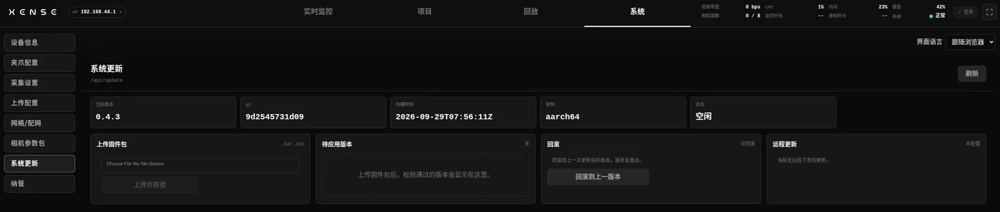

# 升级与 OTA

升级前先确认要更新的组件，三类文件不能混用：

| 更新对象 | 文件 | 操作入口 |
|---|---|---|
| Collector 应用（采集软件与控制台） | `.tar.zst` 升级包 | 系统 → 系统更新，见[导入升级包](#bundle) |
| 数采背包系统 | `.img` 系统镜像 | 联系技术支持，在指导下刷写，见[系统镜像](#system-image) |
| 夹爪固件 | `.bin` 固件 | 系统 → 夹爪配置，见[夹爪固件](#gripper-firmware) |

## 升级顺序 {#order}

新版本 Collector 可能要求更高的夹爪固件。**先刷夹爪固件，再导入升级包**：

1. 看[版本基线](versions.md#baseline)里的主夹爪固件要求，在[设备信息](system.md#device-info)核对两只夹爪的固件版本。
2. 低于要求时，在当前版本的控制台里按[夹爪固件](#gripper-firmware)刷写，两只都刷完、断电重启后再核对一次。
3. 再按下文[导入升级包](#bundle)。

例如升到 0.4.7 前，两只主夹爪须为 1.2.7 及以上；先升 Collector、后刷固件也能刷，但刷好之前开录会被拒绝。

## 导入升级包 {#bundle}

升级包为技术支持提供的 `.tar.zst` 文件，文件名含版本号，如 `taccap-collector-v0.4.3-….tar.zst`。升级包更新 Collector 应用，不用于刷写背包系统镜像，也不包含夹爪固件与相机参数包；应用升级不影响已采集的数据。

1. 停止录制。
2. 点击「上传固件包」，选择 `.tar.zst` 文件，点击「上传并校验」。
3. 校验通过后，在「待应用版本」卡核对版本号。
4. 点击「应用更新并重启」并确认。服务重启约需 1 分钟，页面提示「更新已应用」即升级完成；若等待超时，请手动刷新页面。
5. 在[设备信息](system.md#device-info)确认版本号与构建时间已更新。

校验未通过时，设备拒绝该升级包并在「上次错误」中给出原因，当前版本继续运行。常见原因包括：文件损坏或传输不完整、版本跨度过大、版本低于当前版本。

## 背包系统镜像 {#system-image}

本次发布配套的背包系统版本为 **V1.2.3**，系统镜像内置 **Collector 0.4.7**。镜像适用于 XENSE-3588Q 采集单元的整机刷写，包含启动与系统分区；需要更新这类系统组件时，仅导入 Collector 升级包不能替代系统镜像刷写。

系统镜像是 `.img` 文件，请向技术支持获取适用于该设备的镜像与刷写指导。控制台「上传固件包」仅接受 `.tar.zst`，**不要在该入口上传 `.img`**。Collector 版本与背包系统版本分别管理，不能仅凭「采集端版本」判断系统是否已更新。

刷写前，先将需要保留的录制及导出数据下载或上传到设备以外的位置，确认副本可用，再与技术支持确认配置备份和恢复安排。系统镜像刷写不适用下文应用升级的数据保留与自动回退说明。

## 回滚 {#rollback}

Collector 应用升级会保留上一版本，并提供新版本启动失败时自动回退的保护。此机制只针对应用更新，不用于恢复背包系统镜像；升级后持续无法连接时，按[升级故障排查](troubleshooting.md#update)处理。

0.4.7 起升级包不再提供手动回滚，系统更新页不显示「回滚」卡；需要退回旧版本时联系[技术支持](../common/reference.md#support)。0.4.6 及更早版本的「回滚」卡只能回退一个版本，出厂后未升级过的设备没有可回退的版本。

Collector 应用升级与应用回滚均不影响录制数据、项目、上传配置和网络配置。

## 夹爪固件 {#gripper-firmware}

夹爪固件不通过升级包更新，而是在 系统 → [夹爪配置](system.md#gripper) 页下方的「夹爪固件升级」中刷写，无需电脑。固件文件及是否需要升级，见 PC 版[固件 OTA 升级](../pc/versions.md#ota)。

1. 停止录制，并确认没有进行中的开合标定。
2. 选择目标夹爪（左 / 右），选择 `.bin` 文件，点击「上传并刷写」并确认。
3. 页面提示「固件已刷写完成，设备正在重启」后，**将背包断电再上电**（或重插该夹爪 Type-C 线），否则夹爪可能丢失数据。
4. 在[设备信息](system.md#device-info)核对固件版本；如标定卡显示「未标定」，请在[夹爪配置](system.md#gripper)重新标定。

刷写过程中可点击「中止」；刷写失败后可重新刷写，不会损坏夹爪。

!!! danger "按主从角色选择固件，刷写过程中不要断电"
    主夹爪（SN 末位为 `m`）使用 `tc-gu-01-master-<版本>.bin`（如 `tc-gu-01-master-1.2.7.bin`），从夹爪（SN 末位为 `s`）使用 `tc-gu-01-slave-<版本>.bin`，按主从角色区分，与左右无关。固件选错将导致夹爪无法启动，需返厂恢复；写入过程中断电或拔线也会损坏固件。
