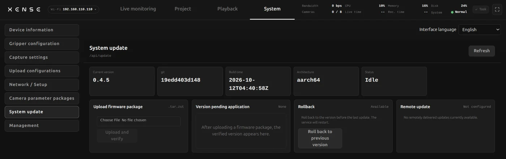

# Versions and upgrades

Go by the version numbers you read on the device: the collection unit and the gripper firmware are on the console's System → [Device information](system.md#device-info), the headset is in the Pico settings, and the tablet is in its system settings.

## Version baseline {#baseline}

The following baseline applies to XTac UMI Collector 0.5.0. Check it after upgrading any component.

| Component | Version and compatibility | Where to check or update |
|---|---|---|
| Tablet OS (REDMI Pad 2 SE) | 3.0.303 or later recommended | Tablet Settings → My device |
| Backpack system firmware | RK3588 V1.2.3 | Factory-installed. See [System image](#system-image) |
| XTac UMI Collector (collection unit) | 0.5.0 | Console System → [Device information](system.md#device-info). See [Importing an upgrade bundle](#bundle) |
| Pico OS | 5.15.5.U or later recommended | Headset Settings → General → About. See [Pico4 headset and tracker setup](../common/pico4.md#pico-system) |
| XTac UMI XR (headset app) | Latest release: 0.4.4. New headset features require a compatible newer app. The minimum version is pending confirmation | Headset app library. See [Installing XTac UMI XR](../common/pico4.md#pico-app) |
| Leader gripper firmware | Minimum 1.2.7, latest 1.3.1 | Console System → [Device information](system.md#device-info). See [Gripper firmware](#gripper-firmware) |
| Follower gripper firmware | Minimum 1.2.17, latest 1.3.1 | See [Follower firmware](../follower/firmware.md#check-version) |

Recording is blocked when a gripper is below the minimum for its role. 1920×1080 wrist capture requires gripper firmware **1.3.1** and fisheye calibration at that resolution. Collector and backpack system versions are managed separately. For the Developer Kit, see [its own requirements](../pc/versions.md#required).

## Upgrades {#upgrade}

These three file types are not interchangeable:

| Component | File | Where to update |
|---|---|---|
| Collector application (collection software and console) | `.tar.zst` upgrade bundle | System → System update; see [Importing an upgrade bundle](#bundle) |
| Backpack system | `.img` system image | Contact technical support for guided flashing; see [System image](#system-image) |
| Gripper firmware | `.bin` firmware | System → Gripper configuration; see [Gripper firmware](#gripper-firmware) |

### Upgrade order {#order}

1. Stop recording, then upload or export all recordings and verify the copies as described under [Importing an upgrade bundle](#bundle).
2. Check the gripper firmware against the [version baseline](#baseline). If it is below the project's requirement, [upgrade it](#gripper-firmware), power-cycle the gripper, and check its version again. Verify 1920×1080 calibration before using 1080p wrist capture.
3. [Import the Collector 0.5.0 OTA bundle](#bundle). Managed mode requires a coordinated Core upgrade. Confirm the matching Core version with technical support first. If your downstream system calls the device API directly, review the [API changes](#api-compatibility) before upgrading.

The legacy `v2` format name from older clients maps to XHE.

### Importing an upgrade bundle {#bundle}

!!! danger "Upload or export all recordings before upgrading"
    Store the data outside the device and verify that every recording is covered and the copies can be read. After a successful upgrade to 0.5.0, downgrading to 0.4.7 is unsupported. Older versions cannot read the data or caches generated by the new version. The first export after upgrading rebuilds the old export cache.

Obtain the aarch64 OTA bundle `taccap-collector-v0.5.0-447ec0631096-aarch64.tar.zst` (21.9 MB) from [technical support](../common/reference.md#support).

This OTA updates only the Collector application. The RK3588 system remains on V1.2.3 and needs no system image flash. Existing projects keep their settings. New projects default to XHE. To keep using Training MCAP or LeRobot, select V1 when [creating the project](monitor-record.md#project-task).

1. Stop recording and complete the backup.
2. In the console, open System → System update. Click "Upload firmware package", choose the `.tar.zst` file, then click "Upload and verify".
3. After verification, confirm that the "Version pending application" card shows 0.5.0.
4. Click "Apply update and restart" and confirm. Wait for the service to restart. "Update applied" indicates completion. If it times out, refresh the page.
5. Confirm the version and build time in [Device information](system.md#device-info). Use a short sample to verify recording, playback, and the required export workflow.

If verification fails, the device rejects the bundle, gives the reason under "Last error", and keeps running the current version. Check file integrity, the version, and the upgrade path.

### Rollback {#rollback}

- If the Collector OTA installation fails, the application automatically rolls back to the version that was running before the upgrade. Automatic rollback applies only to application OTA. If the console remains unavailable, see [Upgrade troubleshooting](troubleshooting.md#update).
- A successful Collector 0.5.0 upgrade cannot be manually downgraded to 0.4.7. Manual rollback was removed in 0.4.7. In 0.4.6 and earlier it could return to one previous version, and factory units that had never been updated had no earlier version.

### Backpack system image {#system-image}

The backpack system remains on **V1.2.3**. The V1.2.3 image distributed with Collector 0.4.7 is for full-device flashing of the XENSE-3588Q, including its boot and system partitions. To upgrade to Collector 0.5.0, use the [application OTA](#bundle).

- The image is an `.img` file; get it from technical support and flash it under their guidance. The console's "Upload firmware package" accepts only `.tar.zst`; **do not upload an `.img` there**.
- Before flashing, download or upload the recordings and exported data you need to a location outside the device, verify those copies, and confirm configuration backup and recovery arrangements with technical support; the data retention and automatic fallback of application upgrades do not apply to system image flashing.

### Gripper firmware {#gripper-firmware}

Flash it from "Gripper firmware update" at the bottom of System → [Gripper configuration](system.md#gripper), with no computer required. The firmware files and whether an upgrade is needed are covered in the Developer Kit's [firmware OTA upgrade](../pc/versions.md#ota).

1. Stop recording and make sure no gripper opening calibration is in progress.
2. Select the target gripper (left / right), select the `.bin` file, click "Upload and flash" and confirm.
3. When the page shows "Firmware flashed, the device is restarting", wait for the gripper to restart, then **unplug and reconnect the leader gripper's USB cable**; otherwise the gripper may lose data.
4. Check the firmware version on [Device information](system.md#device-info); if the calibration card shows "Not calibrated", recalibrate on [Gripper configuration](system.md#gripper).

For follower grippers, follow the [separate upgrade procedure](../follower/firmware.md#mcu-ota). After flashing, unplug and reconnect the 24V power cable. The USB cable can remain connected. Before capturing in 1080p, verify the 1920×1080 fisheye calibration.

You can click "Abort" during flashing; if flashing fails, simply flash again. The gripper will not be damaged.

!!! danger "Select firmware by role, and do not cut power while flashing"
    The leader gripper (SN ending in `m`) uses `tc-gu-01-master-<version>.bin` (such as `tc-gu-01-master-1.3.1.bin`) and the follower (SN ending in `s`) uses `tc-gu-01-slave-<version>.bin`; the choice depends on role, not on left or right. Flashing the wrong firmware leaves the gripper unable to start and requires a factory repair; cutting power or unplugging during writing also corrupts the firmware.

## Version highlights {#history}

Only recent versions are listed here; for earlier versions, the device shows each version's changes the first time you enter the console after upgrading.

### 0.5.0 (2026-11-25) {#v050}

!!! danger "Review before upgrading"
    1. **Breaking update**. After upgrading, **you cannot roll back to 0.4.7**. Earlier versions cannot read data or caches generated by 0.5.0. The first export after upgrading rebuilds the previous export cache.
    2. **API and managed-mode integrations**. This release makes breaking changes to the device HTTP API. It removes `GET /api/episodes/{id}/export/training-mcap` and adds `/api/auto-upload`. New project configuration fields include recording format, streaming encoding, wrist camera specifications, and the default video codec. Update any scripts and tools that call the device API directly. For managed mode, upgrade Core on the management side at the same time.

    Before upgrading, upload or export all recordings off the device and verify that the copies are readable. See [Importing an upgrade bundle](#bundle).

**Firmware requirements for recording**. Leader grippers require firmware **1.2.7 or later**, and follower grippers require **1.2.17 or later**. A gripper below the minimum for its role prevents recording from starting. See the [version baseline](#baseline).

- **Recording and playback**. New projects default to XHE, dual grippers with stereo headset fisheye, and High export quality. XHE writes H.264 video into `.xhe.mcap` during recording. Once finalized, recordings can be played on the Project page. You can also download or upload the original XHE files in batches by task. Existing projects keep their settings. See [playback and export](projects-export.md#playback).
- **Training data delivery**. Choose V1 when creating a project that needs LeRobot or Training MCAP. V1 exports offer H.265 and MJPEG. Streaming encoding is off by default and can be enabled in advanced settings. LeRobot batch exports run more efficiently and use fewer resources, and export compatibility with NFSv4.1 has improved. Training MCAP retains original image frame numbers and improves data organization and storage. See [export formats](projects-export.md#formats).
- **Automatic upload and networking**. Once automatic upload is configured and Ethernet is connected, the device uploads while idle and retries failures. S3 uploads can resume after an interruption, and multiple recordings can be exported and uploaded concurrently. Wi-Fi reconnects automatically. The hotspot starts enabled during initial setup, with improved channel management. See [upload configuration](system.md#upload).
- **Camera options**. New projects can use 640×480 or 1920×1080 wrist video. Capture at 1080p requires gripper firmware 1.3.1 and matching fisheye calibration. The device checks camera settings and restores presets when a wrist camera connects. The capture mode sets the headset resolution for new projects. These headset features require a compatible newer app. See [project capture settings](monitor-record.md#project-task).
- **Capture checks**. Live monitoring distinguishes the left and right grippers. For projects that record headset video, the device blocks recording when the headset capture rate is below **28 fps**. After recording, XHE passes the skipped-frame check only if each camera skipped **2% or less** of the frames it captured. If any camera exceeds the limit, the device reports the camera and its frame counts. The device blocks new recordings when the recording disk reaches 70% usage to reserve space for export. See [recording prerequisites](monitor-record.md#record-gates) and [finalization checks](monitor-record.md#record-stop).
- **Recorded data**. Exports can include end-effector velocities for both grippers, and a compatible newer headset app enables recording the headset PUI version. This release improves left end-effector pose conversion and tactile image color correction.

### 0.4.7 (2026-11-05) {#v047}

Changes since 0.4.6:

1. **Upgrade the gripper firmware to 1.2.7 first**: 0.4.7 requires leader gripper firmware ≥ 1.2.7 and refuses to record below it. The upgrade bundle contains no gripper firmware, so **flash the firmware while still on 0.4.6, then import the 0.4.7 bundle**; see [Upgrade order](https://xenserobotics-ai.github.io/XTac-UMI-G1-Docs/v0.4.7/en/backpack/update/#order).
2. **A USB device dropping out stops the recording**: if a gripper, or a wrist fisheye or tactile camera used by the episode, disconnects, recording stops and is marked failed; start a new recording once the device is back. See [USB device disconnects while recording](https://xenserobotics-ai.github.io/XTac-UMI-G1-Docs/v0.4.7/en/backpack/monitor-record/#usb-disconnect).
3. **Low camera frame rate warning**: the recording card shows "Low FPS" live; on stopping, an episode where any camera ran low for more than 5% of its duration is marked "data suspect". See [After stopping](https://xenserobotics-ai.github.io/XTac-UMI-G1-Docs/v0.4.7/en/backpack/monitor-record/#record-stop).
4. **Voice prompts**: choose where they play (Pico / backpack); four new prompts: "Grippers swapped left and right", "Left gripper disconnected", "Right gripper disconnected" and "Gripper start position outside the valid range". See [Voice prompts](https://xenserobotics-ai.github.io/XTac-UMI-G1-Docs/v0.4.7/en/backpack/gripper/#voice-cues).
5. **Starting position**: the pose view can show the range the hands must be in (the start box); out-of-range messages say which hand is off, in which direction and by how many centimetres. See [Starting pose check](https://xenserobotics-ai.github.io/XTac-UMI-G1-Docs/v0.4.7/en/backpack/monitor-record/#initial-pose).
6. **Tracker battery**: the pose view shows the left and right tracker battery levels.
7. **Leftover data cleanup**: System → Device information can scan for and clean up leftover files on the device; see [Device information](https://xenserobotics-ai.github.io/XTac-UMI-G1-Docs/v0.4.7/en/backpack/system/#device-info).
8. **Projects and tasks**: search by project or task name with highlighted matches; a project, or a task within a project, can no longer be created with a duplicate name. With the live preview off, camera cards show the frame rate as a large number.
9. **Export time alignment**: training data exports pick each camera's nearest frame independently and interpolate pose and gripper opening at the frame time. **After upgrading, existing exports show as needing re-export**; the raw recording format is unchanged.
10. **Manual rollback removed**: the upgrade bundle no longer offers "Roll back to previous version"; automatic fallback to the previous version when an upgrade fails is kept. See [Rollback](https://xenserobotics-ai.github.io/XTac-UMI-G1-Docs/v0.4.7/en/backpack/update/#rollback).
11. **Matching headset app**: XTac UMI XR moves to 0.3.9 (tracker battery is reported by the headset app).
12. **Raw MCAP download**: engineering mode provides a per-recording download of the raw MCAP retained on the device for technical support and data analysis, on both desktop and mobile. See [Downloading raw recordings](https://xenserobotics-ai.github.io/XTac-UMI-G1-Docs/v0.4.7/en/backpack/projects-export/#raw-mcap).

### 0.4.6 (2026-10-27) {#v046}

Changes since 0.4.3:

1. **Starting-pose check**: in modes that record headset video, the device checks before every recording that both hands are in the starting range in front of and below the body, and refuses to record otherwise; the range follows the project's headset mount, see [Starting-pose check](https://xenserobotics-ai.github.io/XTac-UMI-G1-Docs/v0.4.7/en/backpack/monitor-record/#initial-pose).
2. **Coordinate reset before every recording**: before each recording the device has the headset reset its world frame, and checks that the left and right trackers are not swapped.
3. **Two new project settings**: "Headset mount" (On head / Around neck, only for modes that record headset video) and "Export quality" (High quality / Standard / Compact), both fixed after creation, see [Picking a project and task](https://xenserobotics-ai.github.io/XTac-UMI-G1-Docs/v0.4.7/en/backpack/monitor-record/#project-task).
4. **Exported poses are relative to the headset at the start of each episode**: the headset position at frame 0 of each recording is the origin and its heading is the X axis, with Z still up, see [Coordinate frames · Origin of exported data](https://xenserobotics-ai.github.io/XTac-UMI-G1-Docs/v0.4.7/en/common/coordinates/#episode-origin). Poses are now interpolated to each frame time and camera frame times are more accurate; the left-hand TCP uses the mirrored convention (`tcp_frame_convention = mirrored-v1`).
5. **Re-export after upgrading**: pose values change throughout, so datasets exported or uploaded before the upgrade show as needing re-export; do not mix old and new exports in one dataset. Raw recordings are unaffected.
6. **Export and upload**: download, upload, archive and delete all require ticking recordings first; before an upload starts, the device lists the files and waits for you to confirm; uploads show the speed and the estimated time left for the current group; Tencent Cloud COS is a new upload backend. Deleting a recording also cleans up its exported artifacts.
7. **Diagnostics package**: System → Device info downloads an encrypted diagnostics package (application logs, kernel log and version information) in one click; hand it to technical support with a fault report.
8. **Other**: the interface language selector moved to the System sidebar; the pose view shows a trail of about 1.5 seconds behind each end effector.
9. **Matching headset app**: XTac UMI XR moves to 0.3.6, which the coordinate reset before recording relies on; headset video streams at a steadier cadence.

### 0.4.3 (2026-09-29) {#v043}

1. The console supports Chinese and English. It uses the browser language by default, and you can change it on the System page. Voice prompts follow the console language by default and can be set separately.
2. Stopping a recording flushes its data to disk. When recording fails due to a power loss or restart, the console records the cause.
3. The console displays the failure reason on both desktop and phone.
4. Quality statistics have four states: "No issues detected", "Collecting statistics", "Incomplete statistics", and "No statistics". Missing values are no longer counted as zero.
5. Project and task storage totals exclude archived recordings and show their size separately.
6. The top bar shows measured disk usage as a percentage. Hover over the reading to see used, total, and available space.

### 0.4.2 (2026-09-28) {#v042}

1. Recording stops and is marked as failed if the headset disconnects or its pose or image stream stops updating for about 3 seconds. The partial data is kept for troubleshooting. It does not count as a successful recording and is excluded from export and upload. Start a new recording after the headset recovers.
2. Voice prompts are available in Chinese and English and distinguish a tracker dropout from a headset dropout.
3. Live monitoring shows "Pico not ready" and "Tracker not ready" separately and provides the reason.
4. Playback removes the difference overlay from tactile images. Existing recordings and exports are unaffected.
5. Pages respond faster when a task contains many recordings.
6. MCAP and LeRobot data formats are unchanged.

### 0.4.1 (2026-09-22) {#v041}

1. Selecting a project or reconnecting the headset syncs the headset's mono or stereo mode, resolution, and image source. The console checks the settings again before starting a recording and waits for confirmation.
2. New projects can use either raw fisheye images or undistorted images from the headset.

See [Upgrades and OTA](https://xenserobotics-ai.github.io/XTac-UMI-G1-Docs/v0.4.7/en/backpack/update/) for upgrade and rollback instructions. If an upgrade fails, contact [support](https://xenserobotics-ai.github.io/XTac-UMI-G1-Docs/v0.4.7/en/common/reference/#support).
