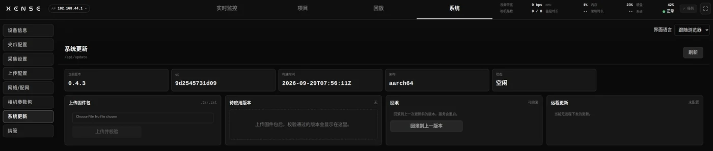

# 版本与升级

版本号以设备上读到的为准：采集单元与夹爪固件看控制台 系统 → [设备信息](system.md#device-info)，头显在 Pico 设置里看，平板在系统设置里看。

## 版本基线 {#baseline}

按 XTac UMI Collector 0.5.0 配套。升级任一组件后回到这张表核对。

| 组件 | 版本与兼容要求 | 在哪看 / 怎么升 |
|---|---|---|
| 平板 OS（REDMI Pad 2 SE） | 建议 3.0.303 及以上 | 平板 设置 → 我的设备；随系统更新 |
| 数采背包 OS 固件 | RK3588 V1.2.3 | 出厂预装，见[系统镜像](#system-image) |
| XTac UMI Collector（采集单元） | 0.5.0 | 控制台 系统 → [设备信息](system.md#device-info)；升级见[导入升级包](#bundle) |
| Pico OS | 建议 5.15.5.U 及以上 | 头显 设置 → 通用 → 关于；见 [Pico4 头显与追踪器](../common/pico4.md#pico-system) |
| XTac UMI XR（头显应用） | 最新发布版 0.4.4。新增头显功能需要配套新版应用，具体最低版本待确认 | 头显应用库；见[安装 XTac UMI XR](../common/pico4.md#pico-app) |
| 主夹爪固件 | 最低 1.2.7，最新 1.3.1 | 控制台 系统 → [设备信息](system.md#device-info)；见[夹爪固件](#gripper-firmware) |
| 从夹爪固件 | 最低 1.2.17，最新 1.3.1 | 见[从夹爪固件](../follower/firmware.md#check-version) |

固件低于对应角色的最低版本时无法开始录制。1920×1080 腕部采集需要夹爪固件 **1.3.1** 和对应分辨率的鱼眼标定。Collector 和背包系统版本分别管理。PC 版请参阅[配套要求](../pc/versions.md#required)。

## 升级 {#upgrade}

三类文件不能混用：

| 更新对象 | 文件 | 操作入口 |
|---|---|---|
| Collector 应用（采集软件与控制台） | `.tar.zst` 升级包 | 系统 → 系统更新，见[导入升级包](#bundle) |
| 数采背包系统 | `.img` 系统镜像 | 联系技术支持，在指导下刷写，见[系统镜像](#system-image) |
| 夹爪固件 | `.bin` 固件 | 系统 → 夹爪配置，见[夹爪固件](#gripper-firmware) |

### 升级顺序 {#order}

1. 停止录制，按[导入升级包](#bundle)中的要求上传或导出所有录制数据并检查副本。
2. 对照[版本基线](#baseline)核对夹爪固件。如果低于项目要求，先按[夹爪固件](#gripper-firmware)升级，断电重启后复查版本。采用 1080p 腕部采集前，核对 1920×1080 标定。
3. [导入 Collector 0.5.0 OTA 包](#bundle)。纳管模式需要同步升级 Core，请先向技术支持确认配套版本。直接调用设备 API 的下游应在升级前检查[接口变更](#api-compatibility)。

旧客户端传入的 `v2` 格式名称映射为 XHE。

### 导入升级包 {#bundle}

!!! danger "升级前务必上传或导出全部录制数据"
    请将数据保存到设备外，确认副本可读取且覆盖所有录制。成功升级至 0.5.0 后，不支持降级至 0.4.7。旧版本无法读取新版生成的数据与缓存。升级后首次导出时会重新生成旧导出缓存。

向[技术支持](../common/reference.md#support)获取 aarch64 OTA 包 `taccap-collector-v0.5.0-447ec0631096-aarch64.tar.zst`（21.9 MB）。

此 OTA 仅更新 Collector 应用，RK3588 系统保持 V1.2.3，无需刷写整机镜像。现有项目保留原设置。新项目默认采用 XHE，需继续使用 Training MCAP 或 LeRobot 时，请在[新建项目](monitor-record.md#project-task)时选择 V1。

1. 停止录制并完成备份。
2. 在控制台 系统 → 系统更新，点击「上传固件包」，选择 `.tar.zst` 文件并点击「上传并校验」。
3. 校验通过后，在「待应用版本」卡核对版本为 0.5.0。
4. 点击「应用更新并重启」并确认。等待服务重启，页面提示「更新已应用」即升级完成。若等待超时，请刷新页面。
5. 在[设备信息](system.md#device-info)确认版本和构建时间，并通过短样本检查录制、回放及所需的导出流程。

校验未通过时，设备拒绝该包，在「上次错误」中说明原因，并继续运行当前版本。请检查文件完整性、版本及升级路径。

### 回滚 {#rollback}

- Collector OTA 安装失败时，应用会自动回滚到升级前可运行的版本。自动回滚只适用于应用 OTA。持续无法访问时见[升级故障排查](troubleshooting.md#update)。
- Collector 0.5.0 成功升级后，不支持主动降级至 0.4.7。0.4.7 起无手动回滚入口。0.4.6 及更早版本的历史入口只能回退一个版本，未升级过的出厂设备没有上一版本。

### 背包系统镜像 {#system-image}

背包系统保持 **V1.2.3**。随 Collector 0.4.7 交付的 V1.2.3 镜像用于 XENSE-3588Q 的整机刷写（含启动与系统分区）。升级 Collector 0.5.0 时使用[应用 OTA](#bundle)。

- 镜像是 `.img` 文件，向技术支持获取并在指导下刷写；控制台「上传固件包」仅接受 `.tar.zst`，**不要在该入口上传 `.img`**。
- 刷写前把要保留的录制与导出数据下载或上传到设备以外，确认副本可用，并与技术支持确认配置备份与恢复安排；应用升级的数据保留与自动回退不适用于系统镜像刷写。

### 夹爪固件 {#gripper-firmware}

在 系统 → [夹爪配置](system.md#gripper) 页下方的「夹爪固件升级」中刷写，无需电脑。固件文件及是否需要升级见 PC 版[固件 OTA 升级](../pc/versions.md#ota)。

1. 停止录制，并确认没有进行中的开合标定。
2. 选择目标夹爪（左 / 右），选择 `.bin` 文件，点击「上传并刷写」并确认。
3. 页面提示「固件已刷写完成，设备正在重启」后，待夹爪重启后，**重新拔插主夹爪 USB 线**，否则夹爪可能丢失数据。
4. 在[设备信息](system.md#device-info)核对固件版本；如标定卡显示「未标定」，请在[夹爪配置](system.md#gripper)重新标定。

从夹爪按[独立升级流程](../follower/firmware.md#mcu-ota)操作，刷写后重新拔插 24V 电源线，无需拔插 USB。使用 1080p 前请核对 1920×1080 鱼眼标定。

刷写过程中可点击「中止」；刷写失败后可重新刷写，不会损坏夹爪。

!!! danger "按主从角色选择固件，刷写过程中不要断电"
    主夹爪（SN 末位为 `m`）使用 `tc-gu-01-master-<版本>.bin`（如 `tc-gu-01-master-1.3.1.bin`），从夹爪（SN 末位为 `s`）使用 `tc-gu-01-slave-<版本>.bin`，按主从角色区分，与左右无关。固件选错将导致夹爪无法启动，需返厂恢复；写入过程中断电或拔线也会损坏固件。

## 各版本要点 {#history}

这里只列近期版本；更早版本的更新内容，升级后首次进入控制台时会在设备上展示。

### 0.5.0（2026-11-25） {#v050}

!!! danger "升级前请确认"
    1. **破坏性更新**：升级后 **无法回退到 0.4.7**。新版生成的数据和缓存，旧版无法读取。升级前的导出缓存会在首次导出时重新生成。
    2. **API / 纳管对接团队**：本版本对设备 HTTP API 做了破坏性改动，删除了 `GET /api/episodes/{id}/export/training-mcap`，新增 `/api/auto-upload`，项目配置新增录制格式、流式编码、腕部相机规格、默认视频编码等字段。直接调用设备接口的脚本和工具请同步调整。纳管模式下，管理端需同步升级 Core。

    升级前请将全部录制上传或导出到设备外，并确认副本可读。见[导入升级包](#bundle)。

**开录固件要求**：主夹爪固件须为 **1.2.7 或更高版本**，从夹爪须为 **1.2.17 或更高版本**。低于对应要求时，设备会阻止开始录制。见[版本基线](#baseline)。

- **录制和回放**：新项目默认使用 XHE、双夹爪与头显双目鱼眼，导出质量默认为 High。XHE 在录制时将 H.264 视频写入 `.xhe.mcap`。录制封存后，可从「项目」页直接回放，也可按任务批量下载或上传原始 XHE 文件。已有项目沿用原设置。见[回放和导出](projects-export.md#playback)。
- **训练数据交付**：需要 LeRobot 或 Training MCAP 时，新建项目请选择 V1。V1 导出可选 H.265 或 MJPEG，默认关闭的流式编码可在高级设置中开启。LeRobot 批量导出的效率更高、资源占用更低，导出也改善了对 NFSv4.1 的兼容性。Training MCAP 保留原始图像帧号，并优化了数据组织和存储。见[导出格式](projects-export.md#formats)。
- **自动上传和网络**：配置自动上传并连接网线后，设备可在空闲时上传，失败会自动重试。S3 支持断点续传，多条录制可边导出边上传。Wi-Fi 断开后会自动重连，设备首次配网时默认开启热点，并改进了热点信道管理。见[上传配置](system.md#upload)。
- **相机选择**：新项目可使用 640×480 或 1920×1080 的腕部画面。1080p 需要夹爪固件 1.3.1 和对应鱼眼标定。连接腕部相机时会检查参数并恢复预设。头显分辨率按新项目的采集模式设置，相关功能需配套新版头显应用。见[项目采集配置](monitor-record.md#project-task)。
- **采集检查**：实时监控区分左右夹爪。录制头显画面的项目在开录前检查头显采集帧率，低于 **28 fps** 时拒绝开录。XHE 停录后逐路检查相机，每路跳帧率均不超过 **2%** 时才通过此项封存检查。任一路超限时，设备会提示对应相机及帧数。录制盘占用达到 70% 时，设备会阻止开始新录制，为导出预留空间。见[开录条件](monitor-record.md#record-gates)与[停录后的封存检查](monitor-record.md#record-stop)。
- **数据内容**：支持导出双爪末端速度，并通过配套新版头显应用记录头显 PUI 版本。优化了左手末端位姿换算和触觉画面的色彩校正。

### 0.4.7（2026-11-05） {#v047}

相对 0.4.6 的变化：

1. **夹爪固件须先升到 1.2.7**：0.4.7 要求主夹爪固件 ≥ 1.2.7，低于此版本拒绝开录。升级包不含夹爪固件，**先在 0.4.6 上刷好固件，再导入 0.4.7 升级包**，见[升级顺序](https://xenserobotics-ai.github.io/XTac-UMI-G1-Docs/v0.4.7/backpack/update/#order)。
2. **录制中 USB 设备断连即停录**：夹爪，或本条用到的腕部鱼眼、视触觉相机掉线时，自动停止并判为失败，设备恢复后需重新开录，见[录制中 USB 设备断连](https://xenserobotics-ai.github.io/XTac-UMI-G1-Docs/v0.4.7/backpack/monitor-record/#usb-disconnect)。
3. **相机帧率偏低提示**：录制卡实时提示「帧率偏低」；停录时某路偏低时长超过本条的 5%，标为「数据可疑」，见[停止后](https://xenserobotics-ai.github.io/XTac-UMI-G1-Docs/v0.4.7/backpack/monitor-record/#record-stop)。
4. **语音播报**：可选播报位置（Pico / 背包）；新增「夹爪左右放反」「左夹爪断开连接」「右夹爪断开连接」「夹爪开录位置超出有效范围」四句，见[语音播报](https://xenserobotics-ai.github.io/XTac-UMI-G1-Docs/v0.4.7/backpack/gripper/#voice-cues)。
5. **开录初始位置**：位姿视图可显示双手应在的范围（开录包围盒）；越界提示写明哪只手往哪个方向超出多少厘米，见[开录初始位姿检查](https://xenserobotics-ai.github.io/XTac-UMI-G1-Docs/v0.4.7/backpack/monitor-record/#initial-pose)。
6. **Tracker 电量**：位姿视图显示左右 Tracker 电量。
7. **清理残留数据**：系统 → 设备信息可扫描并勾选清理设备上的残留文件，见[设备信息](https://xenserobotics-ai.github.io/XTac-UMI-G1-Docs/v0.4.7/backpack/system/#device-info)。
8. **项目与任务**：按项目、任务名称搜索并高亮；不能新建重名的项目，或同一项目下重名的任务。关闭实时预览后，相机卡片中央以大号数字显示帧率。
9. **导出时间对齐**：训练数据导出时各路相机分别取最近帧，位姿与开合度按帧时刻插值。**升级后已有导出会显示需要重新导出**；原始录制格式不变。
10. **不再提供手动回滚**：升级包默认不带「回滚到上一版本」入口；升级失败时自动回退上一版本的保护保留，见[回滚](https://xenserobotics-ai.github.io/XTac-UMI-G1-Docs/v0.4.7/backpack/update/#rollback)。
11. **配套头显应用**：XTac UMI XR 升到 0.3.9（Tracker 电量由头显应用上报）。
12. **原始 MCAP 下载**：工程模式下可按单条录制下载保留在设备上的原始 MCAP，用于技术支持与数据分析；电脑、手机端均有入口，见[下载原始录制](https://xenserobotics-ai.github.io/XTac-UMI-G1-Docs/v0.4.7/backpack/projects-export/#raw-mcap)。

### 0.4.6（2026-10-27） {#v046}

相对 0.4.3 的变化：

1. **开录初始位姿检查**：录头显画面的模式，开录前检查双手是否在身体前下方的初始范围内，不在就拒绝开录；范围按项目的头显佩戴方式选用，见[开录初始位姿检查](https://xenserobotics-ai.github.io/XTac-UMI-G1-Docs/v0.4.7/backpack/monitor-record/#initial-pose)。
2. **开录前自动重置坐标系**：每次开录前，设备先让头显重置世界坐标系，并核对左右 tracker 没有拿反。
3. **新建项目新增两项**：「头显佩戴方式」（戴头 / 挂脖，仅录头显画面的模式）与「导出质量」（高质量 / 标准 / 紧凑），都是建完固定，见[选项目与任务](https://xenserobotics-ai.github.io/XTac-UMI-G1-Docs/v0.4.7/backpack/monitor-record/#project-task)。
4. **导出数据的位姿以每条开录时的头显为原点**：每条录制的第 0 帧头显位置为原点、朝向为 X 轴，Z 轴仍朝上，见[坐标系 · 导出数据的原点](https://xenserobotics-ai.github.io/XTac-UMI-G1-Docs/v0.4.7/common/coordinates/#episode-origin)。位姿改为插值对齐，相机帧时刻更准；左手 TCP 改用镜像约定（`tcp_frame_convention = mirrored-v1`）。
5. **升级后需要重新导出**：位姿数值整体变化，升级前已导出或已上传的数据集会显示需重新导出；新旧导出不要混在同一个数据集里。原始录制不受影响。
6. **导出与上传**：下载、上传、归档、删除都要先勾选录制；上传前列出本次文件清单，确认后才开始；上传时显示速度和当前组预计剩余时间；新增腾讯云 COS 上传后端。删除录制时一并清理它的导出产物。
7. **诊断包**：系统 → 设备信息可一键下载加密诊断包（运行日志、内核日志与版本信息），报修时交给技术支持。
8. **其他**：界面语言切换移到系统页侧栏；位姿视图加了约 1.5 秒的末端轨迹拖尾。
9. **配套头显应用**：XTac UMI XR 升到 0.3.6，开录前的坐标系重置需要它支持；头显画面推流节奏更稳。

### 0.4.3（2026-09-29） {#v043}

1. 控制台支持中英文界面，默认跟随浏览器语言，可在系统页切换；语音播报语言随界面切换，也可单独选。
2. 录制结束时确保数据写入磁盘；断电或重启导致的录制失败会注明具体原因。
3. 录制失败原因在电脑与手机界面上直接显示。
4. 质量统计区分「未发现异常」「统计中」「未完成统计」「暂无统计」，缺失的统计不再当作 0。
5. 项目、任务的占用不再计入已归档录制，归档数据量单独显示。
6. 顶栏磁盘读数改为实测百分比，悬停可看已用、总量与可用空间。

### 0.4.2（2026-09-28） {#v042}

1. 录制中头显断开，或位姿 / 图像约 3 秒没有更新时，本条录制判为失败并停止；已录数据保留供排查，不计入成功条数，也不参与导出上传。头显恢复后需重新开始录制。
2. 语音播报可选中文或英文，能区分 Tracker 掉线与头显掉线。
3. 监控页分别显示「Pico 未就绪」「Tracker 未就绪」及原因。
4. 回放去掉了触觉画面上的差分叠加，已有录制与导出数据不受影响。
5. 任务录制条数很多时，页面操作更流畅。
6. 数据格式（MCAP、LeRobot）不变。

### 0.4.1（2026-09-22） {#v041}

1. 选中项目或头显重连后，自动同步头显的单目 / 双目、分辨率与图像源；开录前再核对一次，未确认则不开录。
2. 新建项目可以选择头显的鱼眼原图或去畸变画面。

升级步骤与回滚见[升级与 OTA](https://xenserobotics-ai.github.io/XTac-UMI-G1-Docs/v0.4.7/backpack/update/)；升级遇到问题联系[支持](https://xenserobotics-ai.github.io/XTac-UMI-G1-Docs/v0.4.7/common/reference/#support)。
