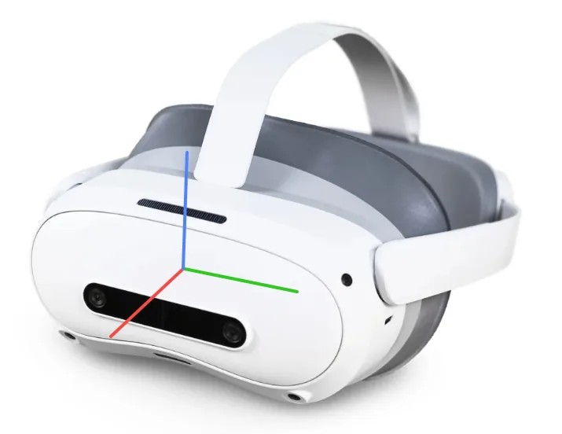

# Coordinate frames

Both configurations take their poses from the same Pico4U headset and trackers, so the frame definition is identical; only the interface for looking at poses is split into "Backpack Kit" / "Developer Kit" tabs.

## The world frame {#world}

The world frame is established and frozen by XTac UMI XR on the headset at the moment it starts. It is right-handed and gravity-aligned:

| Axis | Direction |
|---|---|
| Origin | Where the headset was at the moment XTac UMI XR first started |
| X axis (red) | The device's forward direction, along the normal of the headset's front camera mounting face |
| Y axis (green) | The device's left |
| Z axis (blue) | The device's up |

{ width="420" }

- Once frozen the frame is fixed in space, and turning your head or walking around does not carry it along. Restarting XTac UMI XR establishes a new frame, changing both the origin and the orientation. So face the robot's front when you start it and do not restart it while collecting one dataset; see [Startup and frame alignment](pico4.md#pico-frame).
- Every pose in a dataset is referenced to it: the Developer Kit writes the end-effector TCP pose `tcp.x/y/z` plus the 6-D rotation `r1..r6` (the first two columns of the rotation matrix, with the convention in [What each frame records](../pc/recording.md#53)); the Backpack Kit records the headset's and the trackers' poses in the MCAP, and its exported data has its own origin, described in the next section.

## Origin of exported data (Backpack Kit) {#episode-origin}

From XTac UMI Collector 0.4.6, the poses in state and action in the Backpack Kit's exported LeRobot datasets and training MCAPs no longer use the world frame above directly; instead **each episode is relative to the headset at the moment it started recording**:

| Axis | Direction |
|---|---|
| Origin | The headset position at frame 0 of the episode (worn around the neck, that is the headset at the chest) |
| X axis | The headset's horizontal heading at frame 0 |
| Y axis | Left, orthogonal to X |
| Z axis | Vertically up |

- **Why**: when the headset resets its world frame before every recording, Pico only zeroes the heading and height; the horizontal position can still be off by a few centimetres to tens of centimetres. This gives every episode in a dataset the same starting point, independent of that residual and of restarts of XTac UMI XR.
- **The transform**: translate to the frame-0 headset position, then rotate about the vertical axis to the headset's horizontal heading at that moment. Only translation and yaw are removed; the headset's pitch and roll are kept. It is a rigid transform, so the distance and relative orientation between the hands are unchanged.
- **Face straight towards the work area when you start**: the headset's horizontal heading at that moment is the episode's X axis. The [starting-pose check](../backpack/monitor-record.md#initial-pose) uses the same frame.
- **Scope**: only exported state and action. Raw recordings on the backpack, playback and the live view still use the world frame from recording time; `meta/xumi_collection_devices.json` stores each episode's anchor (its position, yaw and time in the recording frame), so you can convert back.
- **Not applied**: "Dual gripper" mode records no headset pose, so exports skip this transform; the Developer Kit is unaffected and still uses the world frame above.

## The pose view during collection {#world-view}

=== "Backpack Kit"

    The pose view on the console's "Live monitor" page shows the left and right grippers' and the headset's poses live, with the left and right gripper opening angles below it (rad / deg / percentage open). A closed gripper reads about 0.02rad, and a little more force brings it to zero. Before recording, shake each gripper in turn and confirm that the left and right poses each follow it; if one does not move or jumps around, check the [tracker binding](pico4.md#pico-tracker-bind) and whether the view is obstructed.

=== "Developer Kit"

    `--display_data=true` opens a `/world` 3D view in Rerun: each gripper is drawn as a labeled ellipsoid with a triad at its live `tcp.*`, trailing a breadcrumb trajectory.

    - The scene is declared `FLU`, the initial viewpoint faces +X, and the world axes are labeled `+X forward / +Y left / +Z up`.
    - The breadcrumb keeps the most recent 90 samples (about 3 seconds at 30fps), fading with age.
    - With the headset camera on, the headset is drawn into the same `/world` as a smaller amber `HEAD` marker, without a trajectory.
    - `--show_trajectory` is on by default and `false` turns it off; it is skipped automatically when `--robot.enable_tracker=false`.
    - With the gripper lying flat, the EE marker should sit at the midpoint between the fingers with the triad reading X forward / Y left / Z up; if not, the tracker is mounted incorrectly.
    - The `tracker pose` in the scalar panel is the tracker's raw pose, for inspection only; what is written to disk is `tcp.*`.

## Local frames {#local}

The three axes of the headset's own body frame follow the same convention as the world frame: X forward (along the normal of the front camera mounting face), Y left, Z up, right-handed. <!-- TBD: origin definition -->

The gripper's local frames, end-effector (EEF) definition, tracker mounting position and follower flange interface are defined in [XTac-UMI-Description](https://github.com/XenseRobotics-AI/XTac-UMI-Description) (URDF / MJCF / USD and a frame specification). The `tcp.*` the Developer Kit writes is the gripper tip under that definition; to customize it, see [RobotConfig options](../pc/recording.md#robotconfig).
