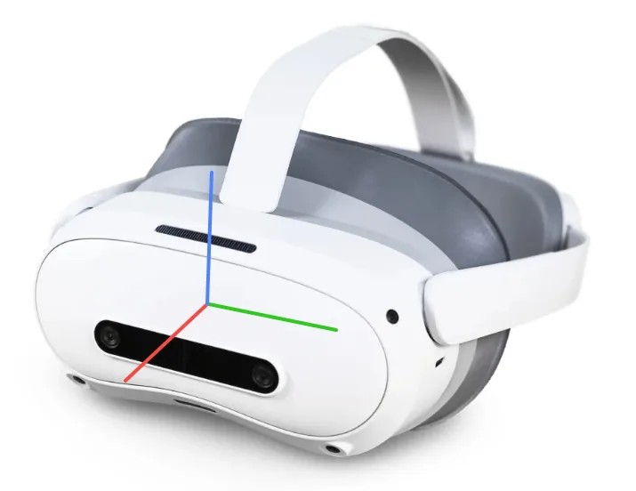

# 坐标系

两种形态的位姿都来自同一套 Pico4 头显与追踪器，坐标系定义相同；只有查看位姿的界面分「背包版 / PC 版」标签页写。

## 世界坐标系 {#world}

世界坐标系由头显上的 XTac UMI XR 在启动瞬间建立并冻结，是右手系，重力对齐：

| 轴 | 方向 |
|---|---|
| 原点 | 首次启动 XTac UMI XR 那一刻头显所在的位置 |
| X 轴（红） | 设备前向，沿头显前部相机安装面法线指向前方 |
| Y 轴（绿） | 设备左向 |
| Z 轴（蓝） | 设备上向 |

{ width="420" }

- 冻结后坐标系固定在空间中，转头、走动都不会带动它；重启 XTac UMI XR 会重新建系，原点和方向都会变。所以要朝机器人正前方启动、同一数据集采集期间不重启，见[启动与坐标系对齐](pico4.md#pico-frame)。
- 数据集里所有位姿都以它为参考：PC 版落盘末端 TCP 位姿 `tcp.x/y/z` 加 6D 旋转 `r1..r6`（旋转矩阵前两列，约定见[每帧记录内容](../pc/recording.md#53)）；背包版 MCAP 记录头显与追踪器的位姿，导出数据的原点见下一节。

## 导出数据的原点（背包版） {#episode-origin}

背包版从 XTac UMI Collector 0.4.6 起，导出的 LeRobot 数据集与训练 MCAP 里，状态与动作的位姿不再直接用上面的世界系，而是**每条录制各自以开录时的头显为原点**：

| 轴 | 方向 |
|---|---|
| 原点 | 这条录制第 0 帧的头显位置（挂脖时是胸前的头显位置） |
| X 轴 | 第 0 帧头显的水平朝向 |
| Y 轴 | 向左，与 X 正交 |
| Z 轴 | 竖直向上 |

- **原因**：每次开录前头显重置世界坐标系时，Pico 只把朝向和高度归零，水平位置仍可能残留几厘米到几十厘米。这样处理后同一数据集里每条的起点一致，不受这个残留和 XTac UMI XR 重启的影响。
- **变换**：先平移到第 0 帧头显位置，再绕竖直轴转到头显当时的水平朝向。只去掉平移和偏航，头显的俯仰、侧倾保留；是刚体变换，双手间距和相对姿态不变。
- **开录时面朝作业区正前方**：那一刻头显的水平朝向就是这条录制的 X 轴。[开录初始位姿检查](../backpack/monitor-record.md#initial-pose)用的也是这个参考系。
- **作用范围**：只作用于导出的状态与动作。背包上的原始录制、回放和实时视图仍用录制时的世界系；`meta/xumi_collection_devices.json` 记录了每条的锚点（录制系里的位置、偏航与时刻），可换算回录制系。
- **不适用**：「双爪」模式不录头显位姿，导出不做这个变换；PC 版不受影响，仍用上面的世界系。

## 采集时的位姿视图 {#world-view}

=== "背包版"

    控制台「实时监控」页的位姿视图实时显示左右爪与头显的位姿，下方是左右爪开合角度（rad / deg / 开合百分比）。夹爪闭合时角度约 0.02rad，再施加一定的力可以到零。开录前逐个摇晃夹爪，确认左右位姿各自跟着动；不动或跳变先查[追踪器绑定](pico4.md#pico-tracker-bind)与视野遮挡。

=== "PC 版"

    `--display_data=true` 会在 Rerun 里开出 `/world` 3D 视图：夹爪以带标签的椭球 + 三轴画在实时 `tcp.*` 处，拖出一条轨迹面包屑。

    - 场景按 `FLU` 声明，初始视角朝 +X，世界轴标 `+X forward / +Y left / +Z up`。
    - 面包屑保留最近 90 个采样点（30fps 下约 3 秒），越旧越淡。
    - 头显相机开启时，头显以更小的琥珀色 `HEAD` 标记画进同一个 `/world`，不带轨迹。
    - `--show_trajectory` 默认开启，`false` 关闭；`--robot.enable_tracker=false` 时自动跳过。
    - 夹爪平放时 EE 标记应在两指中点、三轴呈 X 前 / Y 左 / Z 上，否则追踪器装错了。
    - 标量面板里的 `tracker pose` 是追踪器原始位姿，仅供查看；落盘的是 `tcp.*`。

## 局部坐标系 {#local}

头显本体坐标系的三轴与世界系同一约定：X 前（前部相机安装面法线方向）、Y 左、Z 上，右手系。<!-- 待补：原点定义 -->

夹爪的局部坐标系、末端（EEF）定义、追踪器安装位置与从夹爪法兰接口，以 [XTac-UMI-Description](https://github.com/XenseRobotics-AI/XTac-UMI-Description) 为准（URDF / MJCF / USD 与坐标系说明）。PC 版落盘的 `tcp.*` 即该定义下的夹爪末端；需要自定义时见 [RobotConfig 配置项](../pc/recording.md#robotconfig)。
