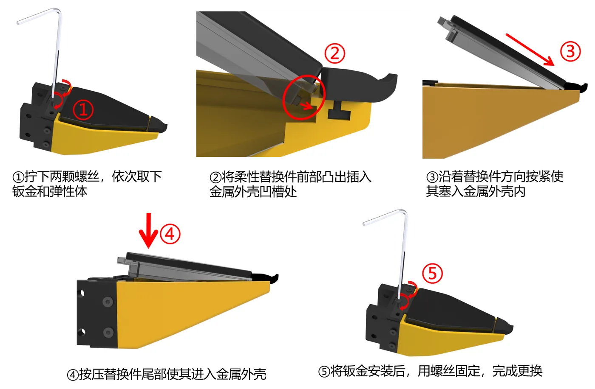

# Maintenance

## Maintenance intervals {#schedule}

| Item | Interval | What to do |
|---|---|---|
| Sensor surface inspection | Before every batch; immediately after contact with a sharp object or a collision | Look for scratches, dirt, permanent dents and image anomalies |
| Sensor surface cleaning | When dust or dirt is found | Blow off loose dust with an air blower first, then wipe gently with a clean lint-free soft cloth if needed. Without official instructions for your hardware batch, do not use alcohol, solvents or any other liquid cleaner |
| Encoder zero check / recalibration | Quick check before every batch; recalibrate when drift is confirmed | `gripper.pos`≈0 closed and ≈1.0 fully open; do not recalibrate when it is normal |
| Wrist camera lens and tactile optical surfaces | Before every batch; clean when the image is blurry or spotted | Air blower first, then wipe gently with a lint-free (lens) cloth if needed; avoid scratching |
| Cable and locking-part inspection | Before every batch; check carefully after robot motion or transport | No damage, looseness, excessive bending or interference with motion |

Quick self-check before every batch: on the Backpack Kit, the [views and poses on the console's "Live monitor" page](../backpack/monitor-record.md#checks); on the Developer Kit, the [Quickstart self-check](../pc/quickstart.md#self-check).

## Visuotactile sensor {#sensor}

The imaging surface is an elastomer / gel material. It is the most delicate part and directly determines tactile data quality.

- Avoid: scratching with sharp objects, digging in with fingernails, impacts from hard objects, deformation from prolonged heavy pressure, oil and solvents. Normal contact during collection is fine; avoid unusually hard squeezing.
- Storage: out of direct light, at room temperature. When not in use, keep the tactile surface free of contact or fit the protective part shipped with the unit; do not let a hard object press on the surface.

!!! danger "Actions that damage the sensor surface"
    Do not clean the surface with sharp objects, do not peel at the bonded surface, do not wipe with solvents unless confirmed. A scratch or a dent can only be fixed by replacing the sensor.

### Removal and refitting {#sensor-removal}

Mind static (ESD) throughout; stop collection before disconnecting the leader gripper's Type-C.

{ width="480" }

After refitting, rerun the tactile and camera preview self-check (on the Backpack Kit, [Confirm in the console before recording](../backpack/monitor-record.md#checks); on the Developer Kit, [Preview before recording](../pc/recording.md#preview)). If the image is clearly worse, check whether the sensor is seated firmly, dirty or fitted backwards; encoder zero calibration does not fix image problems.

## Encoder and calibration {#encoder}

- Calibration is one-off: the zero and the travel limit are written to MCU flash, survive power cycles and do not need redoing on another collection unit.
- Recalibrate when: the mechanics loosen after a drop / hard impact, the encoder or mechanical limit stop has been removed or refitted, or the firmware was erased. Recalibrate the zero and the travel together; when the limit stop changes, the travel limit changes too. Use the console's System → [Gripper](../backpack/system.md#gripper) page on the Backpack Kit, or see [Gripper calibration (zero + travel)](../pc/calibration.md#41) on the Developer Kit.

## Cables and the unit {#cables}

- Do not bend USB / serial cables repeatedly or pull at the strain relief. Plug and unplug gently; on a locking Type-C, loosen the screws before pulling.
- Route and secure the cables so nothing tugs on them during collection and causes a poor contact / dropout.
- Avoid drops, liquid ingress and extreme temperature or humidity. For long-term storage, power down and keep the unit in a dry place out of direct light.

## After-sales support {#after-sales}

Cleaner models, the service life of sensor consumables and the repair / inspection process vary by hardware batch. When you need a cleaner, a tactile surface replacement or an internal repair, contact the delivery or after-sales staff as described in the documents shipped with the unit, with the device SN and photos from the site; see [Support and feedback](reference.md#support).
