# Pico4 headset and tracker setup {#34}

The standalone tracker that ships with the Pico4 Ultra Enterprise mounts on top of the gripper and provides the 6-DoF pose; XTac UMI XR (the VR client app) on the headset sends it to the collection unit. Steps that differ between the Backpack Kit and the Developer Kit are split into tabs.

- **Factory-configured**: developer mode, power policy, app, tracker binding and tracking mode survive power cycles (redo them only after a factory reset or a headset swap); start at [Network connection](#pico-network).
- **Every session**: plug in, short-press the tracker's power button until the blue light comes on, [connect in the app](#pico-toolkit-ui), [align at startup](#pico-frame).

## Unboxing and the system update {#pico-unbox}

1. Unbox: peel off the front-panel sticker, the controller tape and the lens stickers, then hold the power button to switch on.

    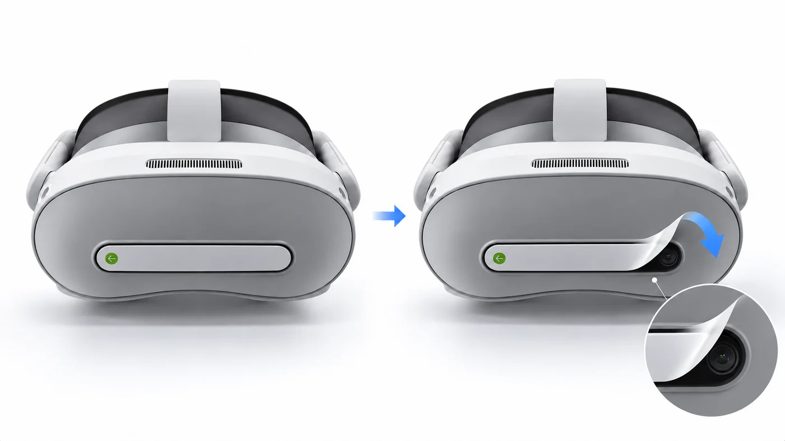{ width="560" }

2. Update the system: a new unit ships on an older build and must be updated before you pair trackers or install the app. Join a Wi-Fi network with internet access, go to Settings → "System Update" and tap "Download and Install" to reach Pico OS 5.15.5.U or later (about 1.9GB).

    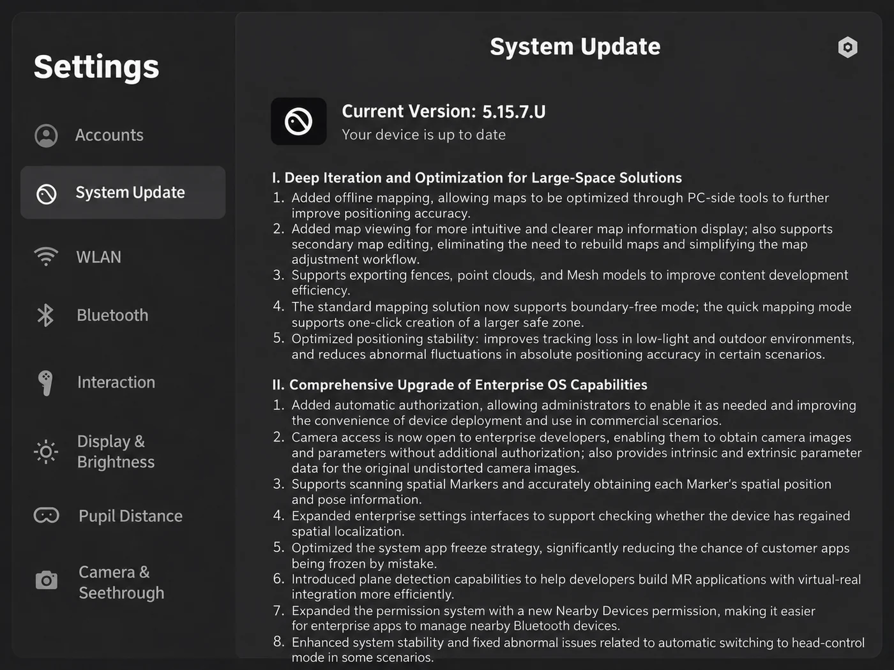{ width="560" }

## System settings: developer mode and power policy {#pico-system}

1. Enable developer mode: Settings → About → tap "Software Version" several times (with the controller, pull the index trigger repeatedly while pointing at it) → "Developer" appears on the left → turn on "USB Debug".

    <div class="tc-pair" markdown>

    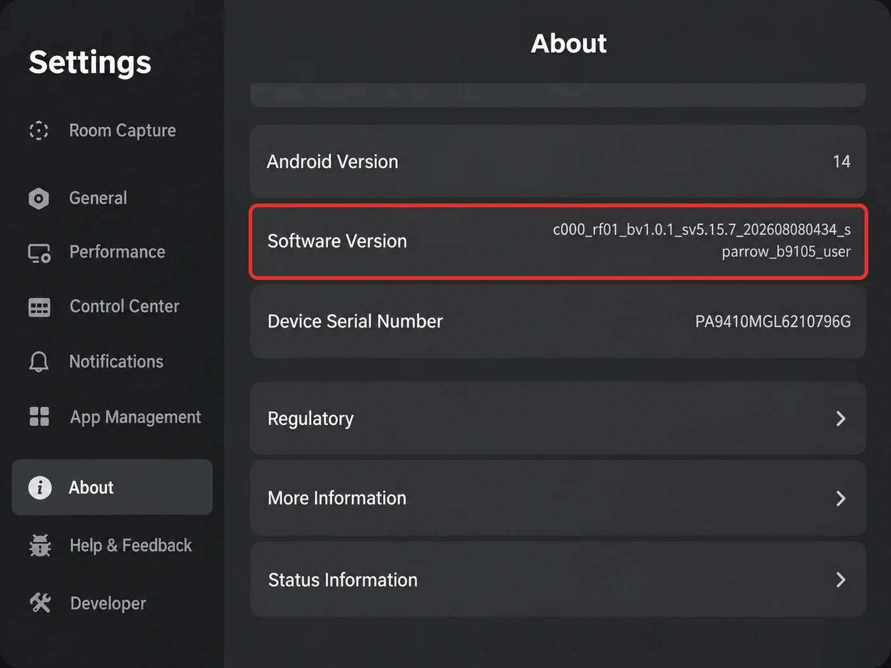

    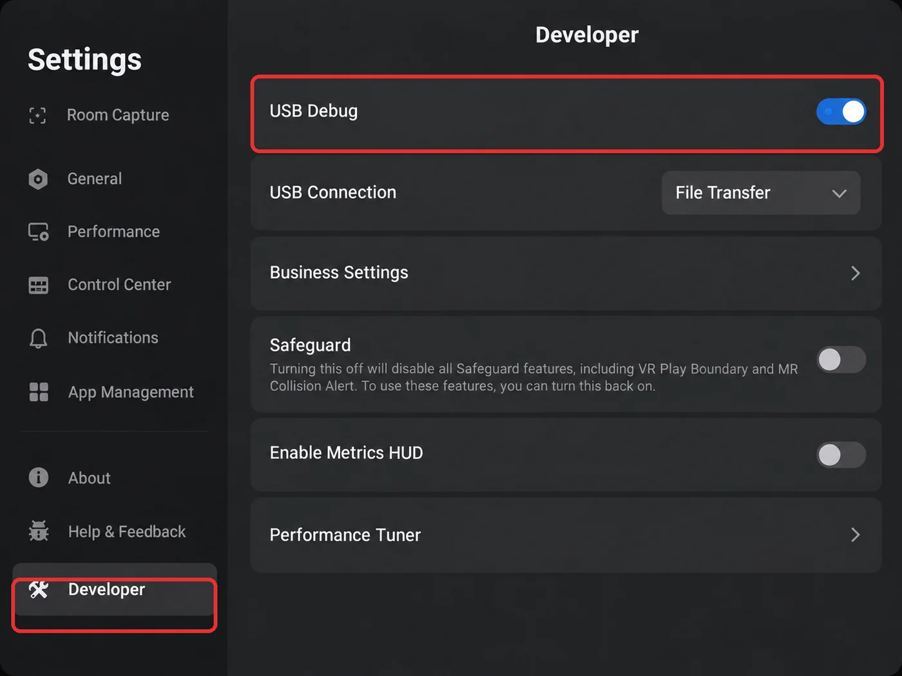

    </div>

2. Disable sleep and screen-off: Developer → "Business Settings" → "System" → "Power Management" (Enterprise edition only; the consumer edition cannot set "Never"). By default, the screen turns off after 30s, the system sleeps after 5min, and the battery icon is hidden. Change them in order:
    1. "System Goes to Sleep After" = "Never";
    2. "Turn Off Screen After" = "Never";
    3. "Battery and Charging Status Icons" at the bottom = "Always show", to check the charge mid-session.

    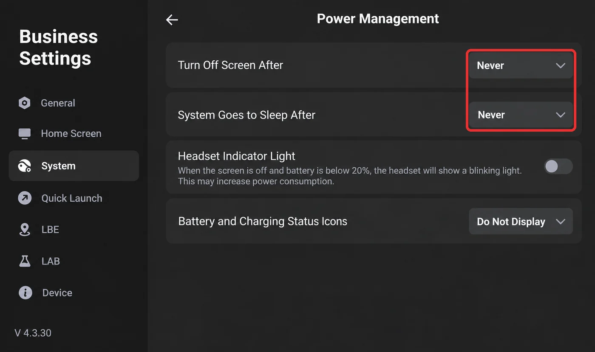{ width="480" }

!!! warning "Sleep first, screen-off second; the order cannot be reversed"
    Screen-off ("Turn Off Screen After") is bounded by system sleep ("System Goes to Sleep After"): while sleep is still at its default, screen-off's "Never" is clamped back to a finite value, so it looks set but is not in effect. Leave Settings and come back to confirm both read "Never".

Otherwise, screen-off or sleep between episodes (also triggered by taking the headset off and setting it down) suspends or kills XTac UMI XR, and restarting it resets the world frame (see [Frame alignment](#pico-frame)).

## Installing XTac UMI XR {#pico-app}

XTac UMI XR **0.4.4** was released on 2026-11-26. Obtain `XTac-UMI-XR-0.4.4.apk` (124.3 MB) from [technical support](reference.md#support) and install it in the headset's file manager. Update the headset app separately.

Version 0.4.4 improves headset pose and IMU capture and time synchronization between trackers and the headset. IMU and pose data are reported at approximately **60 Hz**. The new Collector 0.5.0 headset video modes run at **30 fps**. See [project settings](../backpack/monitor-record.md#project-task). The new headset features require a compatible newer app. The minimum compatible version is pending confirmation.

To install:

1. Connect the headset to the collection PC over USB and copy the APK into the headset's `Download/` directory.

    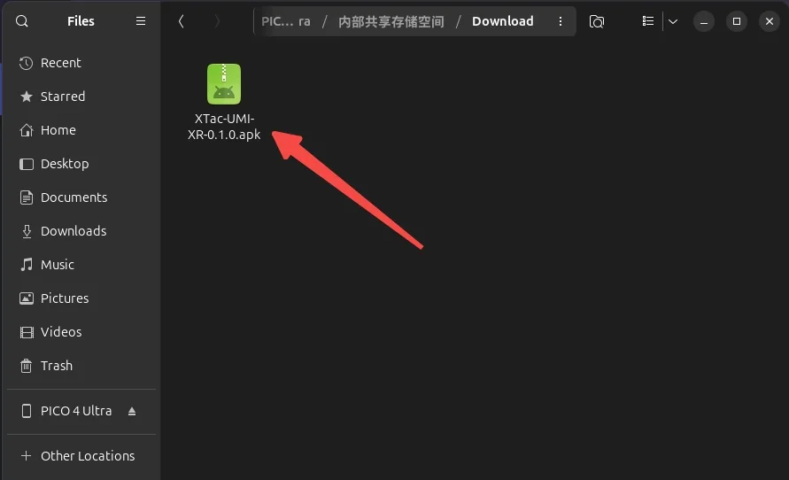{ width="480" }

2. Put the headset on, open the file manager from the taskbar, go to "All Files" and open "Download".

    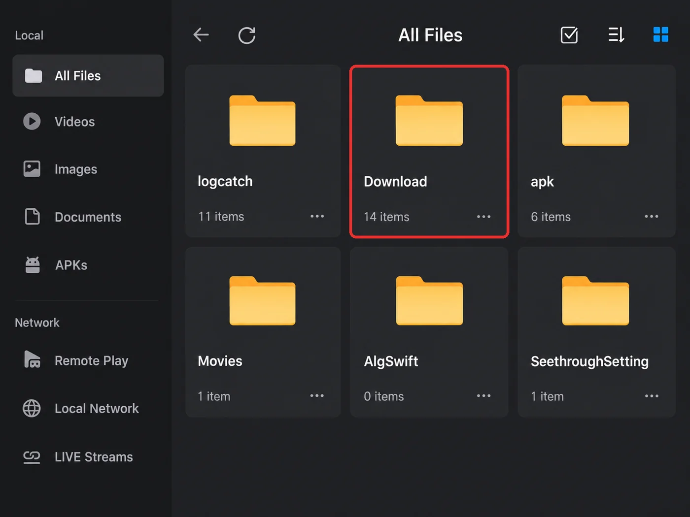{ width="480" }

3. Tap the APK and tap "Install" in the installation prompt; XTac UMI XR then appears in the "Library".

    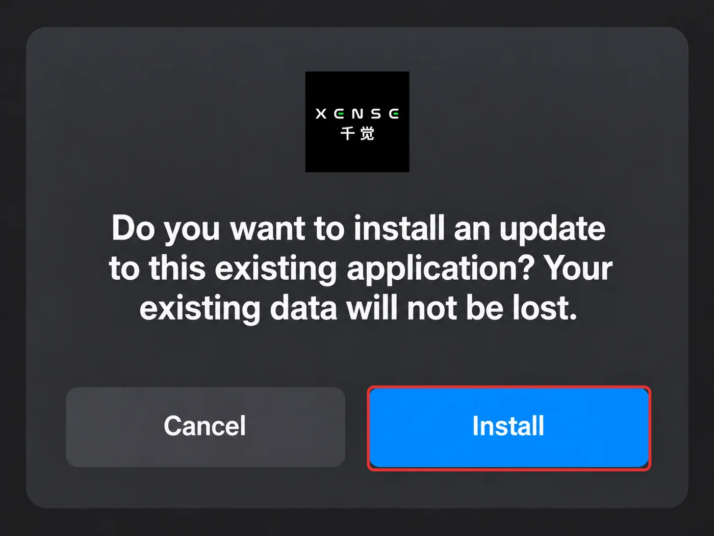{ width="480" }


## Network connection {#pico-network}

Tracking data goes to the XenseVR pose service on the collection unit. The Backpack Kit is **wired only**; the Developer Kit is wired by default. A direct Type-C connection gives the headset a dedicated link with stable latency.

!!! warning "On the Developer Kit, wireless is for quick debugging only, never for real collection"
    Over Wi-Fi the headset competes for the channel with everything on site, so pose data arrives late: at best stutter and jitter, at worst dropped frames. None of it shows while recording and it is hard to tell from other causes afterwards, so the whole batch has to be recollected.

On both editions, set up USB and networking on the headset first:

- **Network settings**: set the headset as the Host device (Developer → "Business Settings" → "Basic Settings" → scroll to the bottom → "Network Settings").
- **Settings path**: Settings → Developer → enable "USB Debug" → set "USB Connection" to "File Transfer".
- **Re-check after re-plugging**: "USB Connection" reverts to its default whenever the cable is reconnected; if you cannot select it, reboot the Pico.

<div class="tc-pair" markdown>

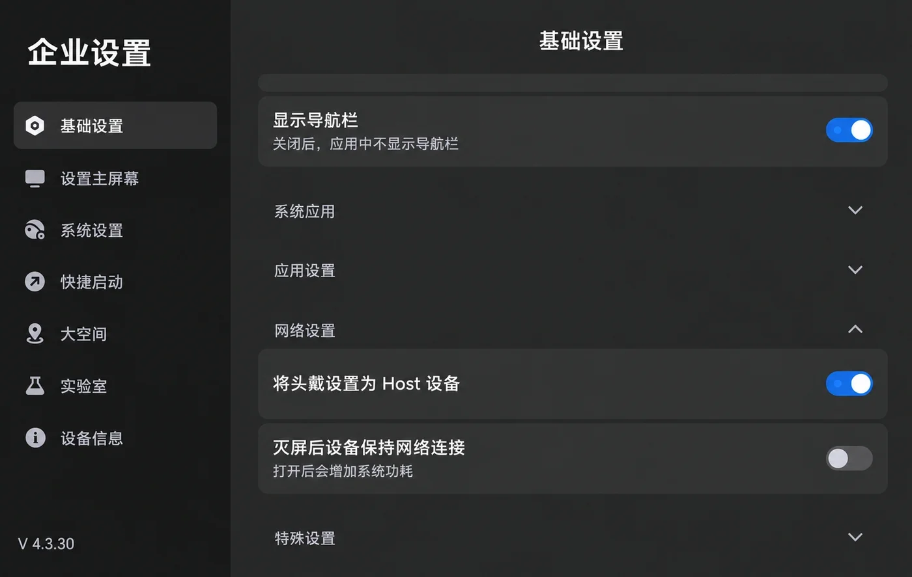

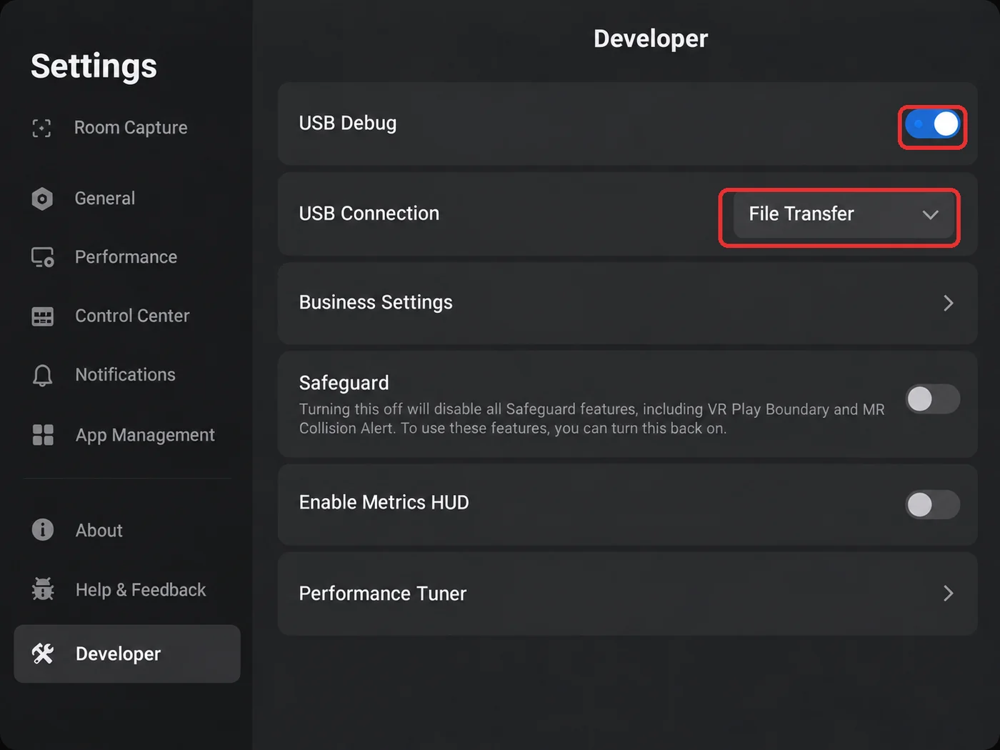

</div>

=== "Backpack Kit"

    1. Run the headset cable (Pico → Pack, Type-C to Type-C) from the headset's side Type-C port to the backpack's `PICO` port; see [Unboxing, cabling and power](../backpack/unbox-connect.md#order). The connection is the same whether the backpack runs on the adapter or a power bank.
    2. Power on the backpack; the pose service built into XTac UMI Collector starts with it.
    3. Open XTac UMI XR, choose "XTac" as the connection (selected by default on first launch; the address is fixed to the backpack at `192.168.100.1`), then tap "Connect".

=== "Developer Kit"

    1. Before every session, start the service on the collection PC first with `runService.sh` (see [Start the XenseVR PC Service](../pc/host-setup.md#35)); otherwise the app cannot connect.
    2. Connect the headset directly to the collection PC with a Type-C cable; the headset assigns the collection PC an IP.
    3. Open XTac UMI XR, choose "USB Network" as the connection and tap "Connect": the app connects to the collection PC (`192.168.58.1`) by itself and Status changes to "Connected" (see [The app's screen](#pico-toolkit-ui)).

    Over Wi-Fi: put the headset and the collection PC on the same network, choose "WiFi Network", tap "PC IP", enter the collection PC's IP and save, then tap "Connect".

    !!! warning "On the wired link, turn the collection PC's Wi-Fi off"
        The wired shared network contends with other networks on the collection PC (Wi-Fi above all) for routing and interfaces, leaving the tracker unreachable or its pose unstable; keep only the headset's shared network.

## Binding the tracker to the headset {#pico-tracker-bind}

On first use, or after swapping a tracker, bind the PICO Motion Tracker to this headset first; otherwise the headset cannot track it and neither XTac UMI XR nor the collection unit will discover its SN.

Before pairing, scan the QR code on the back of the tracker with your phone for its full SN, and mount it odd-left / even-right (see [Serial numbers and side identification](gripper.md#sn)). The six digits in the red box are the number shown in the "My Motion Trackers" list after pairing (e.g. `Tracker 150311`).

| Scan this | You get this |
|---|---|
| 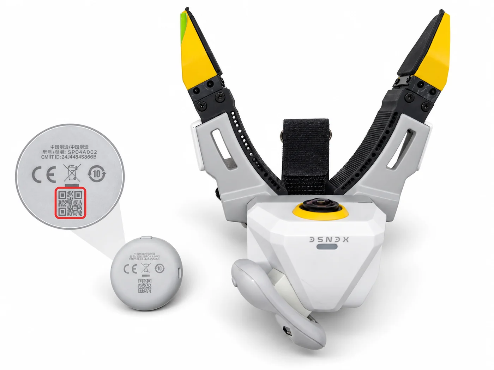{ width="300" } | 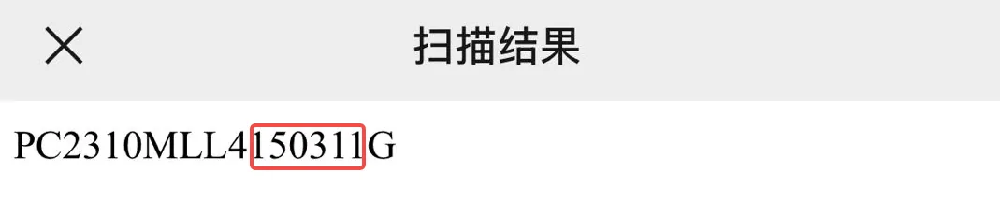{ width="320" }<br>`1` before the `G`, odd → left gripper |

1. Open the "PICO Motion Tracker" app from the Library and tap the top-right icon on the main screen to enter pairing.

    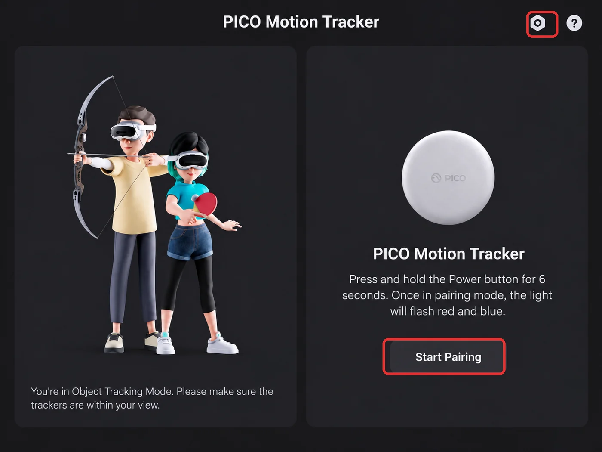{ width="440" }

2. Hold the tracker's power button for about 6 seconds, until the indicator alternates blue and red (Bluetooth pairing mode).
3. Tap "Start Pairing". The headset beeps on success and the tracker appears in "My Motion Trackers" with its battery level and number (e.g. `Tracker 150399`), marked "Connected".
4. Bind one per gripper; the top of the list should read "2 Motion Trackers paired".

    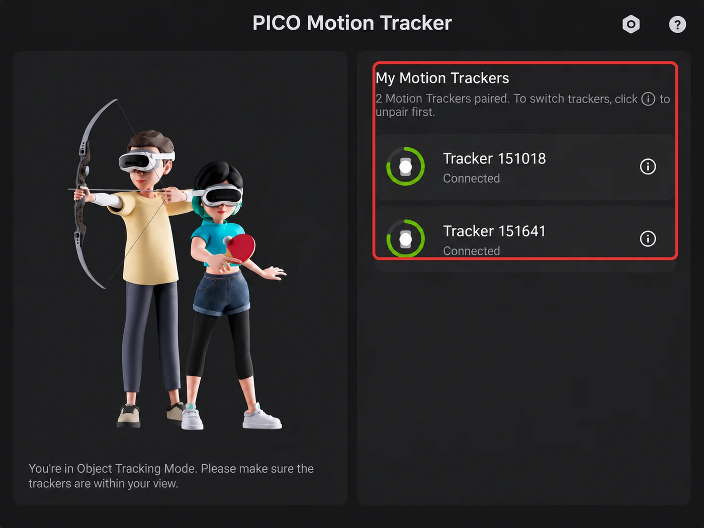{ width="440" }

- **Power-on is a short press; only pairing needs the hold**: everyday power-on is a short press until the blue light comes on; that is not pairing mode and the app will not find it.
- **Re-binding**: the binding is stored on the headset and survives power cycles and app restarts. After swapping trackers, moving to another headset, a factory reset or pairing the wrong one, unpair from the ⓘ on the right of the list entry, then bind the new one.

!!! warning "In independent tracking mode the tracker must stay in the headset's view"
    A tracker occluded for long by your body, the desk edge or the other hand loses tracking (pose jumps or a frozen pose).

### Reading a tracker SN {#pico-tracker-sn}

- **Purpose**: it sets the side (the digit before the `G`, odd-left / even-right) and is how the collection unit identifies a tracker.
- **From the QR code**: the full SN (shaped like `PC2310MLL3200496G`) comes from the QR code on the back of the tracker; the "PICO Motion Tracker" app only shows a short number (e.g. `Tracker 150399`), and the SN on XTac UMI XR's Network panel (e.g. `PA9410MGL…`) is the headset's own.

=== "Backpack Kit"

    The SN comes only from the QR code; there is no command-line interface. Once connected, shake one gripper at a time in the pose view of the console's "Live monitor" page to confirm the sides are not swapped.

=== "Developer Kit"

    Read it with the PC Service's Python interface:

    ```python
    import xensevr_pc_service_sdk as xrt

    xrt.init()
    print(xrt.get_motion_tracker_serial_numbers())   # e.g. ['PC2310MLL3200496G', ...]
    ```

    - **Prerequisites**: tracker bound and on → XTac UMI XR ["Connected"](#pico-toolkit-ui) → [PC Service](../pc/host-setup.md#35) running on the collection PC; miss one and you get an empty list.
    - **Pin the SN**: `--robot.tracker_serial=<SN>` skips [auto-matching](../pc/host-setup.md#33); shake one gripper at a time to confirm which SN is which hand before writing it into your config.

## Tracking mode {#pico-tracker}

Once bound, open "PICO Motion Tracker" on the headset → Settings → "Tracking Mode", select "Object Tracking" and tap "Confirm"; the row should read "Object Tracking". The factory default "Full-Body Tracking" follows a human body; "Object Tracking" follows an object the tracker is fixed to.

<div class="tc-pair" markdown>

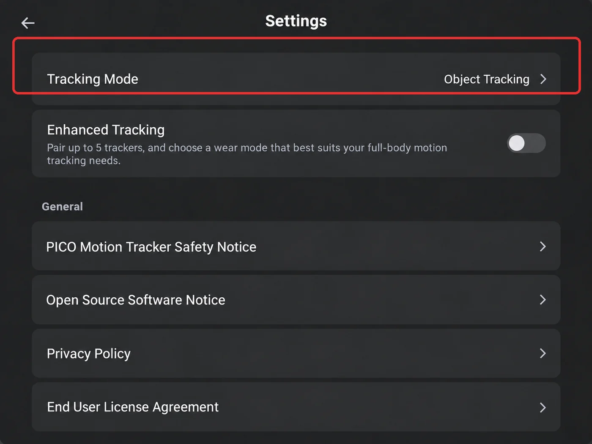

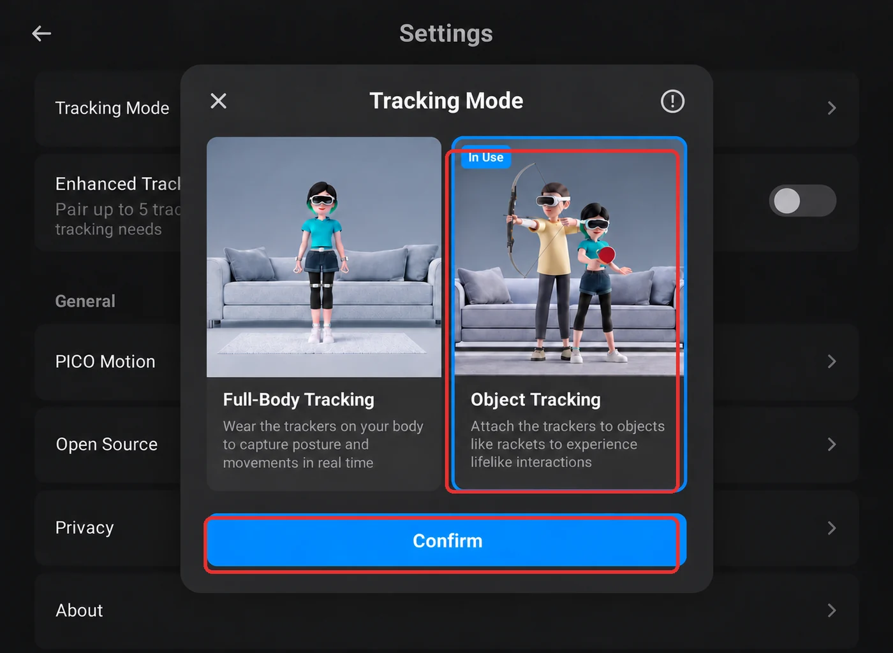

</div>

## The app's screen {#pico-toolkit-ui}

With the headset on, open XTac UMI XR from the Library to reach the "XENSE XR Console". Connecting only uses these items on the left:

| Item | What it means |
|---|---|
| Tracker Mode | Should read "object tracking" (Pico's "Object Tracking" mode); if not, redo [Tracking mode](#pico-tracker) |
| Pico Hardware | Should read "Enterprise" |
| Status | Until "Connected", the collection unit reads no pose |
| Connection | "XTac": Backpack Kit (`192.168.100.1`, selected by default on first launch); "USB Network": Developer Kit wired (`192.168.58.1`); "WiFi Network": Developer Kit wireless. Cannot be changed while connected or connecting |
| PC IP | Under "XTac" it shows the backpack's address and cannot be edited; under "WiFi Network" tap it, enter the collection PC's IP and save; under "USB Network" nothing to enter |
| Connect / Disconnect | Tap "Connect"; once connected the button turns into "Disconnect" |

From then on XR reconnects automatically with the last connection each time it opens; after you tap "Disconnect" it stops reconnecting until you tap "Connect" again.

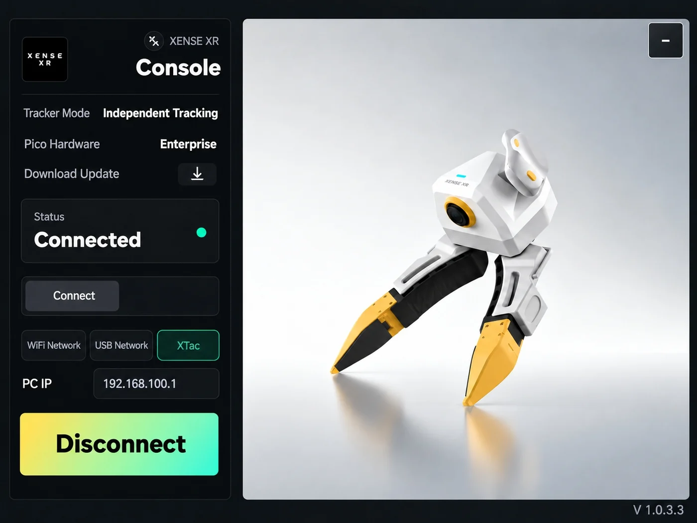{ width="560" }

=== "Backpack Kit"

    - **Panel icon**: appears when tracker accuracy degrades or the link to the backpack drops.
    - **Check the poses**: the pose view on the console's "Live monitor" page should show the headset and both gripper poses.
    - **Record button not ready**: it states the reason; both can appear together:
        - "Pico not ready": headset disconnected or timed out, pose data or clock synchronization missing or timed out;
        - "Tracker not ready": tracker out of view or stationary for over 5 seconds.
    - **Disconnect while recording**: the recording stops at once, see [Headset disconnects while recording](../backpack/monitor-record.md#pico-disconnect).

=== "Developer Kit"

    - **Never connects**: usually the [network](#pico-network) is not up or the collection PC's Wi-Fi is still on.
    - **Confirm the collection PC gets data**: "Connected" on the headset does not mean the collection PC receives data; confirm a pose with an `sn` comes through via `ConsoleDemo` in `/opt/apps/roboticsservice/` or `python -m lerobot.robots.taccap_gripper.check_tracker`.

## Startup and frame alignment {#pico-frame}

Face the robot's front when you launch XTac UMI XR, then [connect in the app](#pico-toolkit-ui). The world frame's origin and orientation freeze at launch and every pose is referenced to it; the definition and diagram are in [Coordinate frames](coordinates.md).

!!! danger "Face the same direction as the robot at launch; do not restart XTac UMI XR between episodes"
    - **Same direction**: this aligns world X with the robot's forward direction; only your heading matters, not where you stand.
    - **Do not restart**: a restart changes the origin and orientation, leaving poses inside one dataset in different frames, with nothing in the data to show it.
