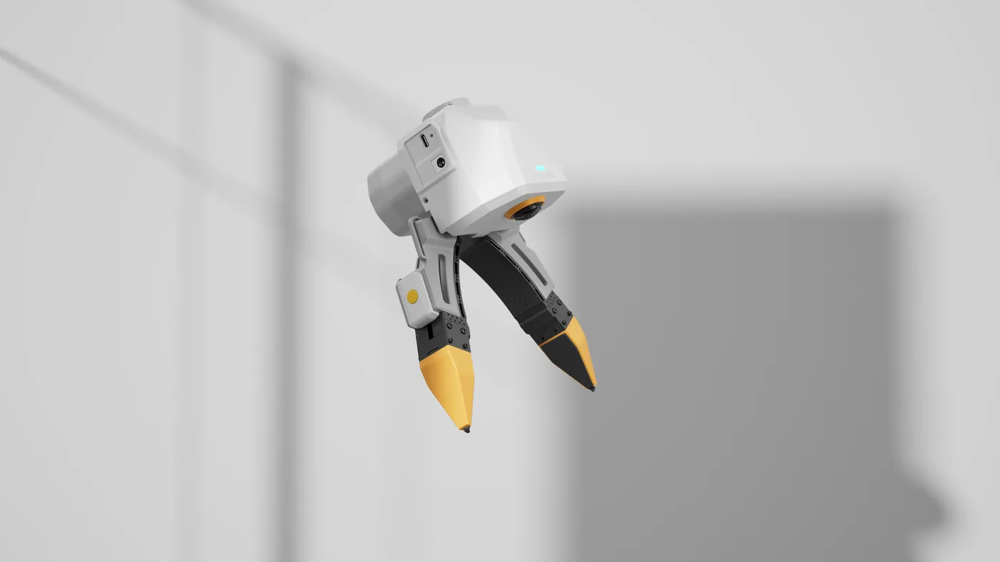
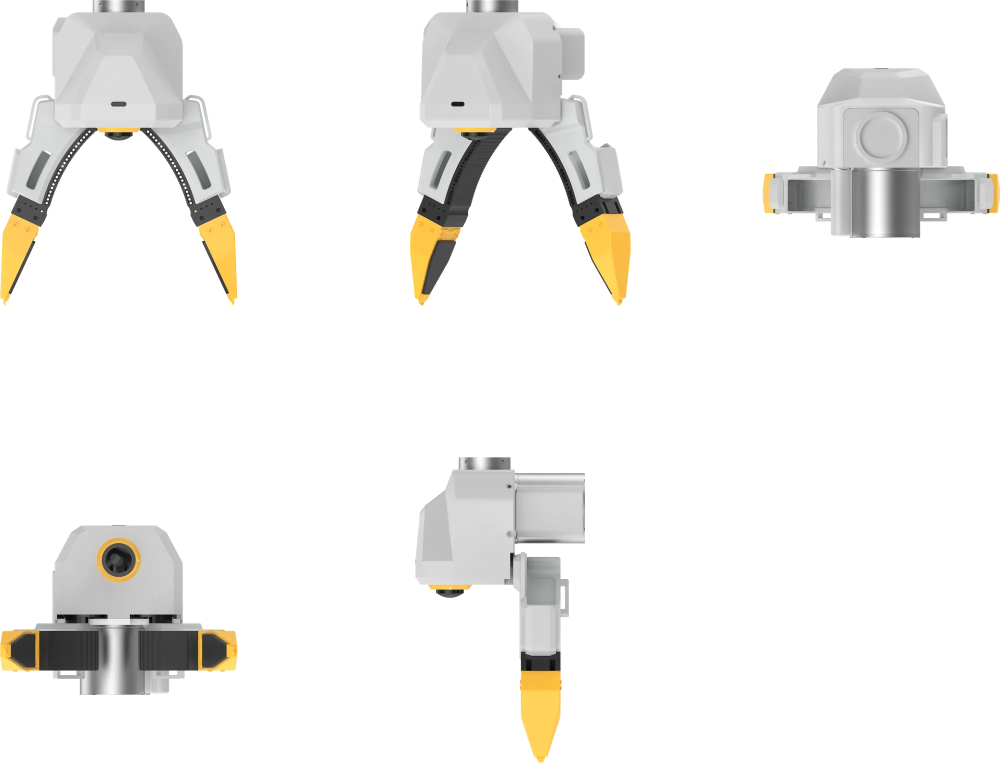

# Follower gripper overview

The follower gripper mounts on the robot's end effector, opens and closes under motor drive, and performs the motion captured with the leader gripper. This chapter shows how to control it with the `xense.taccap` SDK. It is written against [TacCap-Gripper](https://github.com/XenseRobotics-AI/TacCap-Gripper) **v0.5.0** and applies to both the Backpack Kit and the Developer Kit; features marked “0.4.4 and later” need 0.4.4 or newer.

{ width="720" }

## How it differs from the leader gripper {#vs-leader}

| | Leader gripper | Follower gripper |
|---|---|---|
| Purpose | Handheld capture | Mounted on the robot's end effector to open, close and grasp |
| Motor | None | RobStride EL05 |
| Power | USB Type-C | USB Type-C + **24V** |
| IMU | Yes | Yes (firmware 1.2.17 / SDK 0.4.5 and later) |
| Encoder / buttons | Yes | No |
| Travel calibration | Manual | Automatic at power-on |
| Last letter of the serial number | `m` | `s` |
| Firmware bundled with SDK 0.5.0 | 1.3.1 | 1.3.1 |

- Leader and follower grippers use separate firmware images under a shared version numbering scheme. The current version for both is **1.3.1**.

{ width="720" }

## Serial number {#sn}

Taking `TCGU01A24A0001s` as an example:

- The **last letter** is the role: `m` = leader gripper, `s` = follower gripper. Use it to pick the image when flashing firmware.
- The **last digit of the running number**, just before the role letter (`1` here), gives the side: odd = left, even = right. The follower gripper is mechanically not side-specific; the software uses this to tell two follower grippers apart.

## Motor {#motor-model}

| Continuous stall rating | Max. speed |
|---|---|
| 1.1N·m | 50rad/s |

The **continuous stall rating** is the torque the fingers can hold indefinitely while pressing against an object; it is also the default grip force and its upper limit.

## Safety notes {#safety-model}

- The gripper firmware has a built-in **motion safety envelope** (torque limit, thermal derating) that no program can bypass; it is active automatically from firmware 1.2.12. **Older firmware lacks this protection**: pressing against something hard can pull the 24V supply voltage down and make the gripper let go, so [upgrade](firmware.md#mcu-ota) to the firmware bundled with the SDK before use.
- When control stops, the program exits or USB disconnects, the gripper releases and whatever it is holding will drop.
- After power-on the gripper opens and closes once by itself to calibrate (about 10 seconds). During that time do not put anything in it and do not send commands.

## Next steps {#next}

1. Mounting and wiring: [Gripper connection and serial numbers → Follower gripper mounting and connection](../common/gripper.md#follower-install)
2. Install the SDK and run the self-check: [Setup and self-check](setup.md)
3. Make it move: [Motion control](control.md)
4. Write your own program: [API and examples](api.md)
5. Upgrade the firmware: [Firmware and motor upgrades](firmware.md)
6. When something goes wrong: [Follower gripper troubleshooting](troubleshooting.md)
7. Add it to your robot model: [XTac-UMI-Description](https://github.com/XenseRobotics-AI/XTac-UMI-Description) (URDF, Xacro, MJCF, USD; ROS 2 supported)
