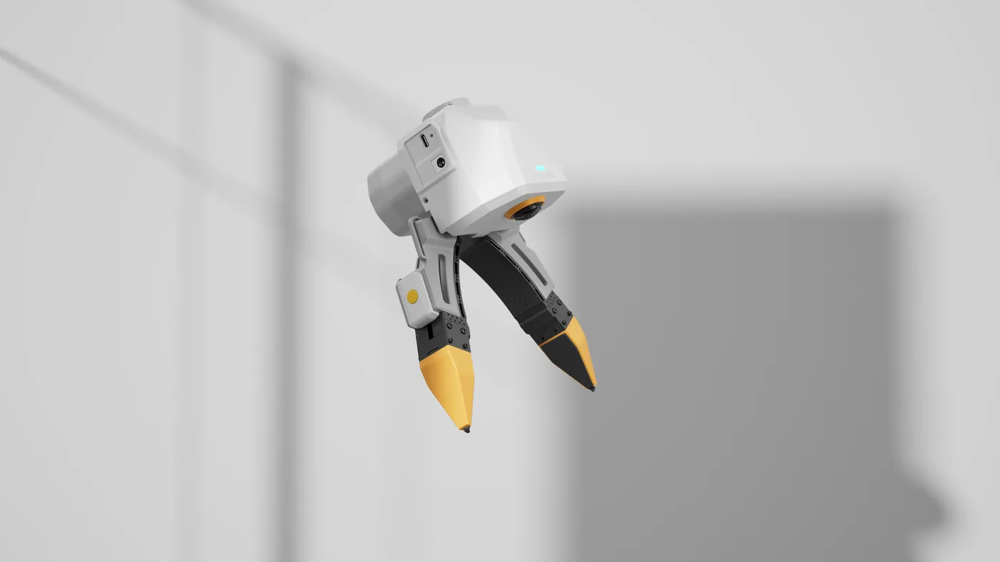
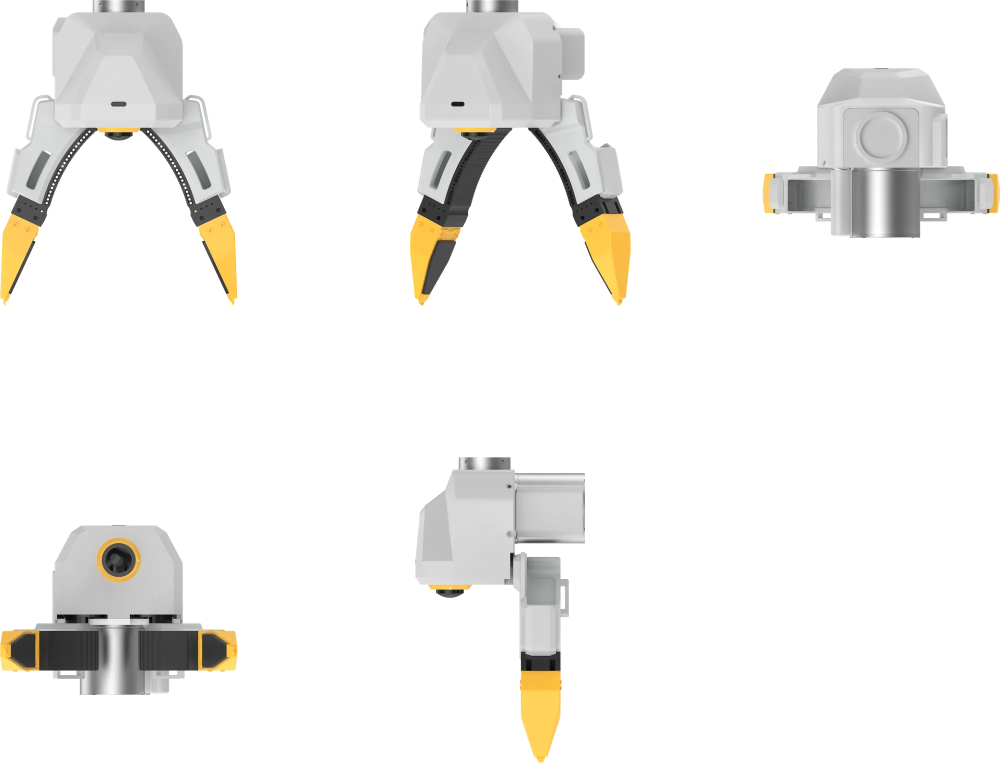

# 从夹爪概览

从夹爪（Follower）装在机器人末端，由电机驱动开合，执行主夹爪采集到的动作。本章讲怎样用 `xense.taccap` SDK 控制它，按 [TacCap-Gripper](https://github.com/XenseRobotics-AI/TacCap-Gripper) **v0.5.0** 编写，背包版与 PC 版都适用；标注「0.4.4 起」的功能需要 0.4.4 及以上。

{ width="720" }

## 和主夹爪的区别 {#vs-leader}

| | 主夹爪 | 从夹爪 |
|---|---|---|
| 用途 | 手持采集 | 装在机器人末端执行开合与夹持 |
| 电机 | 无 | RobStride EL05 |
| 供电 | USB Type-C | USB Type-C + **24V** |
| IMU | 有 | 有（固件 1.2.17 / SDK 0.4.5 起） |
| 编码器 / 按键 | 有 | 无 |
| 行程标定 | 手动标定 | 上电自动标定 |
| 序列号末位字母 | `m` | `s` |
| 随 SDK 0.5.0 附带的固件 | 1.3.1 | 1.3.1 |

- 主夹爪和从夹爪使用各自的固件镜像，现采用统一的版本编号，当前版本均为 **1.3.1**。

{ width="720" }

## 序列号 {#sn}

以 `TCGU01A24A0001s` 为例：

- **最后一个字母**是角色：`m` = 主夹爪，`s` = 从夹爪。刷固件时按它选镜像。
- 角色字母前**流水号的末位**（例中是 `1`）：单数 = 左，双数 = 右。从夹爪机械上不分左右，软件以此区分两只。

## 电机 {#motor-model}

| 持续堵转额定 | 速度量程 |
|---|---|
| 1.1N·m | 50rad/s |

**持续堵转额定**是爪子顶住物体时可以一直保持的力矩，也是默认的夹持力和上限。

## 安全须知 {#safety-model}

- 夹爪固件内置**运动安全包络**（力矩上限、过热降额），任何程序都绕不过去，固件 1.2.12 起自动生效。**更旧的固件没有这层保护**，爪子顶住硬物时会把 24V 电源拉垮、夹爪松手，使用前务必[升级](firmware.md#mcu-ota)到随 SDK 附带的版本。
- 停止控制、程序退出或 USB 断开时，夹爪会松开，夹着的东西会掉。
- 上电后夹爪会自己开合一次做标定（约 10 秒），期间不要放东西、不要发命令。

## 接下来 {#next}

1. 安装与接线：[夹爪连接与序列号 → 从夹爪安装与连接](../common/gripper.md#follower-install)
2. 安装 SDK 与自检：[准备与自检](setup.md)
3. 让它动起来：[运动控制](control.md)
4. 写自己的程序：[API 与示例](api.md)
5. 升级固件：[固件与电机升级](firmware.md)
6. 出问题时：[从夹爪故障排查](troubleshooting.md)
7. 加进机器人模型：[XTac-UMI-Description](https://github.com/XenseRobotics-AI/XTac-UMI-Description)（URDF、Xacro、MJCF、USD，支持 ROS 2）
