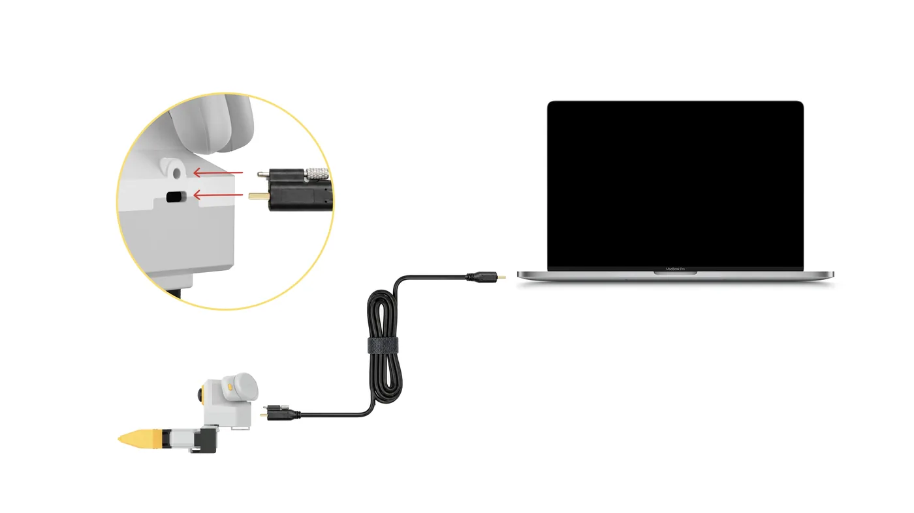
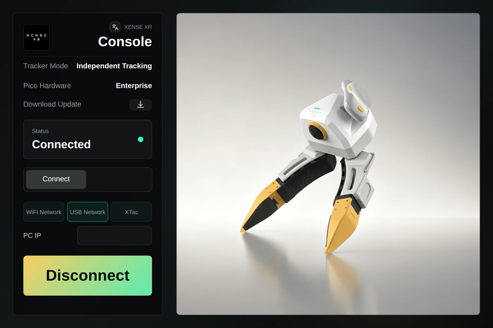
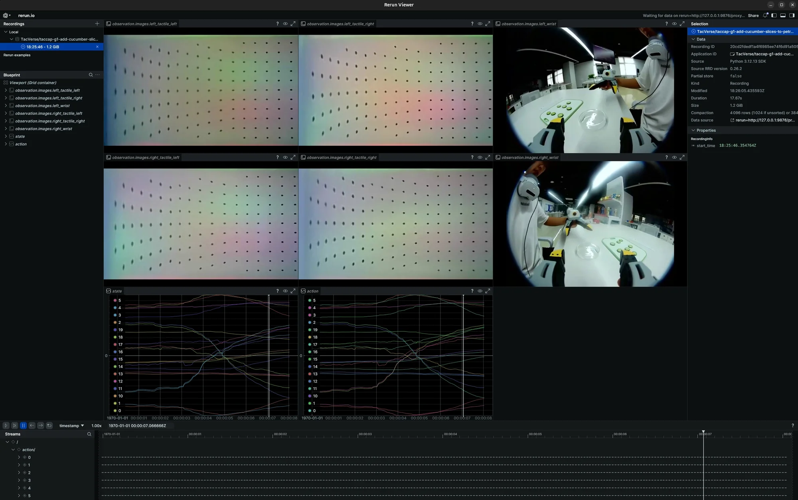
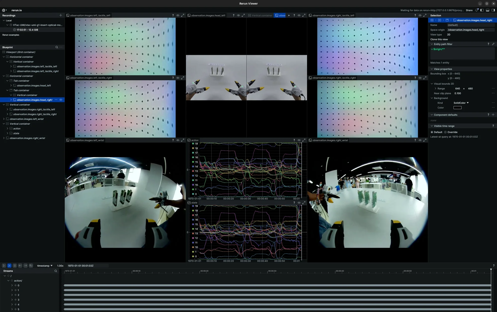
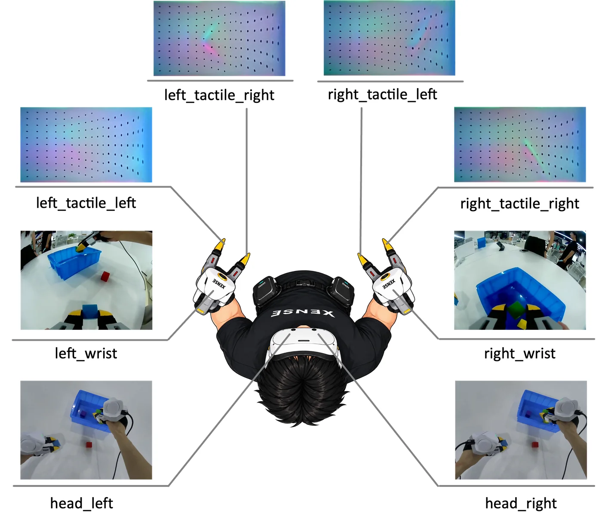

# Quickstart

From power-on to your first recorded episode. Before you start, make sure these five items are done:

- Hardware connected → [Leader gripper connection and use](../common/gripper.md#install)
- Environment installed and active (`mamba activate xense-taccap` or the Docker container) → [Installation](install.md)
- Collection PC configured: brltty removed, serial permissions, ModemManager kept off the ports (miss one and the gripper will not connect) → [Host setup · Required on first use](host-setup.md#first-use)
- Every leader gripper calibrated (an uncalibrated leader is refused) → [Gripper calibration (zero + travel)](calibration.md#41)
- Repo, SDK and gripper firmware all up to date → [You must upgrade to the latest versions](versions.md#required)

## 1. Power on and connect {#power-on}

1. Plug in the gripper USB.
2. Connect the headset to the collection PC by cable and **turn off the collection PC's Wi-Fi**.
3. Turn on the headset and short-press the tracker power button until the LED is solid blue.
4. Start the XenseVR PC Service: `/opt/apps/roboticsservice/runService.sh`
5. **Facing the same direction as the robot**, open XTac UMI XR, choose "USB Network" as the connection and tap "Connect"; Status changes to "Connected".

<div class="tc-pair" markdown>

<figure class="tc-shot" markdown>

<figcaption>The gripper connects to the collection PC over USB Type-C</figcaption>
</figure>

<figure class="tc-shot" markdown>

<figcaption>XTac UMI XR Status changes to "Connected"</figcaption>
</figure>

</div>

!!! warning "Three common mistakes"
    - Start the PC Service before opening the XR app, or it cannot connect.
    - With a wired headset the collection PC's Wi-Fi must be off, or tracking is unstable. See [Network connection](../common/pico4.md#pico-network).
    - Do not restart the XR app during collection: it resets the world origin, so poses within one dataset stop lining up.

Power off in reverse: stop recording and let the current episode save, quit the XR app, stop the PC Service, then unplug, in the order given in [Power and connection requirements](../common/gripper.md#power).

## 2. Self-check {#self-check}

```bash
python -c "from xense.taccap import scan_grippers
for g in scan_grippers(): print(g.side.name, g.role.name, repr(g.firmware_sn))"
```

One line per gripper, `role` is `Leader` or `Follower`, and the serial is not empty. If not, see [Troubleshooting](troubleshooting.md).

## 3. Preview check

Keep the trackers in the headset's view before starting; tracking is lost if they are occluded.

=== "② With wrist pose"

    ```bash
    lerobot-teleoperate \
        --robot.type=bi_taccap_gripper \
        --robot.id=0 \
        --fps=30 \
        --display_data=true
    ```

    

=== "③ Full setup"

    ```bash
    lerobot-teleoperate \
        --robot.type=xtac_umi_g1 \
        --robot.id=0 \
        --fps=30 \
        --display_data=true
    ```

    

Move and open/close the grippers, check that every image, tactile stream and pose updates, then press Ctrl+C.

- ① Grippers only (no PC Service needed): add `--robot.enable_tracker=false` to the ② command.
- Single gripper: `--robot.type=taccap_gripper`; with both grippers plugged in, add `--robot.side=left` or `right`.
- `--robot.id` is required: the station number as a plain number (`0`, `1`, …), one per setup.

What each tier records and the item-by-item checklist are in [Preview before recording](recording.md#preview).

## 4. Full recording

Keep `--robot.type` (and whether you add `--robot.enable_tracker=false`) **the same as in the preview**; for ③ Full setup, change the type below to `xtac_umi_g1`.

```bash
lerobot-record \
    --robot.type=bi_taccap_gripper \
    --robot.id=0 \
    --dataset.repo_id=<your_org>/<dataset_name> \
    --dataset.single_task='Pick up the object' \
    --dataset.num_episodes=1 \
    --dataset.fps=30 \
    --dataset.episode_time_s=120 \
    --dataset.reset_time_s=60 \
    --dataset.push_to_hub=false
```

② records 6 image streams per frame (four visuotactile, both wrist cameras), plus gripper opening and gripper pose; ③ adds the headset stereo pair and the head pose, 8 streams in total:

<figure class="tc-shot tc-shot--narrow" markdown>

<figcaption>The eight streams and their keys in the dataset</figcaption>
</figure>

All parameters: [Data collection · Parameters](recording.md#params).

## 5. Check and upload

```bash
# Check the dataset
lerobot-check-dataset --repo-id <your_org>/<dataset_name>

# Upload to the Hugging Face Hub when needed
lerobot-push-dataset-to-hub \
    --repo-id <your_org>/<dataset_name> \
    --dataset-path ~/.cache/huggingface/lerobot/<your_org>/<dataset_name> \
    --upload-large-folder
```

Dataset layout and fields: [Dataset](dataset.md).
