# XTac UMI G1

Xense XTac UMI G1 is a wearable data-collection gripper system for building embodied manipulation datasets. The leader gripper integrates tri-color visuotactile sensors, a wrist fisheye camera and a high-precision pose sensor, capturing vision, touch, pose, gripper state and IMU data in sync; the follower gripper mounts on the robot's end effector to execute or replay motions. The system serves imitation learning, VLA / VTLA model training and tactile world model research.

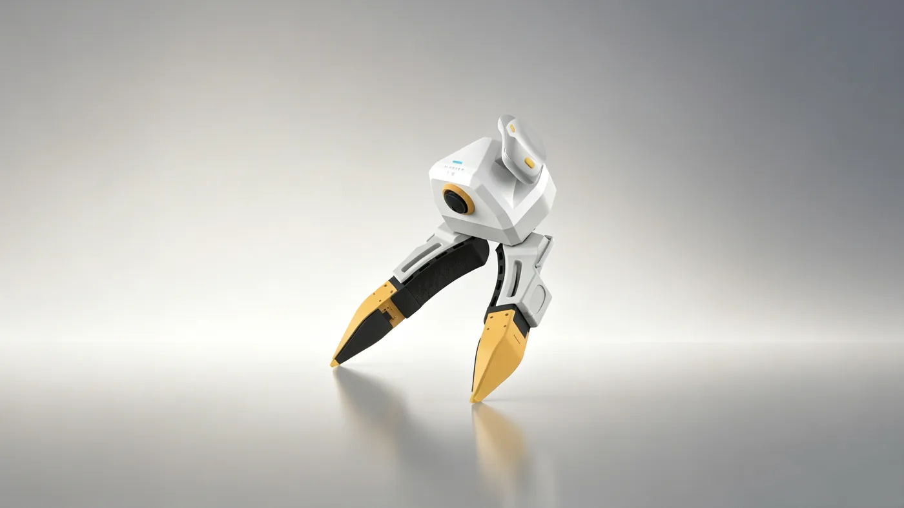{ width="720" }

## System components

| Part | Role |
|---|---|
| Leader grippers ×2 (left / right) | Handheld demonstration; each carries two visuotactile sensors, a wrist fisheye camera, an opening encoder and an IMU, see [Gripper connection and serial numbers](../common/gripper.md) |
| Pico4 Ultra Enterprise trackers ×2 | Mounted on top of the leader grippers, giving their 6-DoF pose |
| Pico4 Ultra Enterprise headset | Tracks the trackers and sets the world frame; can also record a first-person stereo view, see [Pico4 headset and tracker setup](../common/pico4.md) |
| Collection unit | The [backpack](../backpack/index.md) on the Backpack Kit, your own collection PC on the Developer Kit, see [Product line and configuration comparison](editions.md) |
| Follower grippers (optional) | Mounted on a robot to execute or replay motions, see [Follower gripper overview](../follower/index.md) |

Specifications are in [Technical specifications](specs.md).

## Highlights {#highlights}

-   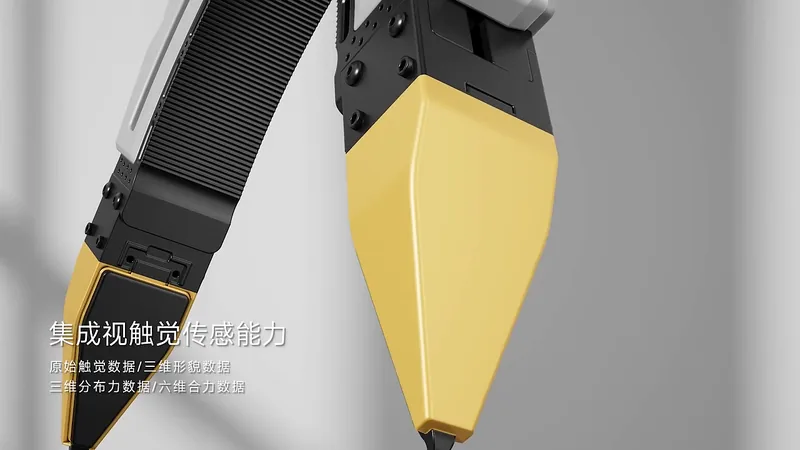{ .tc-card-img loading=lazy }

    :material-layers-triple-outline: __Visuotactile fusion, real interaction__

    ---

    High-frame-rate tri-color visuotactile sensors record contact location, grasp stability and slip trends in sync.

-   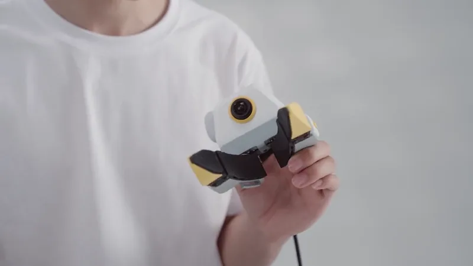{ .tc-card-img loading=lazy }

    :material-gesture-tap-hold: __Close to the human hand, faster collection__

    ---

    The wearable leader gripper is light and easy to pick up, covering grasping, carrying, insertion, thin-part picking and more.

-   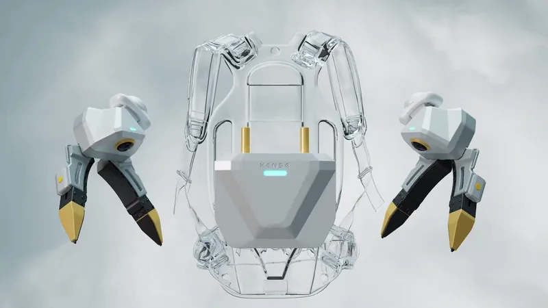{ .tc-card-img loading=lazy }

    :material-sync: __High-precision pose, high-quality data__

    ---

    Multi-device time sync of **5ms** and positioning accuracy of **< 3mm**; every stream is aligned to the same instant.

-   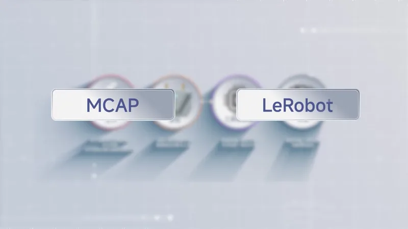{ .tc-card-img loading=lazy }

    :material-connection: __Mainstream ecosystem, data ready to use__

    ---

    Native support for **LeRobot, MCAP** and other mainstream formats and tools, so data is ready for training as soon as it is collected.

-   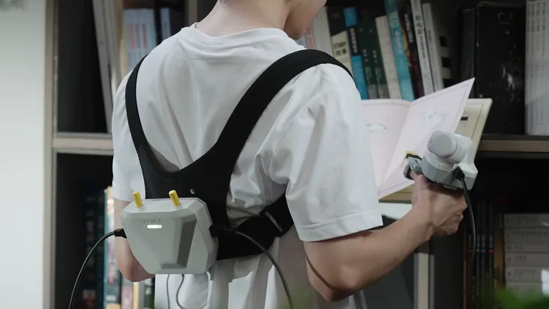{ .tc-card-img loading=lazy }

    :material-bag-personal-outline: __Light deployment, built for scale__

    ---

    A light leader gripper and a wearable collection unit, ready for the lab, home or field.

-   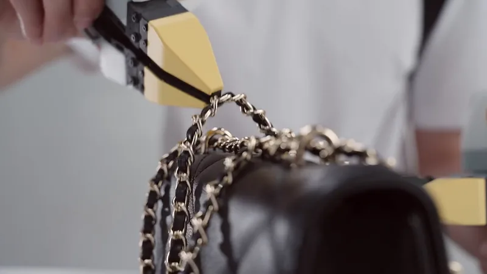{ .tc-card-img loading=lazy }

    :material-gesture-tap-button: __Compliant fingertips for fine grasping__

    ---

    Slim, compliant fingertips make small parts, thin sheets and edge-lying objects easier to pick up.

## Product appearance

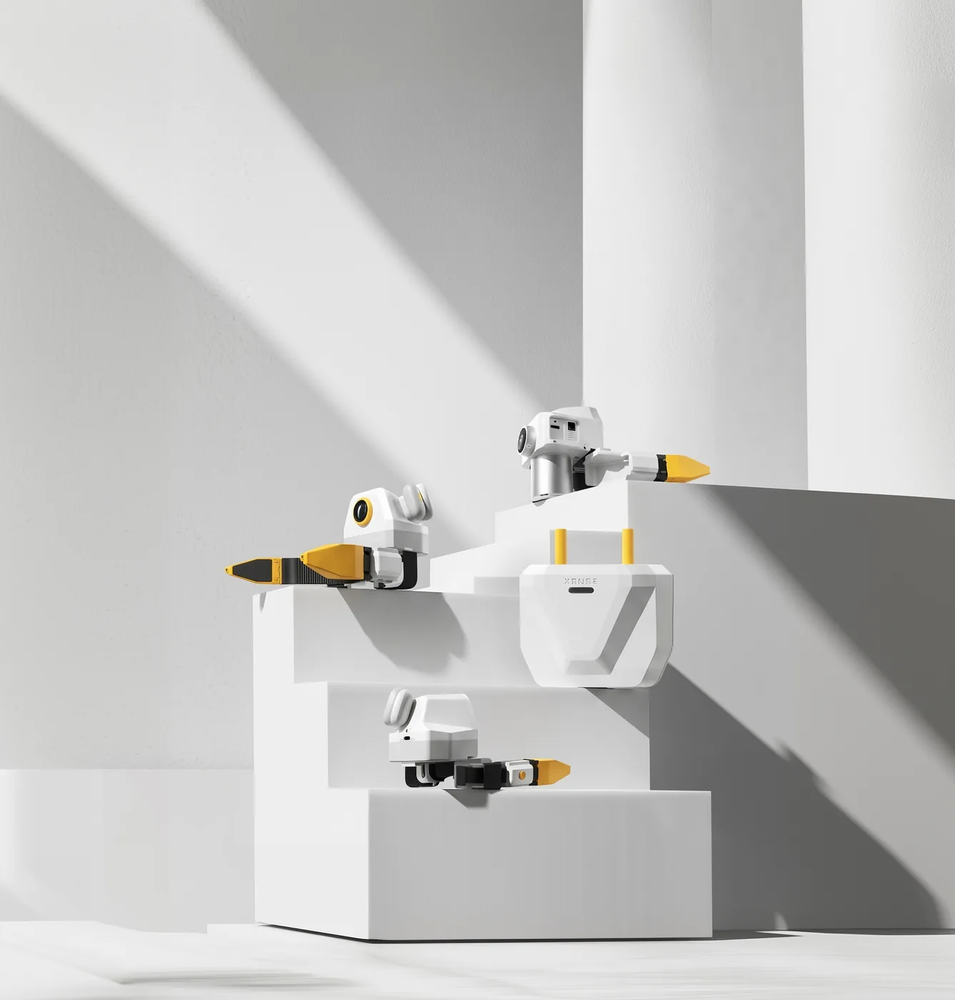{ width="560" }

=== "Leader gripper, five views"

    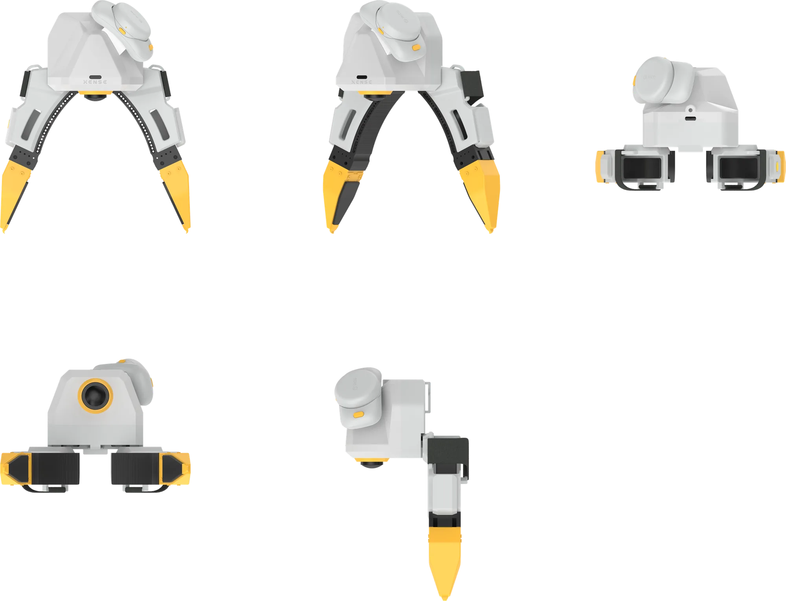{ width="720" }

=== "Follower gripper, five views"

    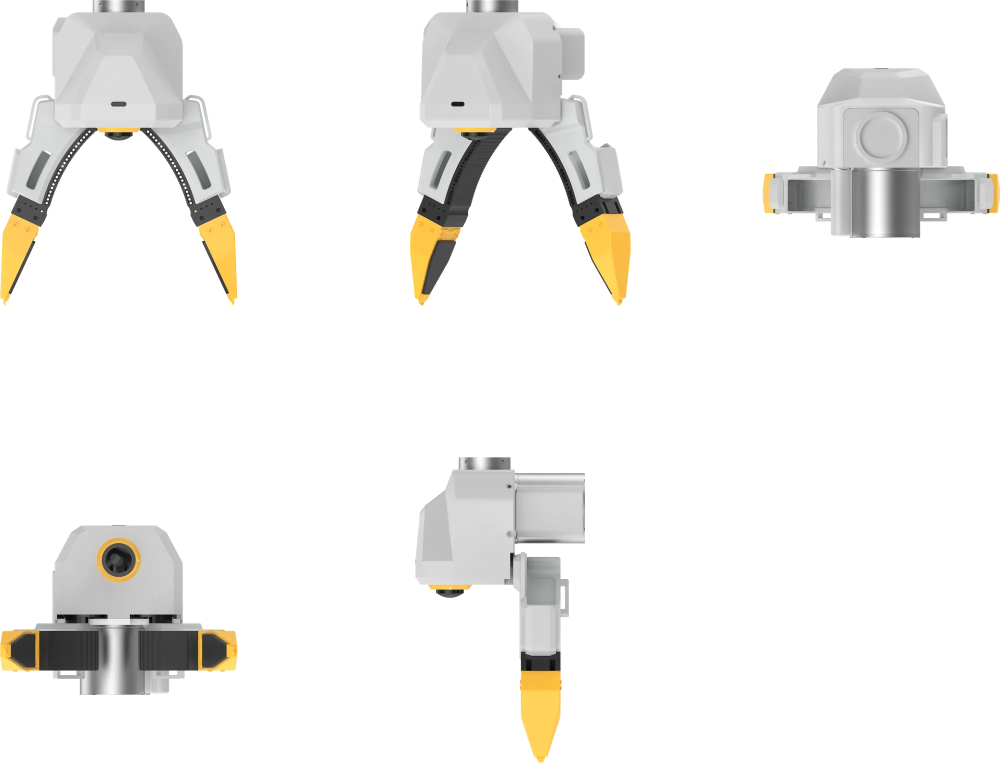{ width="720" }

## Applications

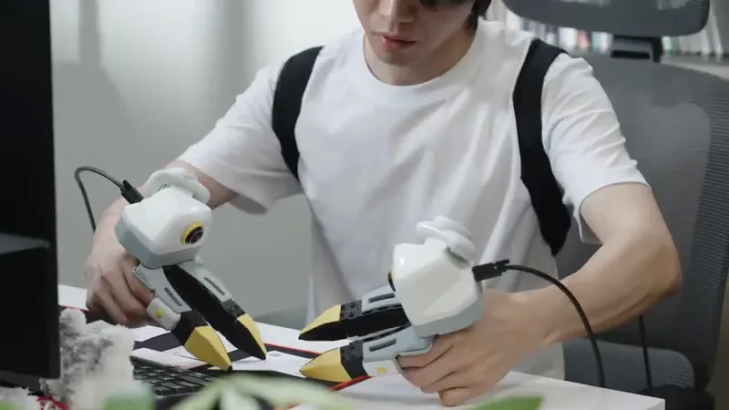{ loading=lazy }
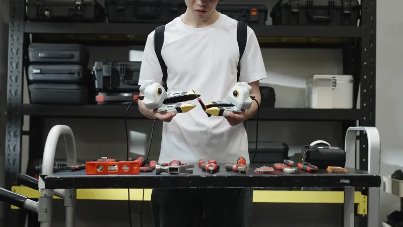{ loading=lazy }
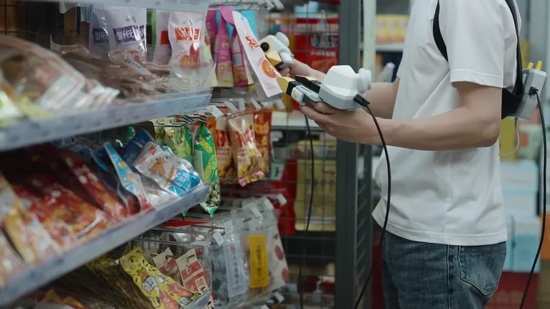{ loading=lazy }

- **Embodied-AI data factories**: large-scale manipulation data collection across many stations, operators and tasks.
- **Robot algorithm R&D**: a source of real interaction data for robotics companies, university labs and embodied-AI teams.
- **Home and service robots**: tidying desks, picking and placing items, opening containers, using tools.
- **Flexible industrial manipulation**: 3C assembly, small-part sorting, cable insertion, part picking.
- **Tactile and real-interaction research**: contact-state understanding, tactile representation and tactile foundation models.

## Data flow {#dataflow}

The sensor side is identical in both editions; they differ only from the collection unit onward. Each edition has its own interactive architecture diagram:

- Backpack Kit: [System overview](../backpack/index.md#system)
- Developer Kit: [System overview](../pc/index.md#system)

Both editions record poses in the same coordinate frame, see [Coordinate frames](../common/coordinates.md); the differences, box contents and wiring are in [Product line and configuration comparison](editions.md).
