# 认识 XTac UMI G1

千觉 XTac UMI G1 是面向具身操作数据集构建的穿戴式数采夹爪系统。主夹爪集成三色光视触觉传感器、腕部鱼眼相机与高精度位姿传感器，可同步采集视觉、触觉、位姿、夹爪状态及 IMU 数据；从夹爪安装于机器人末端，用于执行或回放动作。系统服务于模仿学习、VLA / VTLA 模型训练与触觉世界模型研究。

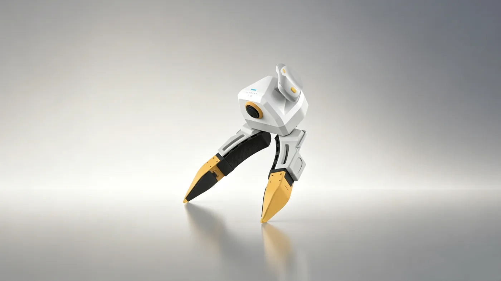{ width="720" }

## 系统组成

| 部件 | 作用 |
|---|---|
| 主夹爪 ×2（左 / 右） | 手持完成人类示范；每只集成 2 个视触觉传感器、腕部鱼眼相机、开合编码器与 IMU，见[夹爪连接与序列号](../common/gripper.md) |
| Pico4 Ultra 运动追踪器 ×2 | 装在主夹爪顶部，提供夹爪的 6-DoF 位姿 |
| Pico4 Ultra 企业版头显 | 跟踪追踪器、建立世界坐标系，可同时录第一视角双目画面，见 [Pico4 头显与追踪器](../common/pico4.md) |
| 采集单元 | 背包版是[数采背包](../backpack/index.md)，PC 版是您自己的工作站，见[产品线与配置对比](editions.md) |
| 从夹爪（选配） | 装在机器人末端执行或回放动作，见[从夹爪](../follower/index.md) |

规格见[技术参数](specs.md)。

## 产品亮点 {#highlights}

-   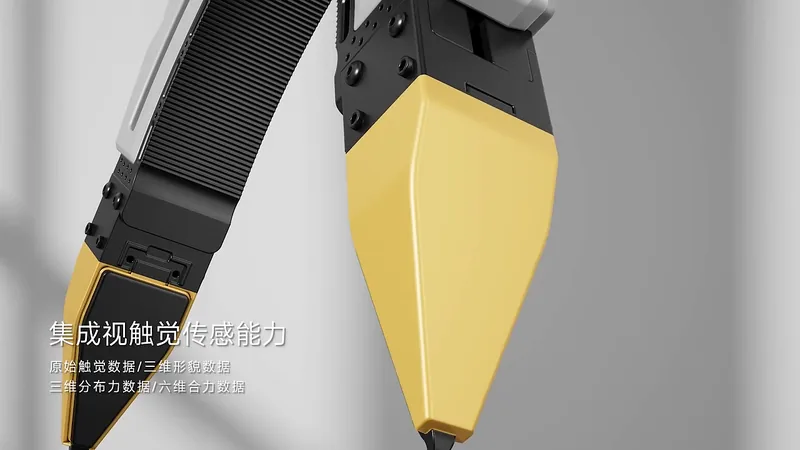{ .tc-card-img loading=lazy }

    :material-layers-triple-outline: __视触融合感知，采集真实交互__

    ---

    高帧率三色光视触觉传感器，同步记录接触位置、夹取稳定性与滑移趋势。

-   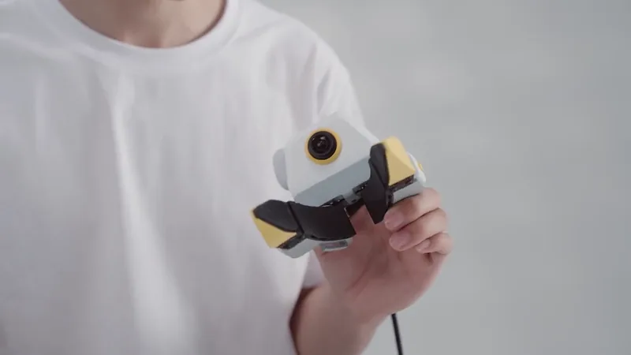{ .tc-card-img loading=lazy }

    :material-gesture-tap-hold: __贴近人手操作，提升采集效率__

    ---

    穿戴式主夹爪轻巧易上手，抓取、搬运、插拔、薄片夹取等任务都能完成。

-   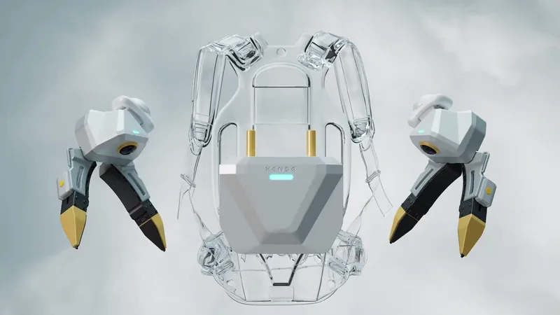{ .tc-card-img loading=lazy }

    :material-sync: __高精度位姿与高质量数据__

    ---

    多设备时间同步 **5ms**、空间定位精度 **< 3mm**，各路数据按同一时刻对齐。

-   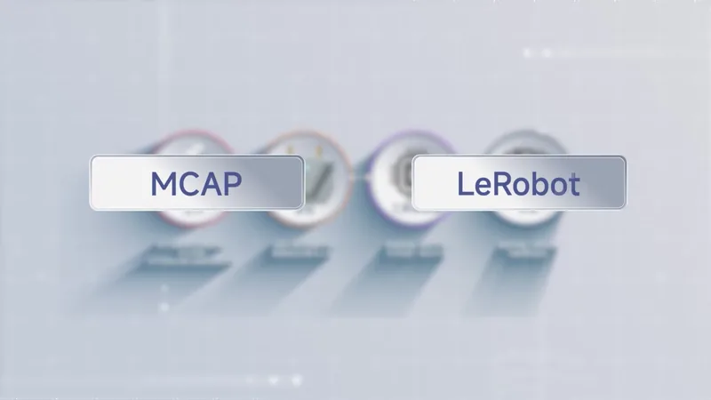{ .tc-card-img loading=lazy }

    :material-connection: __打通主流生态，数据即刻可用__

    ---

    原生兼容 **LeRobot、MCAP** 等主流格式与工具链，采集完即可用于训练。

-   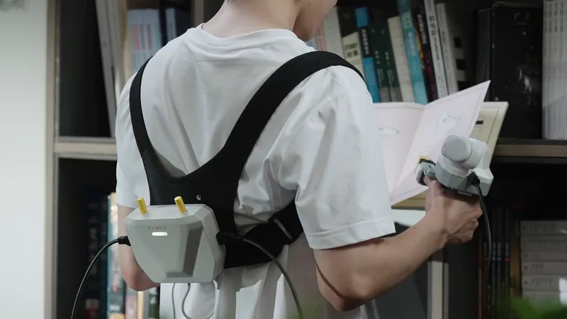{ .tc-card-img loading=lazy }

    :material-bag-personal-outline: __轻量化部署，适配规模采集__

    ---

    轻量主夹爪加背负式单元，实验室、家庭、现场皆可采。

-   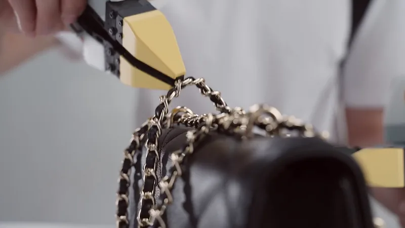{ .tc-card-img loading=lazy }

    :material-gesture-tap-button: __柔顺指尖设计，增强精细夹取__

    ---

    细巧柔顺的指尖，更容易夹起小物件、薄片和边缘物体。

## 产品外观

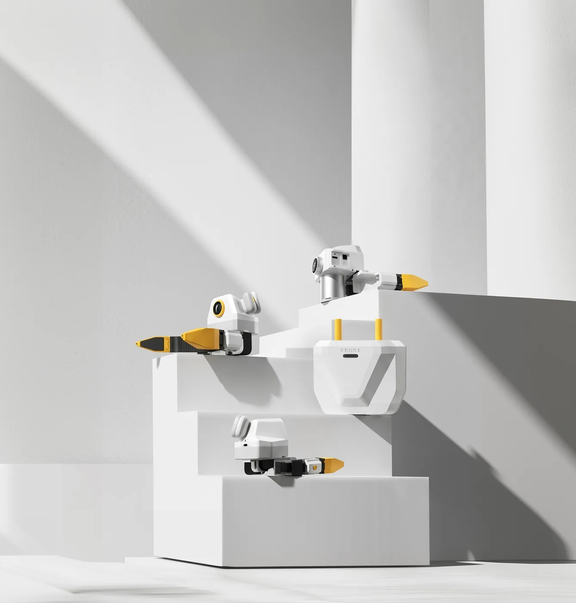{ width="560" }

=== "主夹爪五视图"

    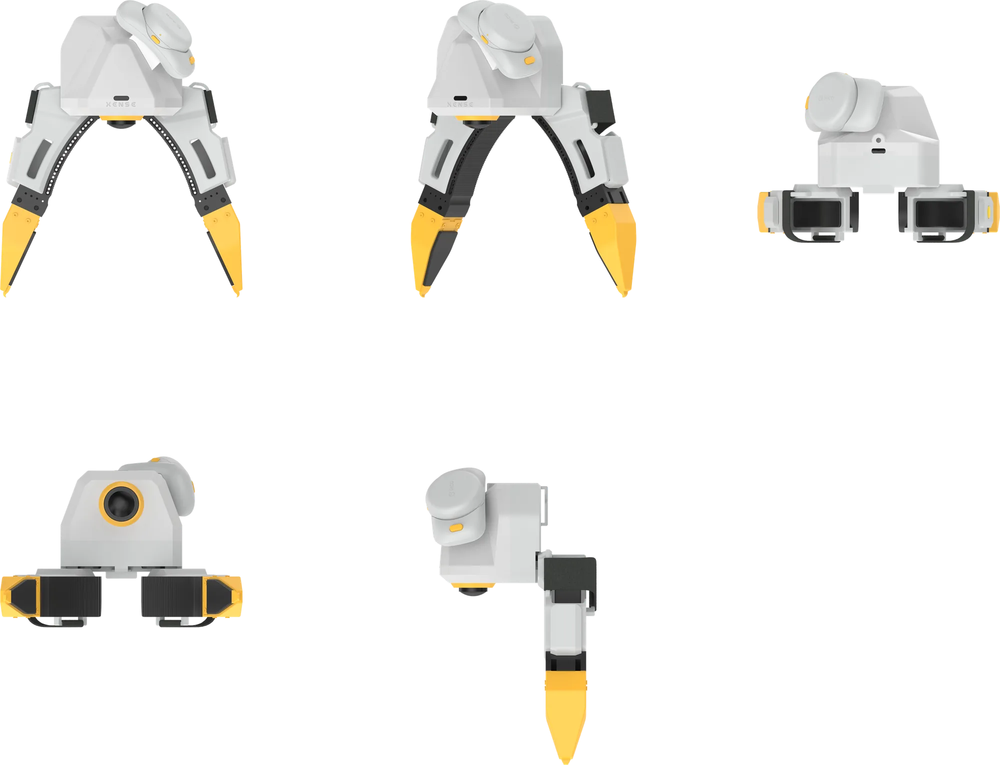{ width="720" }

=== "从夹爪五视图"

    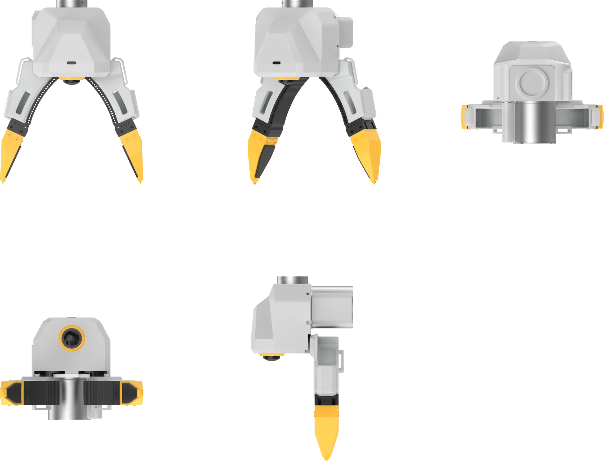{ width="720" }

## 应用场景

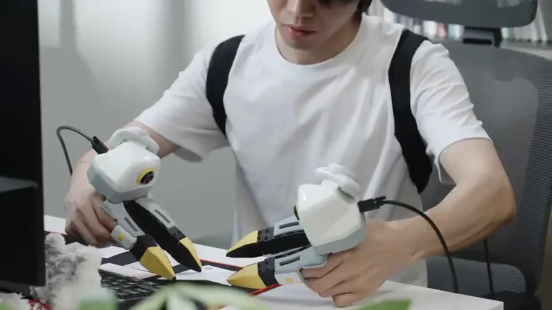{ loading=lazy }
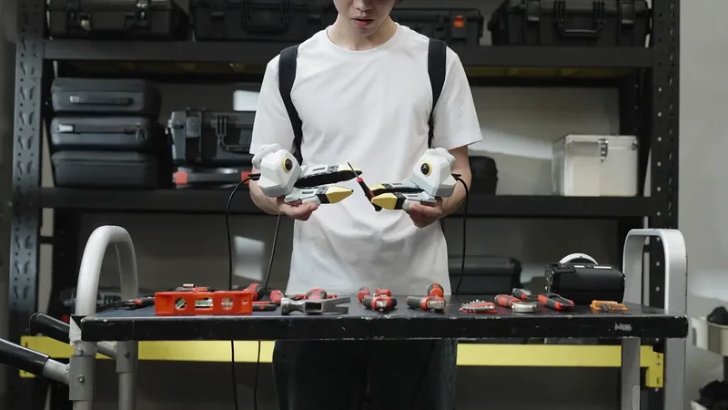{ loading=lazy }
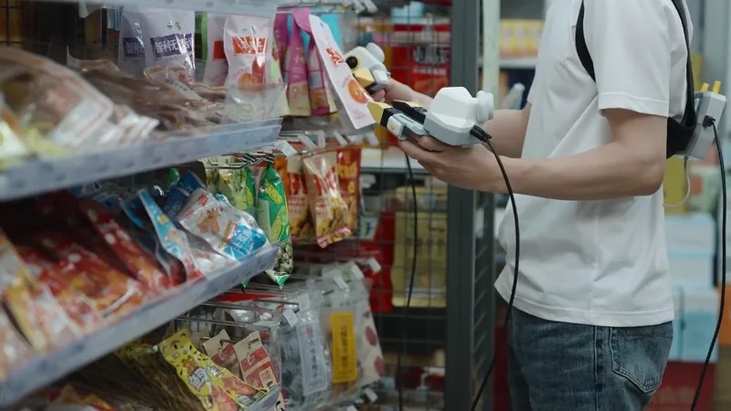{ loading=lazy }

- **具身智能数据工厂**：多工位、多人员、多任务的大规模操作数据采集。
- **机器人算法研发平台**：为机器人公司、高校实验室、具身团队提供真实交互数据入口。
- **家庭与服务机器人**：桌面整理、物品取放、容器开合、工具使用等日常操作。
- **工业柔性操作**：3C 装配、小件分拣、线缆插拔、零件取放。
- **触觉数据与真实交互研究**：接触状态理解、触觉表征与触觉基础模型研究。

## 数据流 {#dataflow}

传感器一侧两种配置完全相同，区别从采集单元开始。两种配置各有一张可交互的架构图：

- 背包版：[数采系统组成](../backpack/index.md#system)
- PC 版：[数采系统组成](../pc/index.md#system)

两种配置记录的位姿坐标系一致，见[坐标系](../common/coordinates.md)；差别、箱内清单与接线见[产品线与配置对比](editions.md)。
