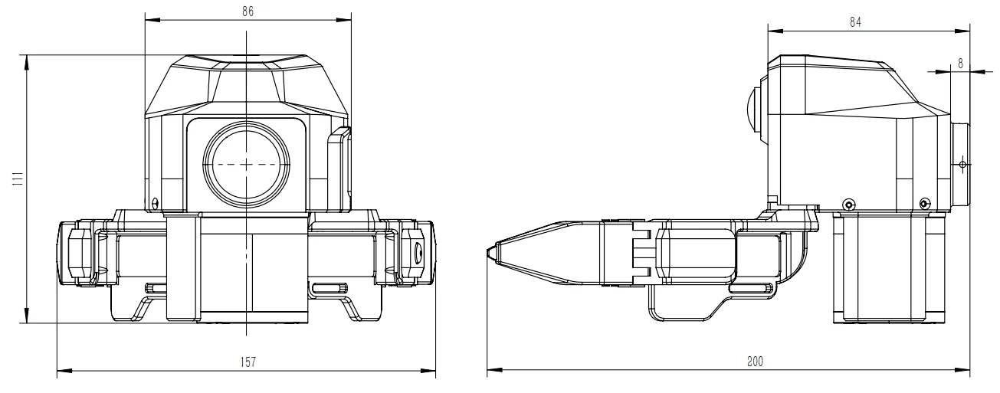

# Technical specifications

Wiring is in [Gripper connection and serial numbers](../common/gripper.md); choosing between the editions is in [Product line and configuration comparison](editions.md).

## Leader gripper {#specs}

| Parameter | Specification |
|---|---|
| Structure | Two-finger gripper, one left and one right |
| Dimensions | 145 × 186 × 170mm |
| Weight | About 370g |
| Payload | 2.5kg maximum |
| Opening travel | 0–150mm (each unit's calibrated value applies) |
| Visuotactile sensors | 2 (one per finger), see [Visuotactile sensor](#sensor) |
| Wrist fisheye camera | 190° field of view, 640×480 and 1920×1080, both at 30 fps |
| IMU | 9-axis. Firmware 1.3.1 supports reporting at up to 1125 Hz. See the [SDK](../sdk/index.md#migrate) |
| Opening encoder | 100Hz |
| Connector and power | USB Type-C (locking), DC 5V / 500mA bus power, no internal battery |
| Operating temperature | 0–50°C |

### Visuotactile sensor {#sensor}

The fingertip sensor is Xense's GS-PS visuotactile sensor; see the [product page](https://www.xenserobotics.com/product/367/detail/23).

| Parameter | Specification |
|---|---|
| Imaging | Tri-color illumination |
| Sensing area | 623mm² |
| Elastomer thickness | 2–5mm |
| Image resolution | 640 × 480 |
| Sampling rate | 60 Hz |
| Range | 0–25N |
| Force accuracy | 0.2N |
| Deformation accuracy | 0.1mm |
| Modalities | 3D shape, 6-axis force, 3D force distribution, slip detection |

The frame rate used during collection can be set as needed (the Developer Kit records tactile at 30fps by default).

## Follower gripper {#follower}

| Parameter | Specification |
|---|---|
| Structure | Two-finger gripper, mounted on the robot's end effector |
| Dimensions | 200 × 157 × 111mm (L × W × H), see the drawing below |
| Motor | RobStride EL05 |
| Maximum output torque | 1.1N·m |
| Opening angle | 0–70° |
| Control | Impedance control (default), force-position control |
| Connector and power | USB Type-C for communication + 24V power adapter (24V 2.5A) |
| Operating temperature | 0–50°C |

{ width="760" }

How to use it is in [Follower gripper](../follower/index.md); the flange interface, frames and 3D models are in [XTac-UMI-Description](https://github.com/XenseRobotics-AI/XTac-UMI-Description).

## Tracking and synchronization {#tracking}

| Parameter | Specification |
|---|---|
| Pose source | Pico4 Ultra Enterprise headset + trackers, 6-DoF |
| Pose streaming | [XTac UMI XR 0.4.6](../common/pico4.md#pico-app) sends headset and tracker poses to the collection unit |
| Collector 0.5.0 headset video specifications | Stereo (per eye): 1280×960 or 1600×1200, both at 30 fps Right eye only: 1920×1440 @ 30 fps |
| Positioning accuracy | < 3mm |
| Multi-device time sync | 5ms |
| Coordinate frame | X forward, Y left, Z up, see [Coordinate frames](../common/coordinates.md) |

## The backpack {#backpack}

The Backpack Kit's collection unit; see [The XTac UMI Backpack](../backpack/index.md).

| Parameter | Specification |
|---|---|
| Processor | RK3588 |
| Storage | eMMC system disk + 1TB NVMe data disk; recordings and exports live on the data disk |
| Disk-full rule | Collector 0.5.0 blocks new recordings when the recording disk reaches 70% usage |
| Exported data size | About 0.5GB per hour of exported LeRobot dataset |
| Power | 12V 3A power adapter, or a 20000mAh power bank through a 12V PD power cable |
| Power draw | About 20W |
| Power-bank runtime | About 3.5–4 hours |
| Network | Ethernet; Wi-Fi (5GHz); built-in 5GHz hotspot |
| Ports | `UMI-L` / `UMI-R` for the leader grippers, `PICO` for the headset, `DC IN` for power, `HOST1` / `HOST2` USB host ports, plus Ethernet, TF slot, `HDMI` and headphone jack, see [Connectors](../backpack/unbox-connect.md#ports) |
| Operating temperature | 0–40°C |
| Environment | Indoor use; not waterproof, keep away from rain, splashes and heavy dust |

The serial number, hotspot name and password on the body label are explained in [Identifying the unit: by its label, not by IP](../backpack/network.md#label).
